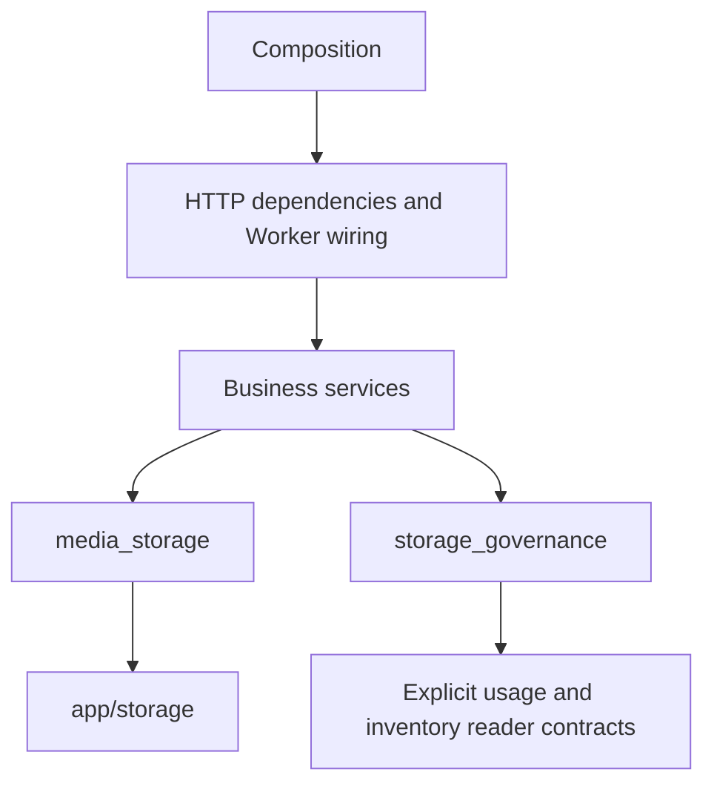

# ADR 0009: Media storage and resource governance

Status: Accepted architectural decision.

## Authorities

`app/storage/` is the provider port and S3-compatible transport adapter. SDK imports
belong here; this boundary has no ORM, FastAPI or business dependency.
`media_storage/` owns physical facts, durable writes, upload sessions, adoption,
references, retirement, verification and delivery. `storage_governance/` owns
quota, usage and inventory contracts. Business domains own authorization, semantic
identity, object-key construction, readiness and retention.

Composition injects concrete services and independent session factories. Business
modules do not import composition. ORM definitions import pure domain enums.
There is no asset catalog, polymorphic owner relationship or persisted delivery grant.
Usage, Quota and Inventory retain distinct responsibilities within governance.

## Injected upload policy

| Policy | Default |
| --- | ---: |
| Avatar input maximum | 5 MiB |
| Score import maximum | 20 MiB |
| Take audio maximum | 500 MiB |
| Take video maximum | 2 GiB |
| SINGLE_PUT maximum | 20 MiB |
| Multipart part size | 16 MiB |
| Signed upload URL lifetime | 900 seconds |
| Session lifetime | 86,400 seconds |
| Suggested client part concurrency | 3 |
| Active sessions per user | 5 |
| Unconsumed temporary declared bytes per user | 4 GiB |

Settings validate limits; composition constructs `UploadPolicy`. User-row
serialization protects concurrent session count and declared-byte admission.
These abuse controls are independent of quota. Quota holds reserve positive
billable capacity through the same semantic admission transaction.

Avatar is a bounded API input. Its reader retains at most 5 MiB plus one sentinel
byte, rejects excess immediately, validates format, dimensions and pixel count,
and normalizes to a 200×200 JPEG. Its generated bytes use ObjectWriteCoordinator.
Avatar has no upload session.

## Object facts and write transactions

`stored_objects` owns unique immutable `object_key`, nonnegative `byte_size`,
canonical `content_type`, optional `sha256`, optional `provider_etag` and paired
`transport_checksum_algorithm` / `transport_checksum`. User metadata is not a
provider-native checksum. A composite checksum is explicitly labelled composite;
it is not interpreted as a full-object SHA-256. Digest enrichment changes an absent
SHA-256 to the verified full digest through the media integrity boundary.

`ObjectWriteCoordinator` owns an independent SessionFactory. `write_bytes`,
`write_batch` and `copy_object` return immutable generation-bound receipts.

1. A short transaction locks intent keys in canonical order, validates immutable
   facts and records WRITING authority; it commits and closes its session.
2. Provider writes/copy/verification execute with no coordinator session,
   PostgreSQL transaction, checked-out connection or row lock.
3. A fresh short transaction checks the exact generation and publishes WRITTEN.

A matching WRITING generation excludes competing writers and cleanup. Lost or
uncertain physical acknowledgements retain WRITE_UNKNOWN authority; expiry does
not authorize destructive cleanup of an unresolved operation. A delayed result can
publish only against its exact unsettled generation. A definitive failure queues
settled/unissued objects for cleanup. Failed batch preparation commits no partial
intent set, and successful batches use two outer transactions.

`adopt_written_object` and batch adoption only mutate/flush the caller transaction.
Adoption, semantic references, hold consumption and logical allocation commit
atomically. Failure leaves unadopted bytes owned by durable intents.
Provider completion uncertainty is not evidence that an operation had no effect.

## Upload session persistence

`upload_sessions` contains:

| Fields | Type / responsibility |
| --- | --- |
| `id`, `session_uuid` | bigint PK; unique external UUID |
| `user_id` | User FK, RESTRICT |
| `purpose` | SCORE_IMPORT / PERFORMANCE_TAKE routing, not ownership polymorphism |
| `mode` | SINGLE_PUT / MULTIPART |
| `generation` | positive immutable session generation |
| `object_key` | unique server locator; staging for SINGLE_PUT, final for Multipart |
| `final_object_key` | unique final immutable locator |
| `expected_byte_size`, `expected_content_type` | exact admitted transport facts |
| `part_bytes` | frozen positive part plan |
| `provider_upload_id` | protected internal MPU handle; never public response data |
| `provider_etag`, checksum pair, `sha256` | verified completion observations |
| `write_intent_uuid` | RESTRICT reference to prepared SINGLE_PUT copy intent |
| `operation_token`, `operation_kind`, `operation_unknown` | exact external-operation responsibility |
| `failure_code` | safe bounded diagnostic code |
| `expires_at`, `capability_expires_at` | session deadline and issued capability horizon |
| `completed_at`, `consumed_at`, `cleanup_completed_at` | distinct transfer, adoption and cleanup facts |
| `created_at`, `updated_at` | UTC timestamps |

Indexes cover `(user_id,status)`, `(status,expires_at)` and
`(status,cleanup_completed_at)`. Constraints enforce positive plans, valid enums,
paired checksums, consumption timestamp and single-PUT handle exclusion.

UploadCreationRequest and Upload each have a unique explicit session FK. Take
Reservation has a unique explicit session FK. Admission creates these concrete
bindings server-side; APIs do not bind an arbitrary session to a different
business command. Consumption locks Session and validates user, purpose and
completion facts. Exactly one successful business transaction transitions it to
CONSUMED. Semantic owner deletion does not reopen consumption.

## Transfer lifecycle

| State | Command or observation | Result |
| --- | --- | --- |
| CREATING | SINGLE_PUT admission | UPLOADING |
| CREATING | Commit CREATE responsibility, initiate MPU, persist exact handle | UPLOADING |
| CREATING | Initiate outcome uncertain | Remains CREATING with unknown operation |
| UPLOADING | Complete request commits exact attempt | COMPLETING |
| COMPLETING | Exact parts, provider completion, metadata verified | COMPLETED |
| COMPLETING | Complete outcome uncertain | Remains COMPLETING with unknown operation |
| COMPLETED | Domain adoption + reference + accounting | CONSUMED |
| Active | Cancellation / expiration / definitive verification rejection | CANCELLED / EXPIRED / FAILED |
| Terminal or consumed single PUT | Capabilities expired, operations settled, physical cleanup verified | Cleanup timestamp |
| CONSUMED Multipart | Physical authority belongs to StoredObject | GC acknowledgement without provider deletion |

SINGLE_PUT signs exact Content-Length and Content-Type for staging. Completion
checks metadata and full bytes within the bounded small-file budget. The domain
performs image/container admission. Coordinator copy verifies source and final
bytes before adoption. Replaying a staging capability cannot overwrite the final
object. GC removes staging only; ObjectWriteIntent owns unadopted copy targets.

Multipart signs only exact planned UploadPart requests bound to UploadId. The
service discovers parts, checks contiguous numbers and exact lengths, completes
MPU, and checks final size, content type and provider evidence. It never issues a
PutObject URL for the final key. Completion invalidates the upload handle.
Adoption registers the completed object in place with optional SHA-256, with no
copy and no full-file API read. CONSUMED Multipart is never a GC deletion target.

## Recovery and cleanup

Periodic retirement maintenance also expires business reservations and runs
bounded session recovery/GC. The database owns responsibility; broker delivery
is not the sole recovery mechanism.

Unknown CREATE uses exact-key paginated MPU discovery. A discovered handle is
persisted against the original operation token; missing or ambiguous discovery
retains unknown responsibility. Unknown COMPLETE reconciles final object facts
without blind re-initiation or duplicate completion. An absent inventory observation
alone never settles an unknown side effect.

Cleanup commits a terminal session claim before external abort/delete. Results
publish only against the current token. It verifies exact-key MPU inventory and
object absence. Failures retain the locator and pending responsibility. Signed
capability expiration bounds new requests; it does not prove that all previously
started provider IO has ended. Permanent provider-side settlement, version cleanup,
IAM, lifecycle policies and backups require deployment qualification. Unknown IO
without sufficient provider evidence remains fail-closed and operationally visible.

Account closure immediately removes identity access. Its erasure phases are
SCORES → IMPORTS → TAKES → UPLOADS → TRANSFERS → FINALIZE. TAKES releases semantic
recordings/reservations and holds. TRANSFERS cancels sessions and waits for physical
settlement. FINALIZE erases request/reservation/manifest history, then settled
sessions, checks zero Inventory/Usage/Quota and finally deletes User. Session
RESTRICT prevents deletion of unresolved physical responsibility. Formal object
retirement remains independent of account erasure completion.

## Take readiness

TakeManifest, client_request_id, capacity hold, finalize lease and unknown-COMMIT
reconciliation belong to Performance Takes. Finalization admits a matching completed
Session and atomically commits Take, reference, hold consumption, usage and CONSUMED.
Known failure rolls back only semantic adoption. Unknown semantic COMMIT resolves
through a fresh database session and persisted reservation/Take facts.

Small-file validation completes synchronously. Multipart Take admission is fast and
sets media state UPLOADED. The same transaction creates TakeProcessingOutbox.
Durable delivery claims PROCESSING, verifies full bytes and container in a worker,
enriches SHA-256 and commits READY. Transient faults retry with bounded attempts;
integrity faults remain FAILED. Playback capabilities require READY media.
Worker verification and provider IO execute outside database transactions.

## Delivery API

MediaDeliveryService owns short-lived signed capabilities and immutable caching.
Business authorization precedes signing; raw locator fields are not response DTOs.
Large-media Range traffic terminates at object storage/CDN.

| Endpoint | Contract |
| --- | --- |
| `GET /me/avatars/{filename}` | 307 signed redirect |
| `GET /performance-takes/{take_id}/playback-url` | Take ID, playback_url, download_url, expires_in |
| `GET /scores/{score_id}/revisions/{revision_id}/playback` | playback_url, download_url, expires_in |
| `GET /guest-previews/{token}/playback` | playback_url, download_url, expires_in |
| Model manifest access | Signed URL JSON |
| Source, render, input and import artifact download/view | Authorized controlled small response |

Upload creation is JSON, followed by direct transport and explicit completion:
`POST /uploads`, `GET /upload-sessions/{id}`, part URL/list endpoints,
`POST /upload-sessions/{id}/complete`, `POST /uploads/{id}/finalize` and cancel.
Take reserve returns its nested session contract; completion precedes reservation
finalize. OpenAPI snapshots are the public backend contract.

## Initialization and verification

`0001_initial_schema.py` is the sole initial migration. It creates the complete
schema and finite FREE / PLUS / PRO plan policies. Empty PostgreSQL upgrade,
downgrade, re-upgrade, native enums, checks, indexes and FK parity are tested.
Tests use real independent PostgreSQL transactions for admission, consumption,
reference/retirement fences, unknown commit, cleanup and account erasure.
Provider doubles establish adapter/application behavior; they do not qualify
external provider permanent-IO settlement or deployment retention policies.
