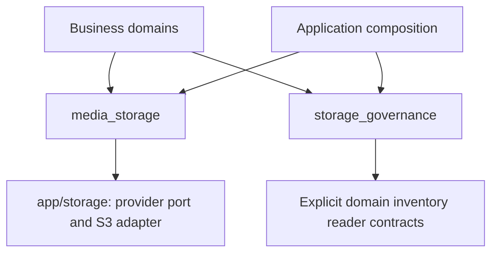

# ADR 0009: Media storage and resource governance

Status: Accepted architectural decision. Runtime implementation scope is explicit below.

## Purpose and implementation boundary

NoteVerse separates physical storage from logical resource accounting and business
ownership. This contract defines the two cohesive infrastructure domains and their
upload, adoption, cleanup and delivery guarantees.

The executable provider boundary is [app/storage](../../backend/app/storage/base.py).
[media_storage](../../backend/app/modules/media_storage/) owns physical object facts,
independent write coordination, adoption, references, retirement and delivery policy.
[storage_governance](../../backend/app/modules/storage_governance/) owns capacity,
accounting and inventory contracts. Avatar uses bounded API input and JPEG normalization.
UploadSession and nullable StoredObject checksum definitions below are schema contracts;
they require explicit migrations before use. Current StoredObject requires full SHA-256.

## Authorities and dependencies

- `app/storage/` owns provider transport, signing, metadata and wire errors. It has
  no ORM, FastAPI or business-domain dependency. SDK imports belong here.
- `media_storage` owns immutable physical facts, ObjectWriteCoordinator,
  adoption, references, retirement, GC and delivery policy. UploadSession belongs to this domain.
- `storage_governance` contains entitlement/quota, logical usage and inventory
  contracts. Accounting and reconciliation remain independent authorities within
  that domain. Its core does not import business ORM or modify business resources.
- Each business domain owns authorization, semantic identity, object-key builders,
  readiness, retention and deletion decisions.
- Composition supplies concrete inventory providers and infrastructure dependencies.

There is no global FileAsset/AssetCatalog, universal ProcessingJob, polymorphic
owner_type/owner_id relationship, persisted DeliveryGrant or ResourceManager.
One authoritative implementation owns each responsibility.

## Product limits and injected policy

All sizes are integer bytes. Admission rejects a declaration above the applicable
file limit or available user quota before issuing upload capability.

| Policy | Default |
| --- | ---: |
| Avatar input limit | 5,242,880 bytes (5 MiB) |
| Score import input limit | 20,971,520 bytes (20 MiB) |
| Take audio input limit | 524,288,000 bytes (500 MiB) |
| Take video input limit | 2,147,483,648 bytes (2 GiB) |
| SINGLE_PUT maximum | 20,971,520 bytes |
| Multipart part size | 16,777,216 bytes |
| Upload signature TTL | 900 seconds |
| Session hard TTL | 86,400 seconds |
| Concurrent part requests per client | 3 |
| Active sessions per user | 5 |
| Unconsumed temporary declared byte budget per user | 4,294,967,296 bytes |

Settings own these defaults; services receive validated policy. Avatar currently
uses `AVATAR_MAX_UPLOAD_BYTES`, `AVATAR_MAX_PIXELS` (16,000,000) and
`AVATAR_MAX_DIMENSION` (8192). Upload signatures accept explicit expiry; the
provider's default is 900 seconds. Session policy is injected at session admission.
The temporary budget and session count are transport abuse controls, separate
from quota holds and logical allocation. Their checks share user serialization.

## Two input modes

### Bounded API input

Avatar receives a single API upload. A synchronous reader requests chunks no
larger than 64 KiB and retains at most the configured limit plus one sentinel
byte. Excess input raises HTTP 413 without reading the remaining file.
Filename extension and decoded format are checked. Dimensions and pixel count
are checked before full decode; decompression-bomb warnings/errors reject input.
Only PNG, JPEG, GIF and WebP are accepted. Output is a 200×200 RGB JPEG.
The output key is server-generated and immutable. Avatar has no UploadSession.

### Direct provider input

Score import and Performance Take use server-created UploadSessions. File size
selects SINGLE_PUT at or below 20 MiB, MULTIPART above that threshold; resumable
transfer can select Multipart where the business request requires it.
The server freezes expected size, media type, protocol, deadline and part plan.
Client input never chooses a final key, provider handle or existing session binding.

SINGLE_PUT signs exact Content-Length and Content-Type with SigV4. It writes to
a unique staging key. Server verification precedes a durable server-only copy to
an immutable final key, followed by adoption. The client never receives a write
capability for that final key. A replayable staging URL cannot overwrite adopted
bytes. Staging cleanup waits for capability expiry and uncertain IO resolution.

MULTIPART signs only UploadPart for exact key, UploadId, part number and length.
CompleteMultipartUpload is server-owned. A completed handle cannot authorize
further UploadPart calls. The direct key is the immutable final key; verified
completion is adopted in place without CopyObject. A client never receives a
PutObject capability for this key.

The [scientific evidence index](../architecture/asset-provider-qualification.md)
contains bounded OSS observations. It establishes neither a cross-provider
conditional PutObject barrier nor native full-object SHA-256 qualification.
SINGLE_PUT therefore has one staging/copy path. Multipart has one in-place path.
Deployment qualification must verify signature enforcement and relevant races.

## Provider contract

`ObjectStorage` exposes put_bytes, exists, read_bytes, object_metadata, iter_bytes,
copy, delete, download_url, generate_put_upload_url, create_multipart_upload,
generate_part_upload_url, list_uploaded_parts, complete_multipart_upload and
abort_multipart_upload. AsyncObjectReader schedules only streamed reads.
Authorized materialization belongs to the admitted-object read boundary.

`ObjectMetadata` separates size/content type, ETag, native checksum algorithm,
checksum value and checksum type. User metadata is not provider validation.
Composite checksums and multipart ETags are not full-object SHA-256.
UploadedPart contains part number, ETag and byte size; completion accepts an
ordered, unique manifest. Listing exhausts provider pagination.

| Provider outcome | Port outcome |
| --- | --- |
| Definitive missing object/handle (matching code and HTTP 404) | ObjectNotFoundError |
| Timeout, connection failure, HTTP 408/429/5xx | ObjectStorageUnavailableError |
| Rejected request, credentials/permissions, invalid completion | ObjectStorageOperationFailedError |
| Successful delete of present or absent key | None; one DELETE request |
| Definitive absent handle during abort | Idempotent success |

Errors expose no provider body, credentials or signed URL. An unavailable mutation
has an uncertain side effect; the caller retains durable recovery responsibility.
Abort success alone does not establish that provider-internal late IO is finished.

## Physical facts and transfer verification

StoredObject is the single admitted physical-object fact. Its contract has:

| Field | Type and semantics |
| --- | --- |
| id | bigint primary key |
| object_key | text, unique, immutable |
| byte_size | bigint, nonnegative, immutable |
| content_type | text, non-null, immutable |
| sha256 | nullable 64-character full-byte digest |
| provider_etag | nullable text, opaque transport identity |
| transport_checksum_algorithm | nullable text |
| transport_checksum | nullable text, paired with algorithm |
| created_at | timestamptz, non-null |

The checksum columns describe the adopted transfer. Their algorithm identifies
composite versus full-object semantics. Full SHA-256 is synchronous for small
files and generated bytes; a domain verification job can fill an absent digest
once after binding its result to exact object identity. A conflicting digest is
an integrity failure. No independent checksum table is introduced.
The current ORM requires SHA-256; the nullable/checksum contract requires a schema
implementation before large-file fast adoption uses it.

Transfer integrity and business media readiness are separate. Verified size and
qualified transport integrity permit durable adoption. Take processing proceeds
through domain-owned UPLOADED → PROCESSING → READY, with full hashing, probing
and transcoding delivered through its outbox. StoredObject existence alone does
not authorize readiness or playback.

## UploadSession schema contract

All UUIDs are server-generated. Times are timestamptz. The following is a target
schema definition, not an existing ORM inventory.

| Column | Type / constraint |
| --- | --- |
| id | bigint primary key |
| session_uuid | uuid, non-null, unique |
| user_id | bigint, non-null FK users.id ON DELETE RESTRICT |
| upload_creation_request_id | bigint, nullable explicit FK ON DELETE RESTRICT |
| take_reservation_id | bigint, nullable explicit FK ON DELETE RESTRICT |
| command_generation | bigint, non-null, positive |
| protocol | text enum SINGLE_PUT / MULTIPART, non-null |
| status | text enum, non-null; transitions below |
| generation | bigint, non-null, positive |
| final_object_key | text, non-null, unique, immutable |
| staging_object_key | text, nullable, unique, SINGLE_PUT only |
| declared_byte_size | bigint, non-null, positive |
| content_type | text, non-null |
| part_size | bigint, nullable, positive, MULTIPART only |
| part_count | integer, nullable, 1–10000, MULTIPART only |
| provider_upload_id | protected text, nullable MPU handle |
| provider_etag | nullable text |
| transport_checksum_algorithm | nullable text |
| transport_checksum | nullable text |
| verified_byte_size | nullable bigint, equals declaration before adoption |
| sha256 | nullable full-object digest |
| adopted_stored_object_id | nullable FK stored_objects.id ON DELETE RESTRICT |
| expires_at | timestamptz, non-null, immutable hard deadline |
| last_capability_expires_at | nullable timestamptz, monotonically increasing |
| resources_closed_at | nullable timestamptz |
| consumed_at | nullable timestamptz |
| cancelled_at | nullable timestamptz |
| created_at / updated_at | timestamptz, non-null |

Exactly one concrete domain FK is non-null. Composite owner FKs verify that the
session and its command belong to the same user. Partial unique constraints on
each concrete command FK plus command_generation prevent duplicate bindings.
Session identity, owner, domain binding, generation and keys cannot be retargeted.
Domain command lineage prevents re-admitting a completed generation while that
command exists. Retention after command erasure is an explicit policy boundary.

Indexes cover user_id/status, status/expires_at and each domain FK. CHECKs enforce
protocol-specific staging/part fields, paired checksum fields, positive sizes and
CONSUMED ownership facts. Consuming the session and admitting StoredObject plus
the business reference, allocation and hold consumption share one transaction.

`upload_session_parts` has FK session_id ON DELETE RESTRICT, unique session/part
number, planned exact length, observed length and opaque ETag. Part count and
length are checked against the immutable plan before completion.

`upload_session_operations` owns recoverable physical execution. It has immutable
operation UUID, session UUID/generation snapshot, kind, exact resource locators,
claim epoch/token, bounded structured failure, lease and settlement result.
Independent physical-resource rows represent multiple discovered handles/objects.
Protected UploadIds and version IDs retain actionable cleanup identity; safe
fingerprints support diagnostics. No signed URLs or credentials are persisted.
Execution evidence survives session deletion through snapshots and nullable FKs.

## Session transitions and uncertain IO

| From | Event / prerequisite | To / durable responsibility |
| --- | --- | --- |
| none | Authorized admission, quota hold, abuse limits, unique command | PREPARED |
| PREPARED | SINGLE_PUT target issued | UPLOADING |
| PREPARED | MPU initiate intent committed | INITIATING |
| INITIATING | Exact returned handle persisted | UPLOADING |
| INITIATING | Network/commit outcome uncertain | INITIATE_UNKNOWN |
| INITIATE_UNKNOWN | Exact-key discovery and independent IO settlement | UPLOADING or CLEANUP_PENDING |
| UPLOADING | Client completion request, manifest/length verified | COMPLETING |
| COMPLETING | Provider completion proven | VERIFYING |
| COMPLETING | Network/commit outcome uncertain | COMPLETE_UNKNOWN |
| COMPLETE_UNKNOWN | Reconcile exact handle and object; no blind re-initiate | VERIFYING or CLEANUP_PENDING |
| VERIFYING | Size/qualified transport evidence; SINGLE_PUT copy settled | VERIFIED |
| VERIFIED | Atomic business adoption + allocation + hold consumption | CONSUMED |
| Active, unconsumed | Cancellation, expiry or failed verification | CLEANUP_PENDING |
| CLEANUP_PENDING | Cleanup execution lease | CLEANUP_PROCESSING |
| CLEANUP_PROCESSING | Transient failure | CLEANUP_FAILED, bounded retry |
| CLEANUP_FAILED | Retry admitted by domain delivery | CLEANUP_PROCESSING |
| CLEANUP_PROCESSING | All resources settled, capabilities expired | CLEANED |

CONSUMED transfers physical ownership to StoredObject. Session GC cannot delete
the adopted final key. Unconsumed staging, MPU handles and candidates remain GC
responsibility. Unknown initiate may own multiple discovered handles. Discovery
NOT_FOUND alone cannot resolve an uncertain initiate or prove permanent absence.
Cleanup needs closed registration, exact per-resource settlement, resolved unknown
operations and an expired capability horizon. Zero resources need explicit trusted
discovery evidence. Evidence is retained according to operational retention policy.

## Coordinated server writes and adoption

ObjectWriteCoordinator owns an independent SessionFactory. It never commits or
rolls back a caller's business session. `write` and `write_batch` persist exact
write intentions before provider IO; batch preparation and result persistence
avoid one database round trip per rendered page. Provider IO acquires no business parent lock. Exact write-intent locks cover
synchronous IO and WRITTEN persistence to fence cleanup and competing generations. Generation-fenced receipts bind exact key, bytes, size and content type.
The business transaction adopts receipts and semantic references atomically.
Failed adoption leaves durable cleanup ownership. A stale generation cannot
revive cleaned authority. An intent-driven copy retains source and target identity
and its uncertain outcome until reconciliation; cleanup cannot delete an adopted
target. These guarantees coexist with the domain-owned Take finalization protocol.

## References, retirement and account erasure

The explicit cross-domain StoredObject reference registry is authoritative.
Business release and logical release share the retirement-admission transaction.
Retirement checks every reference, snapshots immutable facts and preserves durable
history. A committed deletion fence rejects new references irreversibly. The worker
rechecks references and facts before IO; RESTRICT FKs protect row deletion.
Physical failure is retryable; missing physical bytes are idempotent cleanup.
Unknown commit outcomes never restore reusable authority.

Lock ordering distinguishes business parents, user lifecycle admission, entitlement,
usage account, hold, write intent, StoredObject, retirement and category counters.
Reentrant account locks serialize same-user accounting; cross-user shared objects
never acquire the other user's account. Concrete integrations need PostgreSQL
proof for every ordering, including cancellation and expiry. Resource registration
and closure lock the same session with conflicting locks before operation/resource
locks. Monotonic claim epochs fence publication; exclusive worker assignment does
not itself prove external lease authorization or that late provider IO is finished.

Account closure tombstones and invalidates credentials immediately. Semantic
cleanup releases Take input/holds and formal Upload resources without awaiting a
later physical-transfer stage. Transfer cleanup resolves sessions, handles,
unadopted candidates and pending capabilities before deleting bindings/parts.
Final identity erasure follows history cleanup and zero usage/quota/inventory
invariants. User RESTRICT prevents cascading away physical cleanup evidence.
Avatar has no pending transfer request; its formal reference uses retirement.

## Delivery and verification

Large media delivery uses CDN or short-lived signed URLs and immutable caching.
Authorization precedes URL issuance. Large audio/video Range traffic terminates
at provider/CDN, not Python/FastAPI. Signed delivery is capability, not ownership.
Provider version retention, backups, IAM, encryption and legal retention have
explicit deployment policies; this contract invents no retention period.

Tests verify exact SigV4 headers, normalized wire/stream errors, paginated parts,
invalid completion, single-request deletion, handle invalidation, abort and bounded
Avatar decoding. Provider doubles validate adapter behavior only. Real-provider
tests use an isolated authorized namespace, and report untested capabilities.
PostgreSQL tests establish atomic adoption/accounting, hold concurrency, reference
versus retirement, irreversible fencing, retries and unknown-commit recovery.

## Executable delivery contracts

MediaDeliveryService owns signed URL issuance and DeliveryPolicy. The configured defaults
are 900 seconds for signatures/cache and 20 MiB for controlled audio/video streaming.
Large media selects signed delivery; Controlled Backend Streaming rejects oversized media.
Avatar resolves with a bodyless signed redirect and immutable cache headers. Take playback
URL responses and model-manifest URLs use the same signed capability policy.

Binary response contracts remain explicit at these HTTP adapters:

| Endpoint | Current response | Delivery authority |
| --- | --- | --- |
| `/me/avatars/{filename}` | 307 signed redirect | MediaDeliveryService |
| `/performance-takes/{take_id}/playback-url` | Signed URL JSON | MediaDeliveryService |
| `/model-assets/practice-acoustic/access` | Signed URL JSON | MediaDeliveryService |
| `/revision-sources/{source_id}/access-url`, `/render-assets/{render_asset_id}/access-url` | Authorized application download URL JSON | Business authorization; target uses MediaDeliveryService |
| `/revision-sources/{source_id}/download` | Controlled binary | MediaDeliveryService |
| `/render-assets/{render_asset_id}/download`, `/view` | Controlled binary | MediaDeliveryService |
| `/scores/{score_id}/input-assets/{asset_id}/download` | Controlled binary | MediaDeliveryService |
| `/import-jobs/{job_id}/artifacts/{artifact_id}/download` | Controlled binary | MediaDeliveryService |
| `/guest-previews/{token}/render-assets/{asset_id}/view` | Controlled binary | MediaDeliveryService |
| `/scores/{score_id}/revisions/{revision_id}/playback` | Binary Range stream | Explicit HTTP contract; frontend-linked signed delivery is not active |
| `/performance-takes/{take_id}/media` | Binary Range stream | Explicit HTTP contract; frontend-linked signed delivery is not active |
| `/guest-previews/{token}/playback` | Binary Range stream | Explicit HTTP contract; frontend-linked signed delivery is not active |

Upload HTTP responses carry semantic Upload IDs and facts, without a separate object
download endpoint. Import input downloads reuse the artifact endpoint after authorization.

These three Range contracts do proxy media through the application. They are a documented
implementation gap against the large-media offload policy and require one coordinated
API/client contract change. They do not claim signed offload is active. Render archives
stream generated ZIP bytes from domain-authorized inputs, not a formal object transfer.

ObjectWriteCoordinator accepts only its independent SessionFactory and ObjectStorage.
`write_bytes` and `write_batch` persist all PREPARED rows in one transaction, then acquire
all exact Intent locks in key order, perform IO and persist WRITTEN in a second transaction.
A failed batch queues matching unadopted generations for cleanup; transaction uncertainty
retains PREPARED/WRITTEN evidence and expiry recovery. `copy_object` verifies source and
copied target bytes before WRITTEN. Adoption and batch adoption never commit or rollback.
Batch adoption locks every Intent in key order before locking any StoredObject.

Composition constructs infrastructure and business participants. API dependency functions
and Worker execution import composition; business modules do not. ORM definitions import
pure domain state modules without importing application services. Enum values, SQL types,
constraints and table structures remain unchanged by namespace placement.
