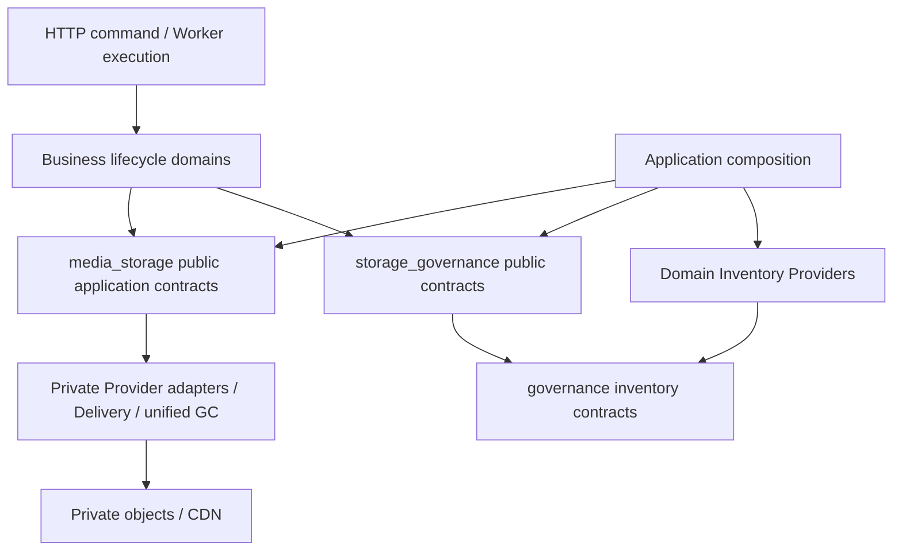

# ADR 0009: Converged Media Storage Re-foundation

Status: Gate 0 target decisions frozen by architecture-owner instruction; implementation awaits later Gate instructions.

日期：2026-11-26（Asia/Shanghai）。调查基准：`69e8e399940aead88d95cc00c117c505494fe251`，
分支 `refactor/practice-foundation-v2`。本文明确区分当前源码事实、冻结的目标设计和未验证的部署能力。
本次只新增本文，不改变运行时、测试、ORM、Alembic、Frontend 或既有 Accepted ADR。
任务明确拍板的产品/职责决策在本文冻结；新增字段、安全实现与分批映射是具体设计供负责人审查，
不将它们冒充已经通过Provider资格验证或已经获得生产实施授权。

## 1. Authority, naming and scope

仓库正式 ADR 使用 `docs/adr/0002-…` 至 `0008-…`。本文按本批允许的既有命名规范，
采用 `docs/adr/0009-media-storage-refoundation.md`，没有另建 architecture/adr 命名体系。
本批仅允许新增一份文档，因此不修改索引；本文独立包含调查与后续 Gate 文件映射。

本文替代 [旧 RFC](../architecture/asset-infrastructure-rfc.md) 的全 browser ingress Multipart（含 Avatar）、
额外 AvatarChangeRequest、staging→copy 默认路径和全量同步 Take verify 目标。
旧 [Gates](../architecture/asset-infrastructure-gates.md) 的 PostgreSQL 原型是可复用的身份/锁/责任证据，
不是已存在的 UploadSession，也不授权本批实施生产代码。已有业务授权、账务、Manifest、Account Closure、
持久化 Delivery、引用保护与不可逆 Retirement fence 保留；未来 Gate 同步替换旧路径和失效架构规则。

不建设全局 FileAsset/AssetCatalog、巨型 ProcessingJob、多态 owner_type/owner_id、持久化 DeliveryGrant、
通用 ResourceManager、第二套队列/删除账本或新旧兼容层。User 是唯一配额主体，不引入租户和共享空间配额。

## 2. Verified baseline

### 2.1 Git and inventory

开始时 local/remote 都是调查 SHA，working tree clean。相对
`cfe83a5c845d29d83e26c3ba6f3e1fa749e9f891` 有七个新增提交，完整 log/stat 见附录 A。
变化都是此前文档、资格工具和 SQL 测试证据，没有生产 UploadSession。
附录 B–F 提供本次读取/AST 提取的完整文件、核心符号、模型字段、调用位置和架构规则清单。

### 2.2 ObjectStorage and S3 adapter

真实路径：[base.py](../../backend/app/storage/base.py)、[s3_compatible.py](../../backend/app/storage/s3_compatible.py)、
[async_adapter.py](../../backend/app/storage/async_adapter.py)、[factory.py](../../backend/app/storage/factory.py)、
[paths.py](../../backend/app/storage/paths.py)、[__init__.py](../../backend/app/storage/__init__.py)。
不存在 app/storage/objects.py 或 deps.py。

`ObjectStorage` 方法全集：put_bytes、exists、read_bytes、object_metadata、upload_url、iter_bytes、copy、delete、
download_url、materialize_to_local。没有 MPU 或 batch/条件写协议。
frozen DTO：ObjectWriteResult(object_key,size_bytes)、DirectUploadTarget(upload_url,upload_method,upload_headers)、
ObjectMetadata(size_bytes,content_type,checksum_sha256)。自定义异常：ObjectStorageUnavailableError(RuntimeError)。

`S3CompatibleObjectStorage._make_client()` 使用 boto3 S3/SigV4、配置 endpoint/region、path或virtual addressing；
request/response checksum 为 when_required，payload_signing_enabled=False。client 懒加载，配置独立签名 endpoint 时
才建立 signing_client。[StorageSettings](../../backend/app/core/settings/storage.py) 默认签名期限900秒，
这不是新 Session hard deadline 的批准值。

| 当前方法 | 实际实现与限制 |
| --- | --- |
| put_bytes | put_object，接收内存bytes，返回参数key和len(content)；不回读/独立校验Provider hash |
| upload_url | 签Bucket/Key/ContentType/Metadata.sha256的put_object；headers仅content-type/x-amz-meta-sha256；没有ContentLength、原生checksum、防覆盖条件 |
| object_metadata | HEAD ContentLength/ContentType，checksum_sha256读取Metadata.sha256，不是Provider验证结果 |
| copy | 单次copy_object，同bucket/key；没有MPU copy或version pin |
| delete | exists/HEAD后delete_object，返回先前是否存在；不是永久删除终结证明，无版本/Delete Marker处理 |
| read_bytes / iter_bytes | GET，后者支持Range/chunks；关闭Body；缺失转FileNotFoundError，已知读故障转ObjectStorageUnavailableError |
| exists / metadata / copy / delete | 多数Provider错误原样传播；_is_not_found_error按404/NoSuchKey/NotFound code判断，没有统一覆盖所有mutation的错误模型 |
| download_url | 签GET，可设置响应下载名/type；传入或配置期限，不持久化Grant |
| materialize_to_local | download_file到Worker scratch，不是durable本地fallback |

AsyncObjectStorage 用 asyncio.to_thread 调度同一 namespace，取消时 shield 并等待当前调用返回；
这不等于Provider IO幂等或永久结束。factory.get_object_storage() lru_cache 返回S3 adapter。

### 2.3 Write protocol, physical facts and retirement

[writes.py](../../backend/app/modules/storage_objects/writes.py) 当前 write_object(db,storage,…) 接收调用方Session。
prepare_object_write 检查new/dirty/deleted；prepare_write锁Intent校验facts并commit PREPARED；
perform_write持精确generation锁执行put并commit WRITTEN；异常rollback的是同一个db。
ORM干净不代表没有业务事务/锁，这正是独立SessionFactory的必要性。
adopt_written_object 在caller事务检查live WRITTEN generation/facts，创建或保留StoredObject、设置ADOPTED，不commit。
retain_existing_object/retain_for_reference 经过Retirement fence，不是全局跨域hash dedup。

| 当前表/路径 | 实际结构与约束 |
| --- | --- |
| [StoredObject](../../backend/app/db/models/stored_object.py) | id/object_key/byte_size/sha256/content_type/created_at；key唯一、size>=0、非空key/type、64位小写hex SHA必填；无业务owner/filename/Quota |
| [ObjectWriteIntent](../../backend/app/db/models/object_write_intent.py) | id/intent_uuid/key/size/sha/type/status/write_token/write_expires_at/written_at，cleanup attempt/token/due/timestamps/failure_detail、created/updated；key唯一、status/due索引、processing token/attempt约束 |
| [StoredObjectRetirement](../../backend/app/db/models/stored_object_retirement.py) | id/retirement_uuid、nullable stored_object_id SET NULL、物理快照、status、attempt/token/due/timestamps、deletion_fenced_at、5项failure facts、created/updated；object FK唯一、fence不得CANCELLED |

Intent：PREPARED→WRITTEN→ADOPTED；cleanup分支为CLEANUP_PENDING/DISPATCHED/PROCESSING/FAILED→CLEANED。
Retirement：PENDING/DISPATCHED/PROCESSING/FAILED/COMPLETED/CANCELLED。
[retirement.py](../../backend/app/modules/storage_objects/retirement.py) 在语义引用/Usage release flush后登记，caller提交。
[执行器](../../backend/app/worker/execution/stored_object_retirement.py) claim提交后按StoredObject→Retirement锁重验快照/全部引用，
持久化不可逆fence，再FK-validated DELETE flush→物理delete→完成commit。COMMIT未知不能恢复可复用authority。
当前最终物理delete仍在DB锁事务中，不能描述为已经完成事务外IO改造。

[references.py](../../backend/app/modules/storage_objects/references.py) 显式九条语义FK：
Upload.stored_object_id、PerformanceTake.recording_object_id、ImportArtifact.stored_object_id、
ScoreRevisionSource.stored_object_id、ScoreRenderAsset.stored_object_id、ScorePlaybackAsset.stored_object_id、
PracticeBundleRecord.prepared_musicxml_object_id、PracticeBundleRecord.artifact_object_id、User.avatar_object_id。
语义RESTRICT与Retirement历史SET NULL职责不同。完整生产调用方见附录D。

### 2.4 Complete current Avatar path

account/dependencies.get_avatar_service → account/router.upload_avatar → file.file.read()（无界全读）
→ AvatarService.replace_user_avatar → process_avatar → write_object → active/nondeleted User FOR UPDATE
→ adopt_written_object → User.avatar_object替换 → retire_after_release(previous) → commit/refresh。
process_avatar检查png/jpg/jpeg/gif/webp和5MiB，再Pillow open/convert/thumbnail(200×200)、白底居中JPEG quality85/optimize。
文件名由user_id、JPEG SHA256、随机UUID构成。没有显式独立输入像素上限/DecompressionBombWarning处理。
DELETE /me/avatar 使用 get_command_db→clear_user_avatar，锁User、清FK、Retirement由caller提交。
[avatar_presentation.avatar_url_for_user](../../backend/app/modules/account/avatar_presentation.py) 返回应用链接；
GET /me/avatars/{filename}校验regex，JOIN当前User.avatar_object_id与StoredObject、过滤deleted_at，签URL返回307。
Avatar当前不进入Usage/Quota，不能凭key直接授权访问。

### 2.5 Take protocol and cleanup

[Reservation ORM](../../backend/app/db/models/performance_take_upload_reservation.py) 全字段见附录C。
manifest_id/user_id复合FK CASCADE、user_id CASCADE、quota_hold_id RESTRICT且唯一；user/client_request唯一；
status/expires索引，FINALIZING必须有完整token/key/expiry tuple。
[PerformanceTake](../../backend/app/db/models/performance_take.py) 当前没有UPLOADED/PROCESSING/READY字段。
Manifest是规范化业务快照，不等于物理校验Receipt。

PerformanceTakeReservationService.reserve_upload 授权Bundle、创建Manifest/Reservation/UPLOAD Hold，
reservation当前1小时，签staging PUT并跟踪URLexpiry；状态RESERVED/FINALIZING/COMPLETED/CANCELLED/EXPIRED。
UploadReservationLifecycle是纯状态机，persistence统一hydrate/apply，effects组合consume_hold+Allocation。
FINALIZING lease当前15分钟；takeover需要新token/key，旧candidate进入orphan lineage。
UNKNOWN_OUTCOME_GRACE当前30分钟，不是已证明的外部请求永久结束界限。

Finalize body必须为空。PerformanceTakeFinalizationService.finalize_take先锁User/容量/Reservation并提交lease，
释放事务后PerformanceTakeFinalMedia.verify检查metadata/header、全量hash staging→copy candidate→metadata及全量hash candidate。
重新准入后PerformanceTakeWriter.adopt直接object_to_row+Take+Hold消费+Usage同commit。
COMMIT未知时fresh Session查询持久化Take/Reservation/Hold恢复，不重复物理verify/Allocation。

UploadReservationCleanupService.cleanup_expired_reservations有界100项，每项DB恢复→事务外临时delete→DB重验/ACK，
保留staging_cleanup_after/completed与orphan_final_object_keys。
实际入口是 worker/execution/maintenance_dispatch.execute_stored_object_retirement_maintenance，
由tasks.run_stored_object_retirement_maintenance及Beat触发，不存在performance_take_cleanup.py。
Account TAKES当前等待该cleanup；未来交接Session GC必须同时调整阶段，不能让TAKES等TRANSFERS产生ACK。

### 2.6 Governance and delivery facts

当前Quota为FREE/PLUS/PRO有限容量；PlanPolicy.default_limit_bytes、UserStorageEntitlement.plan_code；
Hold HELD→CONSUMED/RELEASED/EXPIRED，稳定user/command_key、有效期和guarded transition。
容量锁Entitlement→UsageAccount→Hold→Counter，业务父锁/User lifecycle先行。
Usage严格Allocation/Release，不允许下溢；Events是审计，不决定业务owner。
Reconciliation只依赖InventoryReader；Registry校验完整Category覆盖、精确声明返回、非负整数与多个provider相加。
六个业务Provider位于revisions/score_assets/scores/uploads/import_jobs/performance_takes；唯一集中装配storage_inventory/composition.py。
composition/storage_resources.py装配Quota/Usage。Category只有SOURCE/UPLOAD/INPUT_ASSET/DERIVED_RENDER/DERIVED_AUDIO/TEMP_IMPORT，
前三类计配额，Take仍为UPLOAD；Avatar/Bundle不记Usage。InputAsset reclassification/multiplicity继续保留。

当前Take router.stream_take_media→PerformanceTakeService.get_media_delivery→api.storage_streaming.stream_storage_object，
enable_range=True，经Python迭代Provider bytes；另有get_playback_url签GET。后者expires_in硬编码3600，而签名配置默认900，
应改由统一delivery返回实际expiry。Customer Web openPerformanceTakeMedia仍消费应用stream endpoint。

## 3. Frozen two-domain design



media_storage收口Provider、ObjectWriteCoordinator、双模UploadSession、不可变StoredObject、采用/引用保护、Retirement/GC和Delivery。
storage_governance内部保留quota/usage/inventory三项成熟authority，不合并账务与准入、不重写对账。
业务只依赖application contract，composition注入实现；业务不反向依赖composition，不取得Provider对象。
media不调用Governance或业务lifecycle；governance不导入Provider/业务ORM。显式引用registry仍是受限FK适配器，
可以集中读九条语义FK，不拥有业务删除政策。领域Inventory可SQL JOIN物理事实，不能访问Provider或扫描bucket。

| 未来目录（backend/app/下） | 唯一职责 |
| --- | --- |
| modules/media_storage/contracts.py | immutable receipts、application read/write/delivery ports，不暴露boto3 |
| modules/media_storage/provider.py、s3_compatible.py | 私有物理port和wire适配，SigV4/条件写/checksum/MPU/错误分类 |
| modules/media_storage/object_facts.py、adoption.py | immutable facts、唯一StoredObject row admission，不决定媒体READY |
| modules/media_storage/write_coordinator.py | 独立SessionFactory的single/batch Intent协议 |
| modules/media_storage/references.py、retirement.py | 显式FK与不可逆retirement、快照/重试 |
| modules/media_storage/upload_sessions/domain.py、repository.py、service.py | 双模纯转换、SQL锁/约束、transport编排分离 |
| modules/media_storage/upload_sessions/operations.py、gc.py | exact locator/claim/IO证据、取消/过期收敛 |
| modules/media_storage/delivery.py | 短期URL/CDN/immutable cache策略，无持久化DeliveryGrant |
| modules/storage_governance/categories.py、contracts.py | 中立Category与接口，避免通过usage ORM取得共享枚举 |
| modules/storage_governance/quota/、usage/、inventory/ | 移入现有成熟实现，保留各自读/写/对账边界 |
| composition/media_storage.py、storage_resources.py、storage_inventory.py | 显式组装，无全局隐式注册 |
| db/models/、worker/dispatch/、worker/execution/ | 继续现有ORM层、Celery runtime与事务所有权；不借机重写全部目录 |

## 4. Two upload modes, limits and abuse guards

| 资源 | 单文件硬上限bytes | 协议 |
| --- | ---: | --- |
| Avatar | 5,242,880（5MiB） | A：API有界流式读→解码/像素验证→JPEG→Coordinator；无Session/MPU |
| Score Import image | 20,971,520（20MiB） | B：UploadSession SINGLE_PUT；明确需要续传可选MPU，仍受20MiB业务限制 |
| Take audio | 524,288,000（500MiB） | ≤20MiB SINGLE_PUT，>20MiB或需续传MULTIPART |
| Take video | 2,147,483,648（2GiB） | 同上，同时受有效Quota/Hold限制 |

等号属于上限，空文件拒绝，拆Session不能绕过一个语义媒体文件的上限。
Avatar边读边计字节，超过5MiB立即中止，不先file.file.read()全读、不信任客户端Content-Length。
Pillow解码前校验容器、警告提升为拒绝并设置显式像素限制；EXIF/透明/动画语义由Avatar决定，输出JPEG。
输入像素阈值须Gate1实测确认，不能把当前200×200输出误当输入像素防炸弹策略。

服务端一次冻结protocol/size/checksum计划；SINGLE_PUT签名必须绑定精确Content-Length；
MPU冻结part_size/count，含尾片精确长度，每part签Content-Length。Complete只接受冻结有序manifest。
客户端没有Complete/Delete/List或STS通配权限；续签不延长Hold/hard deadline。

独立transport防刷：每User活跃Session上限集中配置，建议初始5；
未消费且物理责任尚未结算的声明字节另有限额，建议初始4GiB，可容纳2GiB视频。
5和4GiB是参数提案，需Gate2前确认；不把任务中的“如5”冒充已批准数值。
单文件硬上限已冻结，part尺寸/最大parts、signedTTL/hard deadline由真实Provider资格和产品批准确定。
User admission锁下聚合检查+插入，取消/过期但尚未GC的责任仍占临时预算；旧代未结算不能靠新代绕过。
transport预算不写Usage used_bytes，不代替业务Hold；无authority/配置必须fail closed。

## 5. In-place promotion and immutable physical truth

模式B直传服务端生成的、Session generation独占的最终key，不默认staging→CopyObject。
业务key builder拥有命名，media视为opaque；不从prefix推断业务owner，不全局hash dedup。
对象存在不代表StoredObject已adopt或媒体READY。多页图片各有Session/业务命令。

UUID命名不能防止旧Presigned PUT重写：必须冻结size/checksum/type，并具Provider验证的create-only/防覆盖条件，
MPU Complete也必须保护target。若生产Provider不能验证此组合，不发布直传，不暗中退回copy/应用代理/无约束PUT。
exact-version定位作为替代须另审批并贯穿read/retire，不能先放行再读latest。

传输完整性读取Provider实际size与原生/逐part校验，对比冻结计划；记录algorithm、FULL_OBJECT/COMPOSITE、value与验证来源。
ETag不是full SHA，composite不是完整hash，客户端metadata.sha256不是可信校验结果。
逐part checksum必须由Provider验证并拒绝错误值，结合服务端Complete manifest证明传输计划；媒体probe/transcode仍由领域异步处理。

### 5.1 Required SHA schema correction

当前StoredObject/StoredObjectFacts强制full SHA，不能既维持该约束又在无可信full SHA时快速adopt。
目标正式迁移：StoredObject.sha256允许NULL，非空仍是**已验证完整SHA**且不可后补改写；
新增typed transport integrity字段，server-generated对象仍在写前计算full SHA。
直传只有经核实的transport receipt才可注册；有Provider验证的full SHA时注册即保存，否则不写假值/metadata。
异步全量hash进入独立stored_object_verifications（object_id/algorithm唯一、exact locator/generation、验证时间/结果），
不修改immutable StoredObject事实，不构建AssetCatalog。Retirement快照、facts、reads与约束同批迁移，现有SHA保持不变。
这项Schema演进是Gate3快Finalize的前提，不是Gate0已修改数据库。

### 5.2 One semantic commit

业务重验父资源/User/命令/有效Hold，进入唯一media_storage.adopt_upload：
校验Session当前transport verified与不可写receipt，锁Session，注册StoredObject、建立Upload/Take真实FK、
标CONSUMED、consume Hold、Allocation、领域Outbox在一个caller-owned事务原子提交。
adoption不commit、不做Provider IO。GC与adopt竞争同Session；cleanup fence后不可adopt。
rollback不丢未消费Session责任；COMMIT未知用fresh Session查业务结果/Session/Hold，不补做Allocation。
CONSUMED后正式对象仅由Retirement删除，Session临时GC不能删除已采用对象。

原地采用会在同一语义事务把精确原始resource责任登记为 **ADOPTED/TRANSFERRED**，
绑定adoption operation、StoredObject ID snapshot和immutable locator/integrity，不伪造REMOVED ACK。
Session结束后的证据只保留物理责任转移快照，不额外持一条可阻止业务Retirement的语义FK。
CONSUMED会话可以在所有MPU/未知操作收尾后清除parts/Session，正式对象继续存在并由业务FK保护；
未消费会话则必须逐resource REMOVED。0.6原型只证明未采用资源cleanup，尚未证明此责任转移，
Gate2必须补充原地采用与GC双向竞态/unknown-COMMIT/保留快照测试，不能把既有Root规则原样用于删除已采用对象。

## 6. ObjectWriteCoordinator and batch transactions

Coordinator由composition注入独立SessionFactory；write()/write_batch()没有业务Session参数，绝不提交/回滚caller db。
caller不能持业务锁等待独立Coordinator锁，避免跨连接自锁；业务准入和最终adopt分明确phase。
batch一次校验全部key/facts，确定性排序，在独立短事务有界批量登记PREPARED，提交后才IO；
每项generation/result独立可恢复，按有界组持久化WRITTEN，减少2N次提交放大。
不能为省commit丢单项责任；部分物理成功不代表业务部分成功。caller收齐所需receipt后统一adopt。
事实冲突在IO前拒绝，重试复用精确generation结果；stale writer不得改新代。
现有窄Intent锁跨put机制不能简单删锁后重试替代，Gate1必须证明事务解耦后claim/物理责任仍可靠。

多页Render、Bundle两表示、ImportArtifact集合用write_batch；Avatar/Revision/单Playback用write。
batch是有界spool/stream输入，不是同时把所有页面bytes载入内存。
业务不再持Provider，包括临时Take操作；引擎通过media只读materialization/read contract取输入。

## 7. Transport state machine and unified GC

Session仅拥有传输/input状态，不拥有业务PROCESSING/READY；重试/lease失败记录在明确Operation，不再复制同义queue状态。

| 当前状态 | 精确触发/authority | 下一状态/恢复 |
| --- | --- | --- |
| 新准入 | User/Domain/Quota/transport预算原子通过，UUID/key/大小/协议冻结 | SINGLE_PUT→UPLOADING；MPU→INITIATING，先提交INITIATE再IO |
| INITIATING | 明确UploadId返回 | CREATED_BY资源/INITIATE result持久化→UPLOADING |
| INITIATING | CreateMultipart网络/5xx/响应丢失 | 原状态，operation UNKNOWN；exact generation key分页发现并登记DISCOVERED_BY，不盲目重initiate或遗忘旧代 |
| UPLOADING | 续签 | 不变；User/current generation/deadline重验，长度checksum冻结 |
| UPLOADING | 完成通知/Complete admission | SINGLE_PUT→VERIFYING，MPU→COMPLETING；冻结manifest/command，客户端通知不是事实 |
| COMPLETING | Complete成功，解析无embedded200错误 | exact result持久化→VERIFYING |
| COMPLETING | Complete未知 | operation UNKNOWN；核对UploadId、完整key、size/checksum/version；NoSuchUpload不等于无对象，不覆盖target重启 |
| VERIFYING | Provider size/checksum/不可写资格匹配 | VERIFIED；不在HTTP全量hash/probe/transcode |
| VERIFYING | 确定不匹配 | REJECTED并登记cleanup，不制造业务成功 |
| VERIFIED | 业务/User/Hold重准入+adopt事务 | CONSUMED，语义引用/Allocation/Hold/outbox同commit |
| 未消费状态 | cancel/expiry/account closure | CANCELLED/EXPIRED；停止签新能力，旧URL/在途IO责任保留 |
| CONSUMED | 语义资源释放 | Session不重启；业务release+Retirement同事务，正式删除独立 |
| CANCELLED/EXPIRED/REJECTED | capability结束、未知结果解决、全部locator结算 | 独立CLEANUP CLEANED/SETTLED后可删除parts/Session；不复制Session CLEANED状态 |

多个MPU handle/orphan完整对象使用受约束资源子行，不用无界JSON丢locator。
保留0.4–0.6的exact Session UUID/gen、operationUUID、物理locator/来源、monotonic claim epoch/token及逐资源ACK。
registration/closure同Session FOR NO KEY UPDATE互斥，READ COMMITTED或另经证明的隔离方案。
非空集合必须全部有正确责任结算：未采用项当前claim REMOVED，已采用项同adopt事务TRANSFERRED；
空集合要精确不可变NOT_FOUND observation，所有其他operation settled；
UNKNOWN INITIATE不因NOT_FOUND自动解决。每operation/epoch独占Worker principal，换人新epoch；历史不可改。
普通Worker无任意token/claim表读写，受控claim/assign/publish/ack先核对精确Parent且检查FOUND，无Parent返回false。
数据库fencing不证明Provider旧IO停止，也不保证同principal内重复IO exactly-once。

统一GC是media内责任边界：unadopted Intent、未消费Session对象/MPU、正式Retirement保持明确operation kind，
复用Celery/DurableFailure/Ops/scheduler，不新建万能ProcessingJob/queue。
Abort一次成功、空listing、URL或lease到期不能单独证明永久结束；缺证据保留可诊断BLOCKED责任和最小locator历史。
Bucket incomplete-MPU lifecycle是兜底运维，不决定owner/Inventory。

## 8. Target upload_sessions schema

PostgreSQL BIGINT内部PK、VARCHAR(36) UUID沿用当前映射、UTC TIMESTAMPTZ；状态用VARCHAR+具名CHECK。
下面是完整Session字段组的设计，不是已存在ORM；多handle/claim历史放子表，不能两份可变current authority。

| 字段 | 类型/NULL | 语义与约束 |
| --- | --- | --- |
| id | BIGINT PK | 内部身份 |
| session_uuid | VARCHAR(36) NOT NULL UNIQUE | server UUID，不重用 |
| user_id | BIGINT NOT NULL FK users.id RESTRICT | tombstone保留物理责任，禁CASCADE |
| generation | INTEGER NOT NULL | >0，immutable传输代，非业务重试序号 |
| protocol | VARCHAR(16) NOT NULL | SINGLE_PUT/MULTIPART，immutable |
| state | VARCHAR(16) NOT NULL | 第7节九种状态 |
| object_key | VARCHAR(768) NOT NULL UNIQUE | 该代独占最终key，不是复用已有正式对象入口 |
| expected_bytes | BIGINT NOT NULL | >0，满足该业务硬上限，不能原地扩大 |
| admitted_content_type | VARCHAR(255) NOT NULL | server规范类型，不替代probe |
| policy_version | VARCHAR(64) NOT NULL | 冻结准入/完整性/传输参数版本 |
| integrity_algorithm / integrity_type | VARCHAR(32)/VARCHAR(16) NOT NULL | 已资格算法及FULL_OBJECT/COMPOSITE计划 |
| expected_integrity_value | VARCHAR(256) NULL | SINGLE_PUT固定checksum；MPU可从冻结part计划推导，非伪verified结果 |
| part_size | BIGINT NULL | MPU必需>0，SINGLE_PUT必须NULL |
| part_count | INTEGER NULL | MPU必需>0，受Provider最大parts约束，与总字节数一致 |
| request_fingerprint | VARCHAR(64) NOT NULL | 冻结业务/传输准入摘要 |
| upload_creation_request_id | BIGINT NULL FK upload_creation_requests.id RESTRICT | 明确Upload命令，无多态owner |
| take_reservation_id | BIGINT NULL FK performance_take_upload_reservations.id RESTRICT | 明确Take业务Reservation |
| command_generation | INTEGER NOT NULL | >0；Upload顺序重试，Take同Reservation单代，完成命令不复活 |
| initiate_operation_uuid | VARCHAR(36) NULL FK upload_session_operations.operation_uuid RESTRICT | MPU result identity；raw UploadId仅存不可变resource locator |
| complete_operation_uuid | VARCHAR(36) NULL，同上FK RESTRICT | Complete或SINGLE_PUT完成观察identity |
| verification_operation_uuid | VARCHAR(36) NULL，同上FK RESTRICT | transport verified result，不复制checksum事实 |
| cleanup_operation_uuid | VARCHAR(36) NOT NULL，同上FK RESTRICT | 单cleanup root，deferred相互FK同事务建立 |
| empty_set_observation_uuid | VARCHAR(36) NULL FK upload_empty_set_observations.observation_uuid RESTRICT | 明确空集证据，不是Resource |
| completion_fingerprint | VARCHAR(64) NULL | 一次冻结的完成command/有序manifest，冲突重放拒绝 |
| hard_deadline_at | TIMESTAMPTZ NOT NULL | >created_at，immutable，不超过适用Hold期限 |
| last_capability_expires_at | TIMESTAMPTZ NULL | 最大已签能力截止，单调且不超过hard deadline |
| resources_closed_at | TIMESTAMPTZ NULL | 不可逆登记关闭事实，不自行证明完整发现 |
| input_released_at | TIMESTAMPTZ NULL | 业务放弃/完成input使用；消费后正式对象仅Retirement |
| provider_completed_at / verified_at | TIMESTAMPTZ NULL | 匹配operation推进，不是业务READY |
| consumed_at / terminal_at | TIMESTAMPTZ NULL | CONSUMED二者非空；取消/过期/拒绝仅terminal，不重启 |
| created_at / updated_at | TIMESTAMPTZ NOT NULL | aware UTC |

CHECK num_nonnulls(upload_creation_request_id,take_reservation_id)=1；Avatar没有Session，因此没有Avatar FK。
分别建立(command_id,command_generation) UNIQUE，以及每具体command active-state partial UNIQUE。
同表明确FK弧避免两个业务表各自UNIQUE却跨域复用同Session。Session/command的(id,user_id)复合FK保证同User。
Command被User CASCADE删除也必须被Session RESTRICT挡住；不能越过TRANSFERS。
新代使用新UUID/key，旧Session未结算仍占临时budget；binding删除后由领域终态lineage拒绝旧command重放。
Parent正式擦除后的API身份保留按Account policy，不伪造无限历史。

索引：session_uuid/key UNIQUE；UNIQUE(id,user_id)供复合FK；(user_id,state,created_at,id)、
(state,hard_deadline_at,id)、(user_id,input_released_at,terminal_at)及各具体FK索引。
due/attempt索引只放Operation，不在Session双写next_attempt_at。
单行CHECK约束protocol/part tuple、终态时间、expiry；SINGLE_PUT的expected_integrity_value必须非空，
MPU必须存在完整冻结part checksum计划，不能以NULL代表跳过校验。
跨表result由复合FK/锁定核验/trigger证明，不假装单行CHECK能查询其他表。
CONSUMED必须有真实语义结果、匹配VERIFIED receipt；Session不额外持StoredObject FK制造第十条冗余语义引用。

附属表职责：

- upload_session_parts：Session RESTRICT、part_number UNIQUE、精确expected_length、冻结checksum与observed ETag/size。
- upload_session_operations：UUID、nullable Session FK SET NULL、immutable Session UUID/gen、kind、result、claim/Delivery failure字段。
- upload_physical_resources：原始key/UploadId/physicalgen/version、CREATED_BY/DISCOVERED_BY与独立cleanup target。
- upload_resource_settlements、upload_operation_claims、upload_worker_assignments：逐资源REMOVED或正式采用TRANSFERRED结果、不可变epoch/token历史、独占授权。
- upload_empty_set_observations：精确discovery/current claim/零库存声明，不是伪造对象。

这些是一个高内聚media域内的可靠性事实，不是六个顶层模块或通用AssetCatalog。
不存Signed URL/credentials；Session/User删除不能清除UNKNOWN operation/resource责任。正式建表必须forward migration。

## 9. Business integration and account erasure

| Domain | 目标业务接入与计量 |
| --- | --- |
| Upload/Score Import | Domain command+UPLOAD Hold→Session直传与真实图片验证→同事务adopt/Upload/consume/Allocation；后续Import submit引用Upload。InputAsset promotion保留现有归属/重分类与multiplicity |
| Avatar | 5MiB有界读/解码安全/JPEG→Coordinator write→User当前引用替换+旧Retirement；无Session、无Quota/Usage |
| Take | Reservation/Manifest/Hold仍业务独立；Session接管物理上传，Finalize原地adopt；Hold消费、UPLOADED业务资源、Allocation、领域Outbox原子提交 |
| Revision Source | 业务ScoreOwner/SOURCE Hold/版本冲突与no-op不变；Coordinator预写后唯一adopt，不把Source等同派生资产 |
| Render/Playback | Domain lease/业务ready不变；Coordinator write_batch/write、正式引用/Usage；不创建用户Hold |
| ImportArtifact | 领域Job/attempt保留，批量预写+adopt+TEMP_IMPORT记账；临时scratch与正式对象分清 |
| PracticeBundle | CREATING/READY、领域key/复用/retention保留；Coordinator批量两表示；无用户Usage/Quota |

Account关闭仍在原事务tombstone、撤销凭证、写AccountDeletionOperation，立即退出，不等GC。
新上传/签能力先User fence；tombstone不能撤回已签Provider能力。
目标阶段为SCORES→IMPORTS→TAKES→UPLOADS→TRANSFERS→FINALIZE：
TAKES仅业务取消/input release/未消费Hold释放，不等后面的物理ACK；UPLOADS删正式资源/Usage，保留被Session FK引用的命令。
TRANSFERS取消Session并等待GC解决对象/MPU/未知结果，结算后同事务删parts/Session；
FINALIZE再删Request/Reservation/Manifest、核对Inventory/Usage零值、擦Quota历史、清头像并最后删User。
CONSUMED对象的Retirement独立，不等正式物理删除完成才删User；独立最小物理证据继续保留。
Avatar无ChangeRequest，未采用Coordinator Intent由media GC持有，不引入新账户账本。

Account不复制Score/Import/Take内部删除逻辑，共享StoredObject的其他用户引用始终保留。
Usage/业务引用/hold/adopt或release同caller事务；未消费Session不是已用库存。
已adopt但PROCESSING/失败的媒体仍是用户逻辑资源，继续记Usage，删除精确release；不能借处理状态免费持有对象。
不clamp、不清counter掩盖错误；对账从语义事实重建，不读bucket/events推断owner。

## 10. Async readiness and Delivery P0

大文件Finalize在传输完整性/写保护成立后快速adopt，Take写UPLOADED和领域Outbox，消费Hold/Allocation。
不在HTTP下载全文件或转码。领域Worker沿既有Delivery lease/attempt推进UPLOADED→PROCESSING→READY；
确定媒体失败为明确FAILED，保留诊断与删除入口，重试不重新消费Hold。
Manifest、权限、Reservation与ready属于Take；Session不吞并业务状态机。
完整hash/probe/transcode使用明确Take outbox/table与take/task-revision唯一身份，不是万能ProcessingJob。
转码产物通过Coordinator成为新对象，不能覆盖原始bytes；引用替换/Usage release同业务事务，保留政策由Take决定。

Delivery与Take异步接入同批P0：领域授权User/业务资源及READY策略，media签短期GET或CDN能力，
immutable key/checksum/version决定缓存身份。音视频Range直接到存储/CDN，禁止穿透Python/FastAPI。
删除当前大媒体stream路径与Customer Web openPerformanceTakeMedia消费者，不保留“CDN失败回应用代理”fallback。
下载、分享使用同Delivery contract；URL/secret不写Outbox/Ops/log，无持久化DeliveryGrant。
注销阻止签新URL，旧URL可持续短TTL，不承诺即时全网缓存撤回。expires_in由实际签名expiry产生。
小MusicXML等按现有授权read contract读取，不把大媒体禁代理扩成全系统禁止读取bytes。
CDN域名、真实Origin/CORS、Range/缓存/版本策略需环境实测，本轮没有部署CDN。

## 11. Gate 1–4 exact change mapping

以下均是后续Gate范围建议，不能作为本批实施授权。完整现有目录展开在附录B/C；NEW均明确标记。
每批Implement→Local Verify→Commit→Push→Stop，不能跨批自行开发。

### Gate 1 — converged core and isolated Coordinator

- 迁移 `backend/app/storage/{__init__,base,async_adapter,s3_compatible,factory,paths}.py` 六文件与
  `backend/app/modules/storage_objects/{__init__,facts,persistence,reads,references,retirement,writes}.py`，
  到media_storage对应职责及NEW write_coordinator.py/adoption.py/contracts.py/provider.py/delivery.py。
  WORK_ROOT scratch职责移至Worker物化边界，不混durable fallback。调用全部迁移后删除旧domain/port路径，不保留alias/re-export。
- storage_quota九文件、storage_usage九文件、storage_inventory四文件按附录B逐项迁入storage_governance内部子域，
  inventory/composition.py移至NEW `backend/app/composition/storage_inventory.py`。
  从 `backend/app/db/models/storage_usage.py` 提取Category到NEW `backend/app/modules/storage_governance/categories.py`，
  一次替换所有导入，保持Category值及数据库enum身份，不重新设计账务/Quota。
- 调整 `backend/app/composition/storage_resources.py`；NEW composition/media_storage.py注入SessionFactory/私有Provider；
  `backend/app/db/session.py` 保留SessionLocal authority，Coordinator不能接caller Session。
- 写入调用精确迁移文件（backend/app/modules/）：account/avatar_service.py、uploads/service.py、revisions/service.py、
  score_assets/score_revision_rendering.py、playback/service.py、import_jobs/pipeline/artifact_recorder.py、
  import_jobs/review/service.py、practice/bundle/writer.py。多输出使用batch。
- account/router.py实现有界读，avatar_service.py显式图像安全；不创建Avatar Session/Command模型。
- worker/execution/object_write_cleanup.py、stored_object_retirement.py及对应dispatch只消费新公开contract，
  保留runtime adapter职责和九FK/fence，不为收敛重写正确生命周期。
- db/models/{object_write_intent,stored_object,stored_object_retirement,storage_usage,storage_quota}.py仅在实际契约需要时改动，
  任何Schema变化都forward migration；core/settings/{storage,object_writes,stored_object_retirement}.py集中配置。
- 同步迁移test_object_storage_architecture.py、test_object_write_architecture.py、test_async_storage_architecture.py、
  test_object_key_architecture.py、test_storage_inventory_architecture.py、test_storage_quota_postgres.py、
  test_practice_bundle_architecture.py的路径/allowlist，保留行为门禁，不删除断言求绿。

### Gate 2 — dual UploadSession and Score Import

- NEW `backend/app/modules/media_storage/upload_sessions/{__init__,domain,repository,service,operations,gc}.py`；
  NEW `backend/app/db/models/{upload_session,upload_session_operation,upload_session_resource}.py`按精确职责承载第8节子表；
  NEW media_storage/router.py、schemas.py提供受控能力/完成/取消，不暴露底层Provider。
- 调整 `backend/app/modules/uploads/{router,schemas,service,repository,upload_admission,account_cleanup}.py`、
  db/models/upload_creation_request.py、api/v1/router.py、modules/account/{resource_admission,resource_ownership}.py、
  composition/account_deletion.py。图片直传后仍真实验证再建Upload，现有Import submit引用Upload，不将Session视为Job。
- import_jobs/{service,repository,storage_inventory}.py、review/service.py对接新Upload结果；pipeline不创建Session。
- NEW worker/{dispatch,execution}/upload_session.py；worker/tasks.py、worker/execution/maintenance_dispatch.py、
  task_queue/schedule.py、core/runtime_checks.py注册持久化扫描，不用BackgroundTasks当唯一保障。
- 客户端精确路径：apps/customer-web/src/lib/http/direct-object-upload.ts、lib/api/uploads.ts、
  features/imports/submission/use-import-upload-workflow.ts、upload-types.ts、upload-form.tsx、lib/upload/recommended-score-images.ts；
  NEW lib/upload/upload-session.ts负责协议，业务UI不复制客户端。src/generated/api/从正式OpenAPI再生成，不手写DTO。
- 当前链head为 `0008_collaboration_closure`，新revision在实施时按真实head创建；不在本文编造已经存在的新migration。

### Gate 3 — Take in-place, async readiness and Delivery P0

- db/models/{stored_object,stored_object_retirement,performance_take,performance_take_manifest,performance_take_upload_reservation}.py；
  NEW db/models/{stored_object_verification,performance_take_processing_outbox}.py，forward migration落实typed integrity、
  nullable已验证SHA、业务ready/领域outbox和locator约束，不只松Model而漏DB。
- modules/performance_takes/{router,schemas,dependencies,service,finalization,writer,final_media,manifest,manifest_persistence,aggregate,read_model,object_keys,account_cleanup,storage_inventory}.py，
  upload_reservation/{domain,effects,persistence,reservation_service,responses,recovery,cleanup}.py，
  shared/performance_take_upload.py；NEW领域processing.py、processing_delivery.py。
  删除final_media.py中copy+双全量hash旧Finalize算法，必要纯业务验证迁移到ready处理，不保留fallback。
- media_storage/{adoption,object_facts,delivery,provider,s3_compatible}.py；api/storage_streaming.py和Take router移除大媒体Range；
  modules/playback/delivery.py、score_assets/service.py、practice/bundle/content.py、account/router.py消费新read/delivery接口。
- NEW worker/{dispatch,execution}/performance_take_processing.py；tasks.py/schedule.py/runtime_checks.py及
  modules/ops/{schemas,operation_projection,command_service,operation_summary}.py纳入既有投影，无状态复制表。
- Customer Web：lib/api/performance-takes.ts、lib/http/direct-object-upload.ts、lib/practice/performance-take/{admission,save,save-command}.ts、
  lib/practice/media/performance-take/materialize.ts、hooks/queries/use-performance-take-queries.ts、
  hooks/practice/use-performance-take-export-bundle.ts及附录B列出的真实Take消费者；生成SDK同步。
- test_performance_take_finalization_architecture.py当前要求Writer.object_to_row/同步verify，需替换为唯一adoption/异步ready规则；
  保留unknown-COMMIT/Hold/Allocation/Manifest授权与真实DB测试。Delivery资格必须同批完成，不拖成性能优化。

### Gate 4 — erasure, unified GC and final acceptance

- composition/account_deletion.py、modules/account/{resource_ownership,deletion_service,deletion_repository}.py、
  modules/uploads/account_cleanup.py、modules/performance_takes/account_cleanup.py、db/models/account_deletion_operation.py，
  新增合法TRANSFERS phase的forward migration，确保TAKES不等后置ACK。
- worker/execution/{maintenance_dispatch,maintenance_cleanup,account_deletion,object_write_cleanup,stored_object_retirement}.py，
  worker/dispatch/{object_write_cleanup,stored_object_retirement,account_deletion}.py、task_queue/schedule.py、tasks.py、runtime_checks.py，
  与NEW upload_session adapter收敛统一GC；旧Take临时Provider cleanup分支完整删除。
- modules/ops/{operation_projection,command_service,query_service,schemas,operation_summary}.py、
  observability/async_operation_metrics.py复用统一Ops/审计/监控，无新万能job。
- 领域Inventory保持SQL聚合/multiplicity，usage reconciliation保留caller事务。
  test_account_resource_ownership.py、object_write/storage_inventory/upload_reservation/performance_take_finalization架构测试及附录E规则
  跟随最终目录，不能留下旧路径转发或放宽引用安全。
- 在对应实现Gate更新architecture下object-storage.md、storage-resource-governance.md、storage-resource-execution.md、
  storage-usage.md、storage-quota.md、business-resource-lifecycle.md、performance-take-reservations.md、performance-take-lifecycle.md、
  upload-media-admission.md、README.md，以及backend/docs/backend_engineering_principles.md和Customer Web规范。
  Gate0不改这些文件；最终不能保留互相冲突的current truth。
- CDN/IAM/CORS/MPU lifecycle/版本及证据保留由负责人给真实部署策略，代码不能编造能力。

## 12. Acceptance and qualification boundaries

后续代码Gate执行focused与全backend pytest、Ruff/format/mypy/compileall、Alembic fresh/现有升级与downgrade/parity、
OpenAPI/SDK freshness；相关Frontend typecheck/lint/unit/build和真实browser直传。不能删/skip/放宽测试求绿。

- PostgreSQL17独立连接+Barrier/pg_blocking_pids：同User准入与预算、幂等、跨User隔离、retirement/retain、adopt/GC、
  registration/closure双方向、exclusive assignment/epoch takeover、Parent失效、空集与UNKNOWN保护。
- Coordinator caller事务不被commit/rollback；batch部分写/未知COMMIT/crash恢复；多页事务数随有界batch数增长，
  业务引用/Usage仍整体原子，不是仅减少函数调用。
- 实际Provider和浏览器：SigV4签名确含Content-Length；错长度/缺长度/增大body拒绝；逐part checksum错值拒绝；
  HTTP2、真实Origin/CORS、重放PUT不改已采用bytes、Complete embedded200、unknown initiate/complete、abort/inflight闭环。
- Avatar5MiB、Import20MiB、audio500MiB、video2GiB及SINGLE_PUT/MPU边界；Quota/transport预算不足拒绝。
- 坏媒体不READY，失败仍可删/精确release；异步重试不重复consume。CDN/存储实际206、短签名与immutable cache验证，
  不能只mock URL；大媒体不经应用Range。
- Account立即关闭，新能力拒绝，旧IO/签名不被当成停止；共享对象及其他用户Usage不受损。

本批只执行文档质量、路径/清单核验和git diff，不声称未来代码或Provider测试已运行。

## 13. Explicit conflicts and owner questions

| 问题 | 目标处理与当前资格 |
| --- | --- |
| 旧全Multipart/Avatar Session/copy默认方案 | 被本文双模/原地晋升替代；Gate0没修改当前生产代码 |
| mandatory full SHA vs快Finalize | typed transport integrity + nullable已验证SHA +独立immutable异步verification，必须正式迁移所有facts/read/retirement约束 |
| 可重放URL vsimmutable最终key | 发布前验证create-only/条件Complete或审批exact-version方案；当前adapter未提供 |
| browser Content-Length | JS不能手写该header；用固定Blob/File slice让浏览器发精确长度，必须实际证明与SigV4匹配，不能去掉签名后放行 |
| 原生checksum vsmetadata/composite | 当前metadata不是验证；实际算法/错误值拒绝/full或part含义待资格，缺资格不注册假facts |
| 合域与AST硬路径 | 附录E列实际目录规则，实施时同步迁移，不删除门禁 |
| User删除与物理责任 | Session/command RESTRICT、TRANSFERS结算后擦历史，不能CASCADE遗忘UNKNOWN |
| 护栏/运行参数 | 单文件上限已冻结；建议5会话/临时4GiB与part/TTL/deadline仍需确认，不能冒充部署合同 |
| CDN/生产Provider/IAM/Encryption | 当前只有S3与签名URL实现；生产配置、Origin、缓存/版本/保留期限仍需真实证据 |

2026-11-26查阅一手参考，仅用于风险识别：
[MDN Content-Length](https://developer.mozilla.org/en-US/docs/Web/HTTP/Reference/Headers/Content-Length) 将其列为浏览器禁止脚本设置的header；
[Aliyun CompleteMultipartUpload](https://www.alibabacloud.com/help/en/oss/developer-reference/completemultipartupload) 描述原生防覆盖选项及版本化限制；
[Aliyun PutObject](https://www.alibabacloud.com/help/en/oss/developer-reference/putobject) 描述默认同名覆盖行为。
原生API文档不能证明当前boto3 S3兼容请求已获得同等资格。本轮未访问bucket、未运行Provider测试或修改配置。

## 14. Gate 0 verification

唯一新增文件为本文。实际入口：
`powershell -NoProfile -ExecutionPolicy Bypass -File scripts/quality.ps1 -Check docs-links`、`git diff --check`；
另用git ls-files/Path.exists/AST核对清单、链接和映射，NEW路径与现有路径分开。
文档结果见最终报告；完整backend/frontend/migration/Provider测试不属于本批，未执行不报告通过。
本地检查完成即commit/push/stop，不等Hosted CI。本批可不查询CI，既有失败不能改写为通过。

## Appendix A. Exact baseline Git output

`git log --oneline cfe83a5c..HEAD`（调查基准，未包含本ADR提交）：

```text
69e8e399 test(architecture): enforce exclusive claims and settle empty resource sets
e48e2e9a test(architecture): linearize resource closure and bind operation provenance
b0870f96 test(architecture): bind physical cleanup identity and fence stale attempts
4edb9f71 test(architecture): tighten asset qualification and binding ledger proofs
1f1a6496 test(architecture): harden asset infrastructure review gates
480bff01 docs(architecture): close asset infrastructure review gates
76416316 docs(architecture): define asset infrastructure re-foundation

```
`git diff --stat cfe83a5c..HEAD`：

```text
 .../tests/support/asset_binding_ledger_design.py   |  358 +++
 backend/tests/support/qualify_asset_provider.py    |  962 ++++++++
 .../support/qualify_asset_provider_browser.mjs     |   36 +
 backend/tests/test_asset_gate_postgres.py          |  380 ++++
 backend/tests/test_asset_provider_probe.py         |  791 +++++++
 .../test_asset_session_binding_design_postgres.py  | 2302 ++++++++++++++++++++
 docs/architecture/README.md                        |    7 +
 docs/architecture/asset-infrastructure-gates.md    |  658 ++++++
 docs/architecture/asset-infrastructure-rfc.md      |  709 ++++++
 docs/architecture/asset-provider-qualification.md  |  203 ++
 .../evidence/asset-provider-oss-container.json     |  139 ++
 .../evidence/asset-provider-oss-host.json          |  180 ++
 .../evidence/asset-provider-oss-review-02.json     |  260 +++
 13 files changed, 6985 insertions(+)

```
## Appendix B. Complete current files and core symbols

清单来自本轮 `git ls-files` 与所有列出Python文件的AST；包括private/local class methods以便追踪，不是运行时反射注册。
顶层class列其直接methods；无class/function的文件标明初始化、常量或生成数据。不包含未跟踪缓存。

### backend/app/storage — 6 files

| 完整文件路径 | 当前核心符号 |
| --- | --- |
| `backend/app/storage/__init__.py` | 初始化/导出/常量/生成数据（无顶层class/function） |
| `backend/app/storage/async_adapter.py` | AsyncObjectStorage(__init__, _run, put_bytes, exists, read_bytes, object_metadata, copy, delete, download_url, upload_url, materialize_to_local, iter_bytes) |
| `backend/app/storage/base.py` | ObjectStorageUnavailableError; ObjectWriteResult; DirectUploadTarget; ObjectMetadata; ObjectStorage(put_bytes, exists, read_bytes, object_metadata, upload_url, iter_bytes, copy, delete, download_url, materialize_to_local) |
| `backend/app/storage/factory.py` | get_object_storage |
| `backend/app/storage/paths.py` | object_work_path |
| `backend/app/storage/s3_compatible.py` | S3CompatibleObjectStorage(__init__, client, _make_client, signing_client, put_bytes, exists, read_bytes, object_metadata, upload_url, iter_bytes, delete, copy, download_url, materialize_to_local, _normalize_key, _is_not_found_error) |

### backend/app/composition — 4 files

| 完整文件路径 | 当前核心符号 |
| --- | --- |
| `backend/app/composition/__init__.py` | 初始化/导出/常量/生成数据（无顶层class/function） |
| `backend/app/composition/account_deletion.py` | AccountDeletionExecutor(__init__, execute, _finalize) |
| `backend/app/composition/mail_delivery.py` | validate_mail_source |
| `backend/app/composition/storage_resources.py` | provision_storage_resources; read_storage_usage |

### backend/app/modules/storage_objects — 7 files

| 完整文件路径 | 当前核心符号 |
| --- | --- |
| `backend/app/modules/storage_objects/__init__.py` | 初始化/导出/常量/生成数据（无顶层class/function） |
| `backend/app/modules/storage_objects/facts.py` | StoredObjectFacts(__post_init__, from_bytes) |
| `backend/app/modules/storage_objects/persistence.py` | object_from_row; object_to_row; object_from_bytes |
| `backend/app/modules/storage_objects/reads.py` | StoredObjectIntegrityError; StoredObjectReadTarget(from_object); StoredObjectDelivery(for_object); _physical_read; read_admitted_bytes; iterate_admitted_bytes; materialize_admitted_object |
| `backend/app/modules/storage_objects/references.py` | semantic_references_statement; stored_object_has_semantic_references |
| `backend/app/modules/storage_objects/retirement.py` | delivery_lifecycle; _object; _operation_for_object; retain_for_reference; retire_if_unreferenced; retire_after_release; snapshot; RetirementAttempt; StoredObjectRetirementDelivery(get, claim, mark_dispatched, release_dispatch, fail, can_rearm, rearm_for_operator, _failure, recover_and_list_due) |
| `backend/app/modules/storage_objects/writes.py` | ObjectWriteReceipt(object_key, size_bytes); cleanup_lifecycle; intent_facts; lock_intent; _matching_object; prepare_write; require_generation; inspect_write; finalize_write; perform_write; prepare_object_write; write_object; retain_existing_object; adopt_written_object; receipt_for_intent; CleanupAttempt; ObjectWriteCleanupDelivery(claim, dispatch, release, matches, fail, recover_and_list_due) |

### backend/app/modules/storage_inventory — 4 files

| 完整文件路径 | 当前核心符号 |
| --- | --- |
| `backend/app/modules/storage_inventory/__init__.py` | 初始化/导出/常量/生成数据（无顶层class/function） |
| `backend/app/modules/storage_inventory/composition.py` | build_storage_inventory_registry |
| `backend/app/modules/storage_inventory/contracts.py` | StorageInventorySnapshot(__post_init__); StorageInventoryProvider(categories, used_bytes_for_user); StorageInventoryReader(snapshot_user) |
| `backend/app/modules/storage_inventory/registry.py` | StorageInventoryRegistry(__init__, snapshot_user) |

### backend/app/modules/storage_usage — 9 files

| 完整文件路径 | 当前核心符号 |
| --- | --- |
| `backend/app/modules/storage_usage/__init__.py` | 初始化/导出/常量/生成数据（无顶层class/function） |
| `backend/app/modules/storage_usage/accounting.py` | StorageUsageInvariantError; new_usage_event; release_used_usage |
| `backend/app/modules/storage_usage/availability.py` | usage_projection_unavailable |
| `backend/app/modules/storage_usage/contracts.py` | counts_toward_quota; StorageUsageSnapshot; StorageUsageReader(committed_bytes, try_lock_committed_bytes, snapshot_user) |
| `backend/app/modules/storage_usage/dependencies.py` | get_storage_usage_service |
| `backend/app/modules/storage_usage/provisioning.py` | provision_usage_account |
| `backend/app/modules/storage_usage/reconciliation.py` | UsageTotals; CategoryDrift(drift); StorageUsageInspection(drift); StorageUsageReconciliation(__init__, _account, inspect_user, _inspect, reconcile_user) |
| `backend/app/modules/storage_usage/repository.py` | StorageUsageRepository(has_nonzero_counters, erase_user_events, account, counter, counters) |
| `backend/app/modules/storage_usage/service.py` | StorageUsageService(assert_empty_account, erase_empty_account_history, __init__, committed_bytes, try_lock_committed_bytes, snapshot_user, record_allocation, record_release, _require_account, _ensure_counter) |

### backend/app/modules/storage_quota — 9 files

| 完整文件路径 | 当前核心符号 |
| --- | --- |
| `backend/app/modules/storage_quota/__init__.py` | 初始化/导出/常量/生成数据（无顶层class/function） |
| `backend/app/modules/storage_quota/contracts.py` | EffectiveStorageQuota; StorageQuotaSnapshot; StorageQuotaHoldReceipt; StorageQuotaReader(snapshot_user); StorageQuotaCommands(create_hold, lock_hold, consume_hold, release_hold) |
| `backend/app/modules/storage_quota/domain.py` | available_capacity; admit_capacity; hold_transition |
| `backend/app/modules/storage_quota/entitlements.py` | quota_check_unavailable; StorageQuotaEntitlements(__init__, resolve, change_plan, provision) |
| `backend/app/modules/storage_quota/expiry.py` | StorageQuotaExpiry(__init__, expire_due) |
| `backend/app/modules/storage_quota/repository.py` | StorageQuotaRepository(first_held_for_user, erase_terminal_user_holds, entitlement, policy, hold, command_hold, held_by_category, transition, expired_candidates) |
| `backend/app/modules/storage_quota/router.py` | get_storage_usage |
| `backend/app/modules/storage_quota/schemas.py` | StorageUsageBreakdownRead; StorageUsageQuotaRead; StorageUsageRead |
| `backend/app/modules/storage_quota/service.py` | StorageQuotaService(release_next_held_for_user, erase_terminal_user_holds, __init__, resolve_effective_quota, lock_user, try_lock_user, create_hold, _lock_hold_row, lock_hold, consume_hold, release_hold, _apply_transition, snapshot_user, _receipt) |

### backend/app/modules/uploads — 9 files

| 完整文件路径 | 当前核心符号 |
| --- | --- |
| `backend/app/modules/uploads/__init__.py` | __getattr__ |
| `backend/app/modules/uploads/account_cleanup.py` | has_account_uploads; cleanup_account_upload; erase_account_upload_history |
| `backend/app/modules/uploads/dependencies.py` | get_upload_service |
| `backend/app/modules/uploads/repository.py` | UploadRepository(create_upload, get_upload_by_uuid, creation_request, upload_reference_count, delete_upload_by_id) |
| `backend/app/modules/uploads/router.py` | create_upload; delete_upload |
| `backend/app/modules/uploads/schemas.py` | UploadRead |
| `backend/app/modules/uploads/service.py` | blob_object_key; UploadService(__init__, create_upload, _creation_result, delete_upload) |
| `backend/app/modules/uploads/storage_inventory.py` | UploadStorageInventoryProvider(used_bytes_for_user) |
| `backend/app/modules/uploads/upload_admission.py` | ScoreImportImage; read_score_import_upload; admit_score_import_image |

### backend/app/modules/account — 13 files

| 完整文件路径 | 当前核心符号 |
| --- | --- |
| `backend/app/modules/account/__init__.py` | 初始化/导出/常量/生成数据（无顶层class/function） |
| `backend/app/modules/account/avatar_presentation.py` | avatar_url_for_user |
| `backend/app/modules/account/avatar_service.py` | avatar_object_key; AvatarService(__init__, is_allowed_extension, validate_file_size, process_avatar, replace_user_avatar, clear_user_avatar) |
| `backend/app/modules/account/deletion_delivery.py` | AccountDeletionLease; StaleAccountDeletionAttempt; AccountDeletionDelivery(__init__, lifecycle, claim, require, continue_at, complete, fail, can_rearm, rearm_for_operator, _failure, dispatch, release_dispatch, recover_and_list_due) |
| `backend/app/modules/account/deletion_repository.py` | AccountDeletionRepository(erase_closed_identity, erase_security_history, lock_user, for_user, operation) |
| `backend/app/modules/account/deletion_service.py` | AccountDeletionService(__init__, request_deletion) |
| `backend/app/modules/account/dependencies.py` | get_avatar_service; get_profile_service |
| `backend/app/modules/account/email_identity.py` | _email_identity_key; lock_email_identity; try_lock_email_identity |
| `backend/app/modules/account/profile_service.py` | ProfileService(profile_payload, update_profile) |
| `backend/app/modules/account/resource_admission.py` | lock_active_resource_user |
| `backend/app/modules/account/resource_ownership.py` | AccountResourcePolicy; AccountContactDataPolicy |
| `backend/app/modules/account/router.py` | get_user_profile; update_user_profile; upload_avatar; delete_avatar; read_avatar; delete_account |
| `backend/app/modules/account/schemas.py` | UpdateProfileRequest; ProfileUserRead; ProfileRead; AvatarRead; DeleteAccountRequest; AccountDeletionRead |

### backend/app/modules/performance_takes — 27 files

| 完整文件路径 | 当前核心符号 |
| --- | --- |
| `backend/app/modules/performance_takes/account_cleanup.py` | cleanup_account_take; account_take_cleanup_pending; erase_account_take_history; has_account_takes |
| `backend/app/modules/performance_takes/aggregate.py` | PerformanceTakeFacts(__post_init__); performance_take_facts_from_row |
| `backend/app/modules/performance_takes/dependencies.py` | get_performance_take_repository; get_performance_take_service; get_performance_take_reservation_service; get_performance_take_finalization_service |
| `backend/app/modules/performance_takes/final_media.py` | VerifiedPerformanceTakeCandidate(validate); _sha256_storage_object; PerformanceTakeFinalMedia(__init__, verify) |
| `backend/app/modules/performance_takes/finalization.py` | PerformanceTakeFinalizationService(__init__, finalize_take, _reconcile_unknown_commit, _discard_uncertain_session) |
| `backend/app/modules/performance_takes/generated/__init__.py` | 初始化/导出/常量/生成数据（无顶层class/function） |
| `backend/app/modules/performance_takes/generated/recording_media_admission.py` | RecordingContainer |
| `backend/app/modules/performance_takes/generated/recording_timebase.py` | RecordingActiveSegment(validate_segment); RecordingTimebase(validate_timebase) |
| `backend/app/modules/performance_takes/manifest.py` | _reject_nonfinite_manifest_number; TakeManifest(__post_init__, canonical_document_json, document_sha256, from_document, admitted_upload_metadata) |
| `backend/app/modules/performance_takes/manifest_persistence.py` | manifest_to_row; manifest_from_row |
| `backend/app/modules/performance_takes/object_keys.py` | _require_segment; performance_take_staging_object_key; performance_take_recording_object_key |
| `backend/app/modules/performance_takes/read_model.py` | take_read; PerformanceTakeReadModel(take_page) |
| `backend/app/modules/performance_takes/recording_media_admission.py` | normalize_recording_mime; _recording_container; is_admitted_recording_mime; recording_extension; verify_recording_container_signature |
| `backend/app/modules/performance_takes/repository.py` | PerformanceTakeRepository(create_manifest, create_take, get_by_uuid, get_by_reservation, list_takes, create_reservation, get_reservation_by_client_request_id, get_reservation_by_take_uuid, get_reservation_by_uuid) |
| `backend/app/modules/performance_takes/router.py` | reserve_take_upload; cancel_take_upload_reservation; require_empty_finalize_body; finalize_take; list_takes; get_take; get_playback_url; stream_take_media; delete_take |
| `backend/app/modules/performance_takes/schemas.py` | StrictPerformanceTakeModel; PerformanceTakeScoreTimebase; ScoreTempoPlanSelection; CustomFixedBpmTempoPlanSelection; PerformanceTakeTempoPlanSegment; PerformanceTakeTempoPlan(validate_segments); PerformanceTakePracticeBinding; PerformanceTakeMediaMetadata; PerformanceTakeFullScopeSelection; PerformanceTakeRangeScopeSelection; _PerformanceTakeScoreScope(validate_scope_order); PerformanceTakeResolvedFullScope; PerformanceTakeResolvedRangeScope; PerformanceTakeUploadMetadata; PerformanceTakeUploadReservationRequest; PerformanceTakeUploadTarget; PerformanceTakeManifestRead; PerformanceTakeUploadReservationRead; PerformanceTakeRecordingMediaRead; PerformanceTakeRead; PerformanceTakePlaybackRead; PerformanceTakeListRead |
| `backend/app/modules/performance_takes/service.py` | PerformanceTakeService(__init__, _to_read_dto, _can_open_score, list_takes, get_take, get_playback_url, get_media_delivery, delete_take) |
| `backend/app/modules/performance_takes/storage_inventory.py` | PerformanceTakeStorageInventoryProvider(used_bytes_for_user) |
| `backend/app/modules/performance_takes/upload_reservation/__init__.py` | 初始化/导出/常量/生成数据（无顶层class/function） |
| `backend/app/modules/performance_takes/upload_reservation/cleanup.py` | UploadReservationCleanupService(cleanup_expired_reservations) |
| `backend/app/modules/performance_takes/upload_reservation/domain.py` | ReservationInvariantError; ReservationTransitionError(__init__); FinalizeLease(__post_init__); OrphanFinalCandidate(__post_init__); TransitionEffects; ReservationTransition; UploadReservationLifecycle(__post_init__, reserved, assert_take_presence, require_current_lease, _transition, refresh_upload, _with_orphan, remember_uncertain_candidate, begin_finalize, recover_finalize, _terminal, expire, cancel, cancel_for_account, complete, recover_due, can_cleanup_staging, cleanup_candidates, finish_cleanup) |
| `backend/app/modules/performance_takes/upload_reservation/effects.py` | apply_reservation_transition |
| `backend/app/modules/performance_takes/upload_reservation/persistence.py` | decode_orphan_candidates; encode_orphan_candidates; lifecycle_from_row; initialize_lifecycle; apply_transition; _write |
| `backend/app/modules/performance_takes/upload_reservation/recovery.py` | is_transient_db_disconnect; PerformanceTakeFinalizationRecovery(__init__, validate_completed_hold, recover, recover_known_failure, recover_unknown_commit) |
| `backend/app/modules/performance_takes/upload_reservation/reservation_service.py` | PerformanceTakeReservationService(__init__, _put_url_expires_at, _expire_reservation, _replay_reservation, reserve_upload, cancel_upload_reservation) |
| `backend/app/modules/performance_takes/upload_reservation/responses.py` | reservation_read; completed_reservation_response |
| `backend/app/modules/performance_takes/writer.py` | PerformanceTakeWriter(__init__, adopt, lock_allocation_parent) |

### backend/app/modules/revisions — 18 files

| 完整文件路径 | 当前核心符号 |
| --- | --- |
| `backend/app/modules/revisions/__init__.py` | 初始化/导出/常量/生成数据（无顶层class/function） |
| `backend/app/modules/revisions/account_cleanup.py` | erase_revision_actor_links |
| `backend/app/modules/revisions/derived_asset_retention_service.py` | DerivedAssetRetentionResult; DerivedAssetRetentionService(candidate_score_ids, cleanup_for_score, _score_for_cleanup_statement, _protected_revision_ids_statement, _stale_rendered_pages_statement, _stale_playback_assets_statement) |
| `backend/app/modules/revisions/metadata_delivery.py` | metadata_lifecycle; MetadataPayload; MetadataResult(__post_init__); compute_metadata; RevisionMetadataDelivery(get, claim, _source, adopt, fail, mark_dispatched, rearm, release_dispatch, recover_and_list_due) |
| `backend/app/modules/revisions/metadata_dispatch.py` | dispatch_revision_metadata; release |
| `backend/app/modules/revisions/object_keys.py` | _require_segment; canonical_revision_source_object_key |
| `backend/app/modules/revisions/post_commit.py` | RevisionPostCommitWork; RevisionPostCommitCoordinator(dispatch_best_effort); _log_failure |
| `backend/app/modules/revisions/presentation_demand.py` | RevisionPresentationDemand; lock_presentation_score; revision_presentation_demand; RevisionPresentationSuperseded; admit_generated_revision |
| `backend/app/modules/revisions/read_model.py` | RevisionReadModel(revision_read, revision_page, restore_read, note_read); actor_read |
| `backend/app/modules/revisions/render_admission.py` | admit_revision_render; _new_revision_render_outbox |
| `backend/app/modules/revisions/render_delivery.py` | _delivery_lifecycle; ScoreRevisionRenderDelivery(require_revision_attempt, _require_attempt, claim, _build_payload, _exhaust_unavailable_resources, supersede, complete, fail, mark_dispatched, release_dispatch, recover_and_list_due, _record_failure, rearm_for_operator, _get); rearm_revision_outbox |
| `backend/app/modules/revisions/render_dispatch.py` | dispatch_score_revision_render; _release_revision_render_dispatch |
| `backend/app/modules/revisions/render_queries.py` | revision_render_status |
| `backend/app/modules/revisions/render_target.py` | ScoreRevisionRenderTarget; ScoreRevisionRenderAttempt; revision_render_target |
| `backend/app/modules/revisions/schemas.py` | RevisionCreateRequest; RevisionActorRead; RevisionRestoreRequest; RevisionRestoreRead; RevisionNoteUpdateRequest; RevisionNoteRead; RevisionRead; RevisionListRead; RevisionContentRead |
| `backend/app/modules/revisions/service.py` | RevisionService(__init__, create, _append, list, restore, update_note, content, _read) |
| `backend/app/modules/revisions/storage_inventory.py` | RevisionStorageInventoryProvider(used_bytes_for_user) |
| `backend/app/modules/revisions/writer.py` | PreparedRevisionSource; InitialRevisionWrite; RestoreLineage; AppendRevisionWrite; RevisionWriteResult; RevisionWriter(write, existing_append, _expected_head, _unused) |

### backend/app/modules/score_assets — 9 files

| 完整文件路径 | 当前核心符号 |
| --- | --- |
| `backend/app/modules/score_assets/dependencies.py` | get_score_asset_service |
| `backend/app/modules/score_assets/derived_assets.py` | derived_asset_status; score_derived_assets; derived_assets_read |
| `backend/app/modules/score_assets/render_asset_records.py` | RenderAssetUsage; rendered_page_object_key; render_asset_usage; build_render_asset_record |
| `backend/app/modules/score_assets/repository.py` | ScoreAssetRepository(page_presentation_facts, get_source, get_render_asset, list_sources, canonical_source, list_render_assets, first_rendered_page_asset, playback_asset, latest_playback_outbox, revision_identity_for_asset) |
| `backend/app/modules/score_assets/router.py` | download_revision_source; get_revision_source_access_url; download_render_asset; view_render_asset; get_render_asset_access_url; list_score_revision_assets; archive_score_render_assets; _stream_asset |
| `backend/app/modules/score_assets/schemas.py` | RevisionSourceRead; RenderAssetRead; ScoreRevisionAssetsRead; ScoreDerivedAssetRead; ScoreDerivedAssetsRead; AssetAccessRead |
| `backend/app/modules/score_assets/score_revision_rendering.py` | ScoreRevisionRenderService(__init__, render_for_worker, _render_records, _render_descriptor, _render_pages) |
| `backend/app/modules/score_assets/service.py` | ScoreAssetService(__init__, list_revision_assets, source_delivery, render_asset_delivery, source_access_url, render_asset_access_url, render_asset_archive, _authorized_source, _authorized_render_asset, _authorize_asset_revision, _delivery, _access_read, source_read, render_asset_read, _source_read, _render_asset_read) |
| `backend/app/modules/score_assets/storage_inventory.py` | ScoreAssetStorageInventoryProvider(used_bytes_for_user) |

### backend/app/modules/playback — 11 files

| 完整文件路径 | 当前核心符号 |
| --- | --- |
| `backend/app/modules/playback/__init__.py` | 初始化/导出/常量/生成数据（无顶层class/function） |
| `backend/app/modules/playback/account_cleanup.py` | erase_playback_requester_links |
| `backend/app/modules/playback/asset_records.py` | PlaybackAssetUsage; playback_audio_object_key; playback_asset_usage; build_playback_asset_record |
| `backend/app/modules/playback/delivery.py` | PlaybackDeliveryReadModel(__init__, score_revision_delivery, delivery_for_revision); PlaybackDeliveryService(__init__, score_revision_delivery) |
| `backend/app/modules/playback/dispatch.py` | dispatch_playback_outbox; _release_playback_dispatch |
| `backend/app/modules/playback/execution_manifest.py` | build_playback_execution_manifest |
| `backend/app/modules/playback/outbox_service.py` | _delivery_lifecycle; PlaybackTarget; PlaybackOutboxPayload; create_playback_outbox; _new_playback_outbox; PlaybackOutboxService(require_attempt, claim, _build_payload, _build_revision_audio_payload, _exhaust_unavailable_resources, supersede, complete, fail, mark_dispatched, release_dispatch, recover_and_list_due, _record_failure, rearm_for_operator, _get); rearm_revision_outbox |
| `backend/app/modules/playback/performance_plan_schemas.py` | PerformancePlanRequest; RationalRead(from_fraction); PerformanceOccurrenceRead; PerformanceTempoEventRead; PerformancePlanRead |
| `backend/app/modules/playback/performance_plan_service.py` | compile_performance_plan |
| `backend/app/modules/playback/router.py` | create_performance_plan; get_playback_delivery_service; stream_score_revision_playback; _stream |
| `backend/app/modules/playback/service.py` | PlaybackGenerationService(__init__, render, render_for_worker, _render_worker_asset) |

### backend/app/modules/import_jobs — 39 files

| 完整文件路径 | 当前核心符号 |
| --- | --- |
| `backend/app/modules/import_jobs/__init__.py` | 初始化/导出/常量/生成数据（无顶层class/function） |
| `backend/app/modules/import_jobs/artifact_records.py` | ImportJobStoredArtifactItem |
| `backend/app/modules/import_jobs/deletion_service.py` | ImportJobDeletionService(cleanup_for_account, delete_job, cleanup_binary_artifacts, _release, _orphan_uploads_after_job_delete); has_account_imports |
| `backend/app/modules/import_jobs/dependencies.py` | get_import_job_service |
| `backend/app/modules/import_jobs/dispatch_service.py` | import_delivery_exhausted; ImportExecutionLease; StaleImportDispatchAttempt; lock_dispatch; lock_dispatch_job; require_current_attempt; ImportDispatchPayload; ImportDispatchService(lifecycle, mark_dispatched, claim, _reconcile_closed_execution, complete, release_dispatch, recover_and_list_due, reset_execution, _exhaust, _record_failure, rearm_for_operator) |
| `backend/app/modules/import_jobs/execution_manifest.py` | build_omr_manifest; bind_import_job_execution_manifest |
| `backend/app/modules/import_jobs/execution_recorder.py` | ImportExecutionRecorder(__init__, start_execution, record_progress, finalize_success, finalize_failure, upsert_step, replace_artifacts) |
| `backend/app/modules/import_jobs/lifecycle.py` | queue_import; _queued; reset_processing; begin_processing; record_processing_heartbeat; mark_ready_for_review; mark_failed; mark_confirmed |
| `backend/app/modules/import_jobs/maintenance_service.py` | JobMaintenanceResult; ImportJobMaintenanceService(__init__, run, cleanup_orphan_uploads) |
| `backend/app/modules/import_jobs/notifications.py` | admit_import_processing_outcome; admit_import_confirmation_consequences |
| `backend/app/modules/import_jobs/object_keys.py` | review_musicxml_object_key |
| `backend/app/modules/import_jobs/pipeline/__init__.py` | 初始化/导出/常量/生成数据（无顶层class/function） |
| `backend/app/modules/import_jobs/pipeline/artifact_recorder.py` | replace_files; _build_file_item |
| `backend/app/modules/import_jobs/pipeline/base.py` | Step(run, rollback, __repr__); Pipeline(__init__, build_order_map, run, _ensure_before_deadline, _rollback, __repr__) |
| `backend/app/modules/import_jobs/pipeline/builder.py` | PipelineBuilder(build, build_single_image, build_multi_image) |
| `backend/app/modules/import_jobs/pipeline/context.py` | JobContext(job_id, __post_init__, set_order_map, _upsert, remaining, progress, _recover_session, complete, update_celery_state, create_dirs, is_multi_image, first_image) |
| `backend/app/modules/import_jobs/pipeline/step_tracker.py` | StepTracker(__init__, on_progress, complete_last, mark_failed) |
| `backend/app/modules/import_jobs/pipeline/steps/__init__.py` | 初始化/导出/常量/生成数据（无顶层class/function） |
| `backend/app/modules/import_jobs/pipeline/steps/input.py` | CopyImageStep(run); CopyImagesStep(run) |
| `backend/app/modules/import_jobs/pipeline/steps/normalize.py` | XmlNormalizeStep(run, _force_a4_page_layout, _fix_measure_numbers, _save_formatted_xml, _indent_xml) |
| `backend/app/modules/import_jobs/pipeline/steps/omr.py` | _raise_from_result; OmrStep(run) |
| `backend/app/modules/import_jobs/pipeline/steps/text.py` | TextOcrStep(run, _recognize_text, _integrate_text, _resolve_enhanced_xml_path, _summarize_classified_texts, _shorten_log_text) |
| `backend/app/modules/import_jobs/pipeline/steps/xml.py` | ExtractXmlStep(run) |
| `backend/app/modules/import_jobs/pipeline_runner.py` | ImportPipelineRunner(__init__, failure_for_exception, _resolve_input_paths, run_pipeline) |
| `backend/app/modules/import_jobs/public_errors.py` | ImportFailureFacts; public_import_job_error_code |
| `backend/app/modules/import_jobs/read_model.py` | ImportJobReadModel(__init__, live_scores, live_score_ids, detail, details_for_jobs) |
| `backend/app/modules/import_jobs/repository.py` | ImportJobRepository(list_for_user, get_by_uuid, batch_status, artifact_by_uuid, get_by_idempotency_key, submission_uploads, live_scores_for_import_jobs, execution_manifest_digests, uploads_for_jobs, get_step, list_artifacts, delete_artifacts_by_kind, list_orphan_uploads) |
| `backend/app/modules/import_jobs/requested_options.py` | ImportJobRequestedOptionsV1(exact_version); encode_requested_options; decode_requested_options |
| `backend/app/modules/import_jobs/review/__init__.py` | 初始化/导出/常量/生成数据（无顶层class/function） |
| `backend/app/modules/import_jobs/review/dependencies.py` | get_import_review_service |
| `backend/app/modules/import_jobs/review/read_model.py` | ImportReviewReadModel(__init__, detail, upload_reads) |
| `backend/app/modules/import_jobs/review/router.py` | get_import_job_review; update_import_job_review; confirm_import_job_review |
| `backend/app/modules/import_jobs/review/schemas.py` | ReviewArtifactRead; ReviewMusicXmlRead; ImportJobReviewRead; ReviewConfirmRequest; ReviewConfirmRead; ReviewUpdateRequest |
| `backend/app/modules/import_jobs/review/service.py` | ImportReviewService(__init__, detail, confirm, update, _confirmed_display_title, _confirmed_genres) |
| `backend/app/modules/import_jobs/router.py` | list_jobs; submit_job; retry_job; get_job; batch_job_status; delete_job; download_job_artifact |
| `backend/app/modules/import_jobs/schemas.py` | ImportJobRequestedOptions; ImportJobSubmitRequestLike(upload_ids, options, idempotency_key); ImportJobSubmitResult; ImportArtifactRead; ImportJobRead; ImportJobSubmitRead; ImportJobStatusRead; ImportJobBatchStatusRead; ImportJobStatusEntry; PipelineExecutionSuccessResult; ImportJobSubmitRequest(normalize_idempotency_key); BatchImportJobStatusRequest |
| `backend/app/modules/import_jobs/service.py` | RetryJobRequest; ImportJobService(__init__, submit, retry, list_jobs, get_owned_job, detail, batch_status, delete, artifact_delivery, _upload_delivery) |
| `backend/app/modules/import_jobs/storage_inventory.py` | ImportJobStorageInventoryProvider(used_bytes_for_user) |
| `backend/app/modules/import_jobs/submission_service.py` | ImportJobSubmissionService(__init__, submit, _result, _normalize_key) |

### backend/app/modules/practice — 32 files

| 完整文件路径 | 当前核心符号 |
| --- | --- |
| `backend/app/modules/practice/__init__.py` | 初始化/导出/常量/生成数据（无顶层class/function） |
| `backend/app/modules/practice/activities/__init__.py` | 初始化/导出/常量/生成数据（无顶层class/function） |
| `backend/app/modules/practice/activities/account_cleanup.py` | erase_account_activities |
| `backend/app/modules/practice/activities/router.py` | create_activity |
| `backend/app/modules/practice/activities/schemas.py` | PracticeActivityBinding; PracticeActivityScope(validate_order); PracticeActivityCreateRequest; PracticeActivityRead |
| `backend/app/modules/practice/activities/service.py` | PracticeActivityService(create, _existing, _require_exact_replay) |
| `backend/app/modules/practice/bundle/__init__.py` | 初始化/导出/常量/生成数据（无顶层class/function） |
| `backend/app/modules/practice/bundle/compiler.py` | PracticeBundleCompiler(compile) |
| `backend/app/modules/practice/bundle/content.py` | read_verified_bundle |
| `backend/app/modules/practice/bundle/domain.py` | calculate_bundle_id; PracticeBundleRepresentation(sha256, byte_size, content); PracticeBundleArtifact(value); PracticeBundle(bundle_id); PracticeBundleRef; AuthorizedPracticeBundle |
| `backend/app/modules/practice/bundle/mutation_access.py` | lock_live_practice_mutation_access |
| `backend/app/modules/practice/bundle/object_keys.py` | _require_segment; practice_bundle_musicxml_object_key; practice_bundle_artifact_object_key |
| `backend/app/modules/practice/bundle/repository.py` | BundleRowLock; PracticeBundleRepository(reference, read_bound, read_bound_for_update, _read_bound, lock_by_bundle_id, lock_by_row_id, insert_creation, add_binding, require_ready_row, read_by_bundle_id) |
| `backend/app/modules/practice/bundle/retention.py` | PracticeBundleRetention(has_owner, _retire, retire_unowned, discard_creation, recover_stale_creating, collect_unowned_ready) |
| `backend/app/modules/practice/bundle/router.py` | get_practice_bundle_service; read_bundle |
| `backend/app/modules/practice/bundle/schemas.py` | StrictPracticeBundleModel; PracticeBundleNotationRead; ScoreRevisionPracticeBindingRead; PracticeBundleRead |
| `backend/app/modules/practice/bundle/service.py` | PracticeBundleService(__init__, resolve_bundle, authorize_bundle_for_save, bundle_read, read_bundle) |
| `backend/app/modules/practice/bundle/writer.py` | PracticeBundleWriter(__init__, ensure_binding, _reserve_creation, _prewrite_representations, _adopt_ready_bundle) |
| `backend/app/modules/practice/planning/__init__.py` | 初始化/导出/常量/生成数据（无顶层class/function） |
| `backend/app/modules/practice/planning/score_plan.py` | PracticePlanningError(__init__); PlanningMoment; PracticePlanningScore; FullScopeSelection; RangeScopeSelection; ScoreTempoSelection; CustomTempoSelection; ResolvedPracticeScope; ResolvedTempoSegment; ResolvedPracticeTempoPlan; PracticeScorePlan; _resolve_scope; _resolve_tempo; resolve_practice_score_plan |
| `backend/app/modules/practice/score/__init__.py` | 初始化/导出/常量/生成数据（无顶层class/function） |
| `backend/app/modules/practice/score/artifact.py` | practice_score_artifact_from_timeline; practice_score_artifact_json; canonical_practice_artifact_bytes; practice_artifact_id; _camel_dataclass; _meter_segment; _tempo_segment; _camel_key |
| `backend/app/modules/practice/score/artifact_validation.py` | validate_practice_score_artifact |
| `backend/app/modules/practice/score/compiler/__init__.py` | 初始化/导出/常量/生成数据（无顶层class/function） |
| `backend/app/modules/practice/score/compiler/musicxml.py` | compile_practice_score; project_practice_score; finite_float; invalid |
| `backend/app/modules/practice/score/compiler/stable_ids.py` | prepare_musicxml_ids_for_practice; _direct_children_by_local_name; _local_name; _sanitize_xml_id; _create_unique_musicxml_id; _serialize |
| `backend/app/modules/practice/score/domain.py` | PracticeScoreNote; PracticeScoreEvent; PracticeAttack; PracticeMoment; PracticeMeterSegment(__post_init__, measure_duration_ticks); CompiledPracticeNote; PracticeTempoSegment; CompiledPracticeMeasure; CompiledPracticeScore; PracticeScoreTimeline(playable_onset_ticks, meter_at) |
| `backend/app/modules/practice/score/generated/artifact_transport.py` | ArtifactTransportModel; PracticeScoreEventRead; PracticeScoreMeterSegmentRead; PracticeScoreAttackRead; PracticeScoreMomentRead; PracticeScoreNoteRead(unique_tieTypes); PracticeScoreTempoSegmentRead; PracticeScoreArtifactRead(strict_schemaVersion) |
| `backend/app/modules/practice/score/generated/contract.py` | 初始化/导出/常量/生成数据（无顶层class/function） |
| `backend/app/modules/practice/score/piano_key.py` | PracticeScoreInvalidError; practice_piano_key |
| `backend/app/modules/practice/score/time.py` | score_tick; ticks_per_quarter; PracticeScoreTimebase(__post_init__, derive, to_tick, meter_duration_ticks, meter_pulse_ticks) |
| `backend/app/modules/practice/score/timeline.py` | practice_timeline_from_compiled; _build_moments; note_sounding_end_tick; assert_practice_timeline; _stable_event_id; _stable_entry_group_id; _safe_id |

### backend/app/modules/scores — 14 files

| 完整文件路径 | 当前核心符号 |
| --- | --- |
| `backend/app/modules/scores/__init__.py` | 初始化/导出/常量/生成数据（无顶层class/function） |
| `backend/app/modules/scores/cleanup_records.py` | StorageUsageReleaseRecord |
| `backend/app/modules/scores/deletion_delivery.py` | ScoreDeletionLease; StaleScoreDeletionAttempt; lock_operation; require_current_attempt; ScoreDeletionDeliveryService(lifecycle, mark_dispatched, release_dispatch, claim, complete, fail, recover_and_list_due, rearm_for_operator, _rearm, _record_failure) |
| `backend/app/modules/scores/deletion_executor.py` | ScoreDeletionResult; ScoreDeletionExecutor(__init__, execute) |
| `backend/app/modules/scores/dependencies.py` | get_score_service; get_revision_service; get_fingering_service |
| `backend/app/modules/scores/genres.py` | ScoreGenre; ordered_unique_genres |
| `backend/app/modules/scores/input_asset_lifecycle.py` | ScoreInputAssetLifecycle(__init__, promote_import_uploads, release_score_inputs) |
| `backend/app/modules/scores/input_asset_repository.py` | InputUpload; ScoreInputAssetRepository(lock_score, job_owner, lock_import_uploads, lock_score_uploads, existing_inputs, delete_score_inputs, reference_sets, delete_uploads) |
| `backend/app/modules/scores/lifecycle_service.py` | ScoreLifecycleService(__init__, cleanup_for_account, admit_deletions, admit_account_score, _admit_rows, delete_scores, delete_score); has_account_scores |
| `backend/app/modules/scores/repository.py` | ScoreRepository(lock_active_deletion_set, get, revision, revisions, all_revisions) |
| `backend/app/modules/scores/router.py` | batch_delete_scores; get_score; update_score; download_score_input_asset; create_revision; list_revisions; restore_revision; update_revision_note; get_revision_content; authorize_fingering_generation; generate_score_fingering |
| `backend/app/modules/scores/schemas.py` | ScoreUpdateRequest; ScoreBatchDeleteRequest; ScoreInputAssetRead; ScoreRead; ScoreBatchDeleteRead |
| `backend/app/modules/scores/service.py` | ScoreService(__init__, get, batch_delete, update, delete, input_asset_delivery, _read) |
| `backend/app/modules/scores/storage_inventory.py` | ScoreInputStorageInventoryProvider(used_bytes_for_user) |

### backend/app/modules/rendering — 3 files

| 完整文件路径 | 当前核心符号 |
| --- | --- |
| `backend/app/modules/rendering/__init__.py` | 初始化/导出/常量/生成数据（无顶层class/function） |
| `backend/app/modules/rendering/execution_manifest.py` | build_render_execution_manifest |
| `backend/app/modules/rendering/renderer.py` | RenderedPage; RenderExecutionError(__init__); render_musicxml |

### backend/app/modules/durable_work — 3 files

| 完整文件路径 | 当前核心符号 |
| --- | --- |
| `backend/app/modules/durable_work/__init__.py` | 初始化/导出/常量/生成数据（无顶层class/function） |
| `backend/app/modules/durable_work/delivery.py` | StaleDeliveryAttempt; DeliveryRecord; DeliveryAttemptLease(__post_init__); DeliveryStatuses; DeliveryLifecyclePolicy; ClaimAdmission; DurableDeliveryLifecycle(is_dispatchable, dispatch, release_dispatch, claim_admission, claim, _fail, finish, attempt_matches, finish_attempt, complete_attempt, fail_attempt, recover_lease, reset, rearm, exhaust) |
| `backend/app/modules/durable_work/failure.py` | DurableFailure; FailureDetailRecord; FailureFactsRecord; bounded_failure_detail; set_failure_facts; clear_failure_facts |

### backend/app/modules/model_assets — 5 files

| 完整文件路径 | 当前核心符号 |
| --- | --- |
| `backend/app/modules/model_assets/__init__.py` | 初始化/导出/常量/生成数据（无顶层class/function） |
| `backend/app/modules/model_assets/generated/practice_acoustic_model_asset.py` | ModelAssetContract |
| `backend/app/modules/model_assets/router.py` | get_practice_acoustic_access |
| `backend/app/modules/model_assets/schemas.py` | PracticeAcousticAccessRead(validate_deployment) |
| `backend/app/modules/model_assets/service.py` | ModelAssetService(__init__, get_practice_acoustic_access); get_model_asset_service |

### Runtime/Frontend consumers（补充完整路径，非本批修改）

除上述模块，扫描了worker/task_queue/observability全部Python文件；下列文件直接涉及物理执行、业务dispatch或交付：

```text
backend/app/observability/__init__.py
backend/app/observability/async_operation_metrics.py
backend/app/task_queue/__init__.py
backend/app/task_queue/config.py
backend/app/task_queue/options.py
backend/app/task_queue/producer.py
backend/app/task_queue/protocols.py
backend/app/task_queue/schedule.py
backend/app/task_queue/tracing.py
backend/app/worker/README.md
backend/app/worker/__init__.py
backend/app/worker/dispatch/__init__.py
backend/app/worker/dispatch/account_deletion.py
backend/app/worker/dispatch/import_jobs.py
backend/app/worker/dispatch/mail.py
backend/app/worker/dispatch/object_write_cleanup.py
backend/app/worker/dispatch/score_deletion.py
backend/app/worker/dispatch/stored_object_retirement.py
backend/app/worker/execution/__init__.py
backend/app/worker/execution/account_deletion.py
backend/app/worker/execution/import_job.py
backend/app/worker/execution/mail_outbox.py
backend/app/worker/execution/maintenance_cleanup.py
backend/app/worker/execution/maintenance_dispatch.py
backend/app/worker/execution/object_write_cleanup.py
backend/app/worker/execution/playback_outbox.py
backend/app/worker/execution/revision_metadata.py
backend/app/worker/execution/score_deletion.py
backend/app/worker/execution/score_revision_render_outbox.py
backend/app/worker/execution/stored_object_retirement.py
backend/app/worker/task_runtime.py
backend/app/worker/tasks.py

```
Customer Web相关现有文件（含generated API和测试）：

```text
apps/customer-web/src/app/[locale]/(app)/my-performances/[takeId]/score-video/page.tsx
apps/customer-web/src/app/[locale]/(app)/my-performances/[takeId]/score-video/performance-take-export.test.tsx
apps/customer-web/src/app/[locale]/(app)/my-performances/my-performances-page.test.tsx
apps/customer-web/src/app/[locale]/(app)/my-performances/page.tsx
apps/customer-web/src/features/account/profile/api.ts
apps/customer-web/src/features/account/profile/avatar-cropper-modal.tsx
apps/customer-web/src/features/account/profile/crop-image.test.ts
apps/customer-web/src/features/account/profile/crop-image.ts
apps/customer-web/src/features/account/profile/profile-settings-form.test.tsx
apps/customer-web/src/features/account/profile/profile-settings-form.tsx
apps/customer-web/src/features/account/profile/queries.ts
apps/customer-web/src/features/imports/submission/upload-form.test.tsx
apps/customer-web/src/features/imports/submission/upload-form.tsx
apps/customer-web/src/features/imports/submission/upload-preview-dialog.tsx
apps/customer-web/src/features/imports/submission/upload-types.ts
apps/customer-web/src/features/imports/submission/use-import-upload-workflow.ts
apps/customer-web/src/generated/api/client.gen.ts
apps/customer-web/src/generated/api/client/client.gen.ts
apps/customer-web/src/generated/api/client/index.ts
apps/customer-web/src/generated/api/client/types.gen.ts
apps/customer-web/src/generated/api/client/utils.gen.ts
apps/customer-web/src/generated/api/core/auth.gen.ts
apps/customer-web/src/generated/api/core/bodySerializer.gen.ts
apps/customer-web/src/generated/api/core/params.gen.ts
apps/customer-web/src/generated/api/core/pathSerializer.gen.ts
apps/customer-web/src/generated/api/core/queryKeySerializer.gen.ts
apps/customer-web/src/generated/api/core/serverSentEvents.gen.ts
apps/customer-web/src/generated/api/core/types.gen.ts
apps/customer-web/src/generated/api/core/utils.gen.ts
apps/customer-web/src/generated/api/index.ts
apps/customer-web/src/generated/api/sdk.gen.ts
apps/customer-web/src/generated/api/types.gen.ts
apps/customer-web/src/hooks/practice/use-performance-take-export-bundle.test.tsx
apps/customer-web/src/hooks/practice/use-performance-take-export-bundle.ts
apps/customer-web/src/hooks/queries/use-performance-take-queries.test.tsx
apps/customer-web/src/hooks/queries/use-performance-take-queries.ts
apps/customer-web/src/lib/api/performance-takes.test.ts
apps/customer-web/src/lib/api/performance-takes.ts
apps/customer-web/src/lib/api/uploads.test.ts
apps/customer-web/src/lib/api/uploads.ts
apps/customer-web/src/lib/cache-effects/performance-takes.ts
apps/customer-web/src/lib/http/direct-object-upload.ts
apps/customer-web/src/lib/practice/composite-video/__fixtures__/performance-take.ts
apps/customer-web/src/lib/practice/media/performance-take/materialize.test.ts
apps/customer-web/src/lib/practice/media/performance-take/materialize.ts
apps/customer-web/src/lib/practice/performance-take/admission.test.ts
apps/customer-web/src/lib/practice/performance-take/admission.ts
apps/customer-web/src/lib/practice/performance-take/save-command.test.ts
apps/customer-web/src/lib/practice/performance-take/save-command.ts
apps/customer-web/src/lib/practice/performance-take/save-lifecycle-ownership.test.ts
apps/customer-web/src/lib/practice/performance-take/save.test.ts
apps/customer-web/src/lib/practice/performance-take/save.ts

```

## Appendix C. Current model fields and migration chain

以下是源码字段名（包含ORM relationship，约束见正文和真实模型定义）；不是新Schema。
| 文件 / 类 | 完整字段或Enum成员 |
| --- | --- |
| `backend/app/db/models/account_deletion_operation.py` / AccountDeletionStatus | PENDING='PENDING', DISPATCHED='DISPATCHED', PROCESSING='PROCESSING', FAILED='FAILED', COMPLETED='COMPLETED' |
| `backend/app/db/models/account_deletion_operation.py` / AccountDeletionPhase | SCORES='SCORES', IMPORTS='IMPORTS', TAKES='TAKES', UPLOADS='UPLOADS', FINALIZE='FINALIZE' |
| `backend/app/db/models/account_deletion_operation.py` / AccountDeletionOperation | id, operation_uuid, user_id, user_id_snapshot, status, phase, attempt_count, attempt_token, next_attempt_at, dispatched_at, started_at, completed_at, failure_code, failure_stage, failure_classification, failure_retryable, failure_detail, created_at, updated_at |
| `backend/app/db/models/import_dispatch.py` / ImportDispatchStatus | PENDING='PENDING', DISPATCHED='DISPATCHED', PROCESSING='PROCESSING', COMPLETED='COMPLETED', FAILED='FAILED' |
| `backend/app/db/models/import_dispatch.py` / ImportDispatch | id, dispatch_uuid, job_id, originating_request_id, traceparent, tracestate, status, attempt_count, next_attempt_at, dispatched_at, started_at, completed_at, failure_detail, attempt_token, failure_code, failure_stage, failure_classification, failure_retryable, created_at, updated_at |
| `backend/app/db/models/import_job.py` / ImportArtifactKind | REVIEW_MUSICXML='review_musicxml' |
| `backend/app/db/models/import_job.py` / ImportJobState | QUEUED='QUEUED', PROCESSING='PROCESSING', READY_FOR_REVIEW='READY_FOR_REVIEW', CONFIRMED='CONFIRMED', FAILED='FAILED' |
| `backend/app/db/models/import_job.py` / ImportJobStepStatus | PENDING='PENDING', RUNNING='RUNNING', COMPLETED='COMPLETED', FAILED='FAILED' |
| `backend/app/db/models/import_job.py` / ImportJob | id, job_uuid, user_id, state, progress, current_step, idempotency_key, submission_fingerprint, requested_options, execution_manifest_id, failure_code, failure_stage, failure_classification, failure_retryable, failure_detail, processing_started_at, processing_last_heartbeat_at, processing_finished_at, confirmed_at, created_at, updated_at |
| `backend/app/db/models/import_job.py` / ImportJobStep | id, job_id, name, status, start_time, end_time, step_order |
| `backend/app/db/models/import_job.py` / ImportJobUpload | id, job_id, upload_id, page_number, sort_order |
| `backend/app/db/models/import_job.py` / ImportArtifact | id, artifact_uuid, job_id, kind, stored_object_id, stored_object, filename, page_number, created_at |
| `backend/app/db/models/object_write_intent.py` / ObjectWriteIntentStatus | PREPARED='PREPARED', WRITTEN='WRITTEN', ADOPTED='ADOPTED', CLEANUP_PENDING='CLEANUP_PENDING', CLEANUP_DISPATCHED='CLEANUP_DISPATCHED', CLEANUP_PROCESSING='CLEANUP_PROCESSING', CLEANUP_FAILED='CLEANUP_FAILED', CLEANED='CLEANED' |
| `backend/app/db/models/object_write_intent.py` / ObjectWriteIntent | id, intent_uuid, object_key, byte_size, sha256, content_type, status, write_token, write_expires_at, written_at, attempt_count, attempt_token, next_attempt_at, dispatched_at, started_at, completed_at, failure_detail, created_at, updated_at |
| `backend/app/db/models/performance_take.py` / PerformanceTake | id, manifest_id, owner_user_id, manifest, linked_score_id, recording_object_id, recording_object, created_at, updated_at |
| `backend/app/db/models/performance_take_manifest.py` / PerformanceTakeManifest | id, user_id, take_uuid, manifest_json, manifest_sha256, created_at |
| `backend/app/db/models/performance_take_upload_reservation.py` / PerformanceTakeUploadReservation | id, reservation_uuid, user_id, manifest_id, manifest, client_request_id, staging_object_key, quota_hold_id, expires_at, last_put_url_expires_at, staging_cleanup_after, staging_cleanup_completed_at, finalizing_object_key, orphan_final_object_keys, finalizing_token, finalizing_expires_at, status, created_at, updated_at |
| `backend/app/db/models/playback.py` / PlaybackAssetKind | AUDIO='AUDIO' |
| `backend/app/db/models/playback.py` / PlaybackOutboxStatus | PENDING='PENDING', DISPATCHED='DISPATCHED', PROCESSING='PROCESSING', COMPLETED='COMPLETED', FAILED='FAILED', SUPERSEDED='SUPERSEDED' |
| `backend/app/db/models/playback.py` / ScorePlaybackAsset | id, asset_uuid, revision_id, kind, stored_object_id, stored_object, filename, execution_manifest_id, duration_ms, source_fingerprint, generator, generator_version, created_at |
| `backend/app/db/models/playback.py` / PlaybackOutbox | id, outbox_uuid, score_id, revision_id, requested_by_user_id, originating_request_id, traceparent, tracestate, source_fingerprint, asset_kind, status, attempt_token, attempt_count, next_attempt_at, dispatched_at, started_at, completed_at, failure_detail, failure_code, failure_stage, failure_classification, failure_retryable, created_at, updated_at |
| `backend/app/db/models/practice_activity.py` / PracticeActivityMode | STEP_BY_STEP='STEP_BY_STEP', CONTINUOUS_PLAY='CONTINUOUS_PLAY' |
| `backend/app/db/models/practice_activity.py` / PracticeActivityInputSource | MICROPHONE='MICROPHONE', MIDI='MIDI' |
| `backend/app/db/models/practice_activity.py` / PracticeActivityScopeKind | FULL='FULL', RANGE='RANGE' |
| `backend/app/db/models/practice_activity.py` / PracticeActivity | id, activity_uuid, user_id, revision_id, client_session_id, bundle_id, mode, input_source, scope_kind, scope_start_tick, scope_terminal_tick, completed_at |
| `backend/app/db/models/practice_bundle.py` / PracticeBundleStatus | CREATING='CREATING', READY='READY' |
| `backend/app/db/models/practice_bundle.py` / PracticeBundleRecord | id, bundle_id, artifact_id, artifact_schema_version, prepared_musicxml_object_id, prepared_musicxml_object, artifact_object_id, artifact_object, status, creation_expires_at, created_at |
| `backend/app/db/models/practice_bundle.py` / ScoreRevisionPracticeBinding | revision_id, bundle_id, created_at |
| `backend/app/db/models/score.py` / RevisionOrigin | OMR='OMR', EDIT='EDIT', IMPORT='IMPORT' |
| `backend/app/db/models/score.py` / RevisionSourceFormat | MUSICXML='MUSICXML' |
| `backend/app/db/models/score.py` / RenderAssetKind | RENDERED_PAGE='RENDERED_PAGE' |
| `backend/app/db/models/score.py` / ScoreInputAssetPurpose | ORIGINAL_UPLOAD='ORIGINAL_UPLOAD' |
| `backend/app/db/models/score.py` / MetadataStatus | PENDING='PENDING', READY='READY', FAILED='FAILED' |
| `backend/app/db/models/score.py` / Score | id, score_uuid, owner_user_id, display_title, genres, head_revision_id, created_from_import_job_id, metadata_version, deleted_at, created_at, updated_at |
| `backend/app/db/models/score.py` / ScoreInputAsset | id, asset_uuid, score_id, upload_id, purpose, page_number, sort_order, created_at |
| `backend/app/db/models/score.py` / ScoreRevision | id, revision_uuid, score_id, revision_number, content_hash, idempotency_key, origin, created_by_user_id, created_at |
| `backend/app/db/models/score.py` / ScoreRevisionSource | id, source_uuid, revision_id, format, stored_object_id, stored_object, filename, generator, generator_version, created_at |
| `backend/app/db/models/score.py` / ScoreRenderAsset | id, asset_uuid, revision_id, kind, stored_object_id, stored_object, filename, execution_manifest_id, page_number, render_profile, generator, generator_version, created_at |
| `backend/app/db/models/score.py` / ScoreRevisionMetadata | revision_id, status, notation_title, measure_count, part_count, primary_key_fifths, primary_mode, key_signature_events, time_signature_events, tempo_events, extractor_version, error_code, computed_at |
| `backend/app/db/models/score_deletion_operation.py` / ScoreDeletionOperationStatus | PENDING='PENDING', DISPATCHED='DISPATCHED', PROCESSING='PROCESSING', COMPLETED='COMPLETED', FAILED='FAILED' |
| `backend/app/db/models/score_deletion_operation.py` / ScoreDeletionOperation | id, operation_uuid, score_id, score_uuid, owner_user_id, originating_request_id, traceparent, tracestate, status, attempt_count, next_attempt_at, dispatched_at, started_at, completed_at, failure_detail, attempt_token, failure_code, failure_stage, failure_classification, failure_retryable, created_at, updated_at |
| `backend/app/db/models/score_revision_render_outbox.py` / ScoreRevisionRenderStatus | PENDING='PENDING', DISPATCHED='DISPATCHED', PROCESSING='PROCESSING', COMPLETED='COMPLETED', FAILED='FAILED', SUPERSEDED='SUPERSEDED' |
| `backend/app/db/models/score_revision_render_outbox.py` / ScoreRevisionRenderOutbox | id, outbox_uuid, score_id, revision_id, source_fingerprint, requested_by_user_id, originating_request_id, traceparent, tracestate, render_profile, status, attempt_token, attempt_count, next_attempt_at, dispatched_at, started_at, completed_at, failure_detail, failure_code, failure_stage, failure_classification, failure_retryable, created_at, updated_at |
| `backend/app/db/models/storage_quota.py` / StoragePlanCode | FREE='FREE', PLUS='PLUS', PRO='PRO' |
| `backend/app/db/models/storage_quota.py` / StorageQuotaHoldStatus | HELD='HELD', CONSUMED='CONSUMED', RELEASED='RELEASED', EXPIRED='EXPIRED' |
| `backend/app/db/models/storage_quota.py` / StoragePlanPolicy | plan_code, default_limit_bytes, created_at, updated_at |
| `backend/app/db/models/storage_quota.py` / UserStorageEntitlement | user_id, plan_code, created_at, updated_at |
| `backend/app/db/models/storage_quota.py` / StorageQuotaHold | id, hold_uuid, user_id, command_key, category, bytes_held, status, expires_at, created_at, updated_at, consumed_at, released_at, expired_at |
| `backend/app/db/models/storage_usage.py` / StorageUsageCategory | SOURCE='SOURCE', UPLOAD='UPLOAD', INPUT_ASSET='INPUT_ASSET', DERIVED_RENDER='DERIVED_RENDER', DERIVED_AUDIO='DERIVED_AUDIO', TEMP_IMPORT='TEMP_IMPORT' |
| `backend/app/db/models/storage_usage.py` / StorageUsageAccount | user_id, used_bytes, created_at, updated_at |
| `backend/app/db/models/storage_usage.py` / StorageUsageCounter | id, user_id, category, used_bytes, updated_at |
| `backend/app/db/models/storage_usage.py` / StorageUsageEvent | id, user_id, category, delta_bytes, counts_toward_quota_snapshot, reason, object_type, object_id, storage_key, created_at |
| `backend/app/db/models/stored_object.py` / StoredObject | id, object_key, byte_size, sha256, content_type, created_at |
| `backend/app/db/models/stored_object_retirement.py` / StoredObjectRetirementStatus | PENDING='PENDING', DISPATCHED='DISPATCHED', PROCESSING='PROCESSING', FAILED='FAILED', COMPLETED='COMPLETED', CANCELLED='CANCELLED' |
| `backend/app/db/models/stored_object_retirement.py` / StoredObjectRetirement | id, retirement_uuid, stored_object_id, object_key, byte_size, sha256, content_type, status, attempt_count, attempt_token, next_attempt_at, dispatched_at, started_at, completed_at, deletion_fenced_at, failure_code, failure_stage, failure_classification, failure_retryable, failure_detail, created_at, updated_at |
| `backend/app/db/models/upload.py` / Upload | id, upload_uuid, stored_object_id, stored_object, original_filename, uploader_user_id, created_at, updated_at, uploader |
| `backend/app/db/models/upload_creation_request.py` / UploadCreationRequest | id, user_id, client_request_id, request_fingerprint, generation, quota_hold_id, upload_id, completed_at, created_at, updated_at |
| `backend/app/db/models/user.py` / User | id, display_name, email, password_hash, is_active, deleted_at, email_verified_at, last_login, password_changed_at, avatar_object_id, avatar_object, created_at, updated_at, uploads, refresh_tokens |

当前Alembic版本文件（未修改）：

```text
backend/alembic/versions/0001_current_schema.py
backend/alembic/versions/0002_storage_quota.py
backend/alembic/versions/0003_object_retirement_fence.py
backend/alembic/versions/0004_finite_storage_plans.py
backend/alembic/versions/0005_account_resource_commands.py
backend/alembic/versions/0006_erasure_failure_facts.py
backend/alembic/versions/0007_mail_source_lifecycle.py
backend/alembic/versions/0008_collaboration_closure.py

```

## Appendix D. Physical write/copy/delete and admission call inventory

全仓搜索后按生产调用、脚本和测试证据分类；下表扫描backend/app、backend/scripts、根scripts所有Python AST，解析import alias。
物理Provider调用用明确receiver或SDK方法识别；排除普通dict.copy和db.delete。当前S3与Async adapter定义也列出。
| 完整路径:行 / enclosing symbol | 实际调用 |
| --- | --- |
| `backend/app/modules/account/avatar_service.py:95` / AvatarService.replace_user_avatar | `write_object` |
| `backend/app/modules/account/avatar_service.py:110` / AvatarService.replace_user_avatar | `adopt_written_object` |
| `backend/app/modules/account/avatar_service.py:114` / AvatarService.replace_user_avatar | `retire_after_release` |
| `backend/app/modules/account/avatar_service.py:136` / AvatarService.clear_user_avatar | `retire_after_release` |
| `backend/app/modules/import_jobs/deletion_service.py:151` / ImportJobDeletionService._release | `retire_after_release` |
| `backend/app/modules/import_jobs/execution_recorder.py:176` / ImportExecutionRecorder.replace_artifacts | `adopt_written_object` |
| `backend/app/modules/import_jobs/execution_recorder.py:212` / ImportExecutionRecorder.replace_artifacts | `retire_after_release` |
| `backend/app/modules/import_jobs/maintenance_service.py:64` / ImportJobMaintenanceService.cleanup_orphan_uploads | `retire_after_release` |
| `backend/app/modules/import_jobs/pipeline/artifact_recorder.py:70` / _build_file_item | `write_object` |
| `backend/app/modules/import_jobs/review/service.py:159` / ImportReviewService.confirm | `write_object` |
| `backend/app/modules/import_jobs/review/service.py:305` / ImportReviewService.update | `write_object` |
| `backend/app/modules/import_jobs/review/service.py:342` / ImportReviewService.update | `adopt_written_object` |
| `backend/app/modules/import_jobs/review/service.py:366` / ImportReviewService.update | `retire_after_release` |
| `backend/app/modules/performance_takes/final_media.py:87` / PerformanceTakeFinalMedia.verify | `self.storage.copy` |
| `backend/app/modules/performance_takes/service.py:186` / PerformanceTakeService.delete_take | `retire_after_release` |
| `backend/app/modules/performance_takes/upload_reservation/cleanup.py:118` / UploadReservationCleanupService.cleanup_expired_reservations | `storage.delete` |
| `backend/app/modules/performance_takes/upload_reservation/cleanup.py:124` / UploadReservationCleanupService.cleanup_expired_reservations | `storage.delete` |
| `backend/app/modules/performance_takes/upload_reservation/reservation_service.py:165` / PerformanceTakeReservationService._replay_reservation | `self.storage.upload_url` |
| `backend/app/modules/performance_takes/upload_reservation/reservation_service.py:271` / PerformanceTakeReservationService.reserve_upload | `self.storage.upload_url` |
| `backend/app/modules/performance_takes/writer.py:62` / PerformanceTakeWriter.adopt | `object_to_row` |
| `backend/app/modules/playback/service.py:111` / PlaybackGenerationService.render | `write_object` |
| `backend/app/modules/playback/service.py:153` / PlaybackGenerationService.render | `adopt_written_object` |
| `backend/app/modules/playback/service.py:181` / PlaybackGenerationService.render | `retire_after_release` |
| `backend/app/modules/playback/service.py:268` / PlaybackGenerationService._render_worker_asset | `write_object` |
| `backend/app/modules/playback/service.py:317` / PlaybackGenerationService._render_worker_asset | `adopt_written_object` |
| `backend/app/modules/playback/service.py:345` / PlaybackGenerationService._render_worker_asset | `retire_after_release` |
| `backend/app/modules/practice/bundle/retention.py:29` / PracticeBundleRetention._retire | `retire_after_release` |
| `backend/app/modules/practice/bundle/writer.py:113` / PracticeBundleWriter._prewrite_representations | `write_object` |
| `backend/app/modules/practice/bundle/writer.py:147` / PracticeBundleWriter._adopt_ready_bundle | `adopt_written_object` |
| `backend/app/modules/practice/bundle/writer.py:148` / PracticeBundleWriter._adopt_ready_bundle | `adopt_written_object` |
| `backend/app/modules/revisions/derived_asset_retention_service.py:95` / DerivedAssetRetentionService.cleanup_for_score | `retire_after_release` |
| `backend/app/modules/revisions/service.py:124` / RevisionService._append | `write_object` |
| `backend/app/modules/revisions/writer.py:180` / RevisionWriter.write | `adopt_written_object` |
| `backend/app/modules/score_assets/score_revision_rendering.py:132` / ScoreRevisionRenderService.render_for_worker | `adopt_written_object` |
| `backend/app/modules/score_assets/score_revision_rendering.py:175` / ScoreRevisionRenderService.render_for_worker | `retire_after_release` |
| `backend/app/modules/score_assets/score_revision_rendering.py:204` / ScoreRevisionRenderService._render_records | `write_object` |
| `backend/app/modules/scores/deletion_executor.py:159` / ScoreDeletionExecutor.execute | `retire_after_release` |
| `backend/app/modules/storage_objects/persistence.py:12` / object_to_row | `StoredObject` |
| `backend/app/modules/storage_objects/persistence.py:21` / object_from_bytes | `object_to_row` |
| `backend/app/modules/storage_objects/retirement.py:115` / retire_after_release | `retire_if_unreferenced` |
| `backend/app/modules/storage_objects/writes.py:213` / perform_write | `storage.put_bytes` |
| `backend/app/modules/storage_objects/writes.py:260` / retain_existing_object | `retain_for_reference` |
| `backend/app/modules/storage_objects/writes.py:268` / adopt_written_object | `retain_existing_object` |
| `backend/app/modules/storage_objects/writes.py:275` / adopt_written_object | `object_to_row` |
| `backend/app/modules/storage_objects/writes.py:279` / adopt_written_object | `retain_for_reference` |
| `backend/app/modules/uploads/service.py:131` / UploadService.create_upload | `write_object` |
| `backend/app/modules/uploads/service.py:156` / UploadService.create_upload | `adopt_written_object` |
| `backend/app/modules/uploads/service.py:258` / UploadService.delete_upload | `retire_after_release` |
| `backend/app/storage/async_adapter.py:40` / AsyncObjectStorage.put_bytes | `self._storage.put_bytes` |
| `backend/app/storage/async_adapter.py:53` / AsyncObjectStorage.copy | `self._storage.copy` |
| `backend/app/storage/async_adapter.py:56` / AsyncObjectStorage.delete | `self._storage.delete` |
| `backend/app/storage/async_adapter.py:76` / AsyncObjectStorage.upload_url | `self._storage.upload_url` |
| `backend/app/storage/s3_compatible.py:84` / S3CompatibleObjectStorage.put_bytes | `self.client.put_object` |
| `backend/app/storage/s3_compatible.py:189` / S3CompatibleObjectStorage.delete | `self.client.delete_object` |
| `backend/app/storage/s3_compatible.py:196` / S3CompatibleObjectStorage.copy | `self.client.copy_object` |
| `backend/app/worker/execution/object_write_cleanup.py:44` / execute_object_write_cleanup_task | `object_storage.delete` |
| `backend/app/worker/execution/stored_object_retirement.py:89` / _execute | `object_storage.delete` |
| `backend/scripts/seed_integration_user.py:104` / seed_user | `write_object` |
| `backend/scripts/verify_practice_acoustic_model_asset.py:74` / verify_asset | `client.put_object` |

分类结论：Account/Upload/Revision/Render/Playback/Import/Bundle write_object是正式server-write；
Take final_media.copy是现有领域staging→candidate，Take cleanup只删未采用临时对象；writer.object_to_row是现有Take专用采用。
ObjectWriteCleanup是未采用Intent，StoredObjectRetirement是正式物理删除；Async/S3是Provider实现。
脚本verify_practice_acoustic_model_asset.py的put_object是部署模型分发，不是用户StoredObject；不得误改为用户Quota。
测试/资格工具中的独立namespace writes不算生产authority，本批没有运行它们或访问bucket。

### Additional modules discovered through real imports

这些模块未在初始重点目录列表中，但实际导入存储或治理contract；完整展开以避免遗漏准入/读取/用户创建。

#### backend/app/modules/guest_previews

| 完整路径 | 核心符号 |
| --- | --- |
| `backend/app/modules/guest_previews/__init__.py` | 初始化/常量/数据 |
| `backend/app/modules/guest_previews/credentials.py` | issue_guest_preview_token; guest_preview_token_hash |
| `backend/app/modules/guest_previews/dependencies.py` | get_guest_preview_service |
| `backend/app/modules/guest_previews/http_policy.py` | GuestPreviewCachePolicyMiddleware(__init__,__call__) |
| `backend/app/modules/guest_previews/router.py` | read_guest_preview_settings; issue_credential; revoke_credential; rotate_credential; read_guest_preview; view_guest_preview_page; listen_guest_preview |
| `backend/app/modules/guest_previews/schemas.py` | GuestPreviewSettingsRead(); GuestPreviewCredentialIssuedRead(); GuestPreviewPageRead(); GuestPreviewRead() |
| `backend/app/modules/guest_previews/service.py` | GuestPreviewService(__init__,settings,_locked_score,_credential,issue_credential,revoke_credential,rotate_credential,read,image,audio,_authorize) |

#### backend/app/modules/metadata

| 完整路径 | 核心符号 |
| --- | --- |
| `backend/app/modules/metadata/__init__.py` | 初始化/常量/数据 |
| `backend/app/modules/metadata/event_codec.py` | encode_key_signature_events; encode_time_signature_events; encode_tempo_events; decode_key_signature_events; decode_time_signature_events; decode_tempo_events |
| `backend/app/modules/metadata/schemas.py` | MetadataRead() |
| `backend/app/modules/metadata/service.py` | MetadataProjectionService(__init__,get,_apply_result,_mark_failed,to_read) |

#### backend/app/modules/ops

| 完整路径 | 核心符号 |
| --- | --- |
| `backend/app/modules/ops/__init__.py` | 初始化/常量/数据 |
| `backend/app/modules/ops/audit_service.py` | OpsAuditService(list_events,record_event,_read) |
| `backend/app/modules/ops/authorization.py` | PlatformOperationAction(); require_platform_operation |
| `backend/app/modules/ops/command_service.py` | RetryOperationResult(); OpsAsyncOperationCommandService(retry_operation) |
| `backend/app/modules/ops/operation_filters.py` | AsyncOperationFilters() |
| `backend/app/modules/ops/operation_projection.py` | _delivery_status; _delivery_projection; _import_projection; operation_projection; projection_predicates |
| `backend/app/modules/ops/operation_summary.py` | status_counts; AsyncOperationSummaryQuery(summary) |
| `backend/app/modules/ops/query_service.py` | selected_query_operation_kinds; read_projected_operation; OpsAsyncOperationQueryService(__init__,list_operations,get_operation,summary) |
| `backend/app/modules/ops/router.py` | get_ops_async_operation_query_service; get_ops_async_operation_command_service; get_ops_audit_service; list_ops_audit_events; list_async_operations; async_operations_summary; get_async_operation; retry_async_operation |
| `backend/app/modules/ops/schemas.py` | AsyncOperationKind(); AsyncOperationStatus(); AsyncOperationFailure(); RetryAsyncOperationCommand(meaningful_reason); AsyncOperationRead(); AsyncOperationStatusCount(); AsyncOperationKindSummary(); AsyncOperationsSummaryRead(); OpsAuditOutcome(); OpsAuditEventRead() |

## Appendix E. Existing architecture constraint tests and actual rule anchors

下表完整列出backend/tests中名称含architecture的文件，补充真实AST依赖扫描、User/FK清单和SQL gate测试。
规则anchors由实际AST中的路径/import字符串提取；tests列为真实函数名，不代表本批运行这些测试。
纯字符串/allowlist、SQLModel metadata FK核对和AST规则的证明范围不同，不能写成全仓静态类型证明。
| 测试路径 | 实际测试符号 / AST与目录依据 |
| --- | --- |
| `backend/tests/test_account_resource_ownership.py` | test_every_user_foreign_key_has_an_explicit_account_erasure_policy; test_all_semantic_stored_object_references_have_explicit_protection; test_contact_columns_without_user_foreign_keys_have_reviewed_policies; test_every_runtime_mail_admission_declares_domain_source_identity<br>规则：ast.Call, rglob, glob, SQLModel.metadata, SEMANTIC_REFERENCES, ACCOUNT_RESOURCE_POLICIES, ACCOUNT_CONTACT_DATA_POLICIES<br>anchors：*.py |
| `backend/tests/test_asset_gate_postgres.py` | test_account_fence_serializes_counter_first_allocation_with_object_first_adoption; test_final_erasure_does_not_wait_backwards_on_hold_consumption; test_tombstone_commits_but_exclusive_erasure_waits_for_admitted_writer; test_take_finalization_loses_to_reservation_expiry_after_physical_copy; test_two_upload_owners_share_canonical_object_without_cross_account_wait_cycle<br>规则：fixture/类型/字段/真实DB行为<br>anchors：app.modules.performance_takes.upload_reservation.cleanup.utc_now |
| `backend/tests/test_asset_session_binding_design_postgres.py` | test_explicit_arc_requires_exactly_one_domain; test_binding_cannot_transfer_input_to_another_user; test_two_domains_cannot_bind_the_same_session_concurrently; test_live_binding_prevents_silent_parent_deletion; test_binding_identity_cannot_be_updated; test_command_generation_has_at_most_one_session; test_concurrent_same_command_generation_has_one_winner; test_session_without_binding_cannot_commit; test_binding_cannot_be_unlinked_before_cleanup; test_cleaned_binding_cannot_be_deleted_without_session; test_delete_insert_cannot_retarget_terminal_session; test_session_and_binding_deletion_is_atomic; test_wrong_operation_evidence_cannot_release_binding; test_operation_identity_and_parent_cannot_retarget; test_cleanup_operation_identity_is_unique_per_uuid_generation_kind; test_old_attempt_cannot_publish_even_through_unconditional_update; test_late_attempt_waits_for_rotation_and_cannot_publish_ack; test_settled_cleanup_result_and_snapshot_survive_session_deletion; test_terminal_business_generation_cannot_readmit_after_binding_is_gone; test_operation_cannot_insert_preapproved_ack; test_unresolved_evidence_cannot_be_deleted_to_bypass_release_guard; test_wrong_locator_or_operation_ack_cannot_release_any_original_resource; test_one_handle_ack_cannot_stand_in_for_new_handle_or_another_resource; test_registered_locator_is_immutable_before_and_after_settlement; test_settled_operation_rejects_all_claim_result_and_identity_mutations; test_copy_candidate_version_is_bound_and_fingerprint_is_not_cleanup_authority; test_two_step_old_token_reset_is_rejected_and_correct_epoch_can_publish; test_concurrent_claim_cas_has_one_winner_and_no_token_reactivation; test_active_generation_blocks_next_generation_and_terminal_policy_is_domain_specific; test_completed_business_command_cannot_create_next_transport_generation; test_different_generations_concurrently_cannot_create_two_active_sessions; test_operation_insert_requires_exact_session_identity; test_resource_registration_wins_and_closure_observes_committed_resource; test_resource_closure_wins_and_late_registration_is_rejected; test_closed_resource_set_rejects_new_operations; test_successful_physical_operation_requires_correct_resource_provenance; test_resource_provenance_rejects_wrong_source_operation; test_unknown_initiate_discovery_does_not_forge_creation_success; test_read_only_verification_and_empty_discovery_have_explicit_results; test_provider_worker_cannot_read_unassigned_ledger; test_worker_claim_authority_is_separate_from_fencing; test_immutable_settlement_history_and_fk_null_cannot_change_locator; test_resource_insert_rejects_wrong_session_snapshot; test_registration_closure_rejects_unproved_snapshot_isolation; test_assignment_competition_has_one_exclusive_worker_principal; test_two_authorized_coordinators_claim_one_new_epoch; test_exclusive_epoch_five_to_six_takeover_preserves_assignments; test_truly_empty_resource_set_requires_explicit_settled_discovery; test_empty_observation_cannot_forge_identity_or_result; test_other_session_or_unknown_observation_cannot_close_empty_set; test_empty_evidence_is_immutable_and_cannot_replace_resource_ack; test_not_found_requires_trusted_observation_not_worker_assertion; test_old_discovery_claim_observation_cannot_authorize_new_claim; test_historical_operation_without_exact_parent_cannot_progress; test_closure_empty_set_assignment_publication_and_unlink_are_atomic<br>规则：fixture/类型/字段/真实DB行为<br>anchors： |
| `backend/tests/test_async_storage_architecture.py` | test_database_backed_delivery_executes_in_synchronous_http_operations; test_object_write_protocol_uses_exact_generation_admission; test_score_upload_admission_is_application_owned_and_domain_specific<br>规则：ast.Call<br>anchors：modules/storage_objects/writes.py; modules/uploads/service.py |
| `backend/tests/test_collaboration_architecture.py` | test_collaboration_has_distinct_command_and_projection_owners; test_access_and_invite_acceptance_consume_the_role_authority_and_mail_owns_labels; test_collaboration_http_representations_describe_email_targets_and_current_members; test_successful_invite_acceptance_requires_a_persisted_membership_identity<br>规则：ast.ImportFrom, ast.Import<br>anchors：.py; app.modules.collaboration.invitation_service; app.modules.collaboration.membership_service; app.modules.collaboration.read_model; app.modules.collaboration.repository; app.modules.mail.templates.score_invites; app.modules.score_access.policy; app.modules.score_access.roles; app/modules; collaboration/invitation_service.py; score_access/policy.py |
| `backend/tests/test_dependency_architecture.py` | test_one_virtual_project_and_one_lock; test_capability_and_runtime_composition; test_database_capability_uses_the_psycopg_driver_family; test_worker_sources_are_explicit_and_platform_scoped; test_docker_self_enforces_project_authority; test_worker_dependency_artifact_uses_the_governed_python_base<br>规则：rglob, glob<br>anchors： |
| `backend/tests/test_durable_delivery.py` | test_due_delivery_dispatches_without_consuming_attempt; test_non_dispatchable_delivery_is_unchanged; test_dispatch_release_is_pending_without_consuming_attempt_and_truncates_error; test_claim_increments_one_based_attempt_once; test_claim_admission_is_explicit_and_does_not_mutate; test_pending_broker_command_can_claim_while_dispatch_admission_is_not_due; test_retry_uses_current_one_based_attempt; test_retry_respects_domain_delay_ceiling; test_completion_uses_domain_success_mapping; test_lease_cutoff_is_inclusive_and_recovery_is_immediately_due; test_unleased_or_terminal_record_is_not_recovered; test_attempt_fencing; test_terminal_attempt_has_no_execution_authority_or_second_transition; test_rearm_resets_common_fields_and_domain_reset_can_preserve_attempts; test_domain_terminal_and_exhaustion_decisions_use_common_field_mechanics; test_delivery_and_failure_primitives_have_only_pure_dependencies; test_claim_is_the_single_processing_entry_and_lease_is_immutable; test_generic_token_mutation_belongs_to_delivery_lifecycle; test_domain_execution_leases_share_the_common_attempt_identity; test_administrative_lifecycle_transitions_invalidate_processing_ownership; test_worker_outcome_services_require_an_explicit_attempt_lease<br>规则：ast.ImportFrom, ast.Import, rglob, glob<br>anchors：*.py; app.modules.durable_work.failure; app.shared.durable_failure; app/modules/durable_work; delivery.py; failure.py; modules/durable_work/delivery.py |
| `backend/tests/test_musicxml_admission_architecture.py` | test_admission_depends_only_on_semantic_owners_and_public_error_mapping; test_trusted_document_entry_points_share_the_admission_owner<br>规则：ast.ImportFrom, ast.Import, ast.Call<br>anchors：app.core.exceptions; app.processing.musicxml.admission; app.score_semantics.musicxml_score; app.score_semantics.musicxml_tempo; app.shared.error_codes; modules/fingering/service.py; modules/import_jobs/review/service.py; modules/revisions/service.py; processing/musicxml/admission.py |
| `backend/tests/test_object_key_architecture.py` | test_storage_infrastructure_treats_domain_locators_as_opaque; test_producers_and_identity_verifiers_consume_domain_key_authorities<br>规则：ast.ImportFrom, ast.Import, ast.Call, rglob, glob<br>anchors：*.py; app.modules.account.avatar_service; app.modules.import_jobs.object_keys; app.modules.performance_takes.object_keys; app.modules.playback.asset_records; app.modules.practice.bundle.object_keys; app.modules.revisions.object_keys; app.modules.score_assets.render_asset_records; app.modules.uploads.service; modules/import_jobs/pipeline/artifact_recorder.py; modules/import_jobs/review/service.py; modules/performance_takes/finalization.py; modules/performance_takes/upload_reservation/reservation_service.py; modules/practice/bundle/writer.py; modules/revisions/service.py; modules/revisions/writer.py; modules/storage_objects; modules/storage_quota; modules/storage_usage |
| `backend/tests/test_object_storage_architecture.py` | test_application_depends_on_storage_port_and_composition_only; test_one_object_namespace_and_required_direct_upload; test_capability_surface_and_write_observation<br>规则：ast.ImportFrom, ast.Import, rglob, glob, SQLModel.metadata<br>anchors：*.py; app.storage; app.storage.base; app.storage.factory; app.storage.paths |
| `backend/tests/test_object_write_architecture.py` | test_server_object_mutations_and_authority_have_explicit_owners; test_all_application_and_script_mutation_paths_have_a_physical_owner<br>规则：ast.ImportFrom, ast.Import, ast.Call, rglob, glob<br>anchors：*.py; app/modules/performance_takes/final_media.py; app/modules/performance_takes/upload_reservation/cleanup.py; app/modules/performance_takes/writer.py; app/modules/storage_objects/persistence.py; app/modules/storage_objects/writes.py; app/storage/; app/worker/execution/object_write_cleanup.py; app/worker/execution/stored_object_retirement.py; modules/import_jobs/pipeline/artifact_recorder.py; modules/performance_takes/writer.py; modules/storage_objects/persistence.py; modules/storage_objects/writes.py; scripts/verify_practice_acoustic_model_asset.py |
| `backend/tests/test_object_write_schema.py` | test_current_write_statuses_key_uniqueness_and_attempt_bounds<br>规则：fixture/类型/字段/真实DB行为<br>anchors： |
| `backend/tests/test_page_read_models_postgres.py` | test_page_statement_budget_is_independent_of_item_count; test_keyset_continuation_survives_equal_times_and_anchor_mutation; test_cursor_payload_and_scope_fail_closed_over_http; test_page_paths_delegate_to_query_specific_projection_owners; test_take_visibility_query_errors_propagate_instead_of_becoming_access_denial; test_take_timeline_owns_its_seek_with_other_user_noise; test_take_timeline_where_clause_uses_direct_relational_owner; test_take_detail_propagates_authorization_system_failures; test_take_detail_projects_explicit_access_denial; test_take_detail_does_not_convert_driver_failure_to_a_successful_access_projection<br>规则：ast.Call<br>anchors：app/modules; library/service.py; notifications/read_model.py; performance_takes/service.py |
| `backend/tests/test_performance_take_finalization_architecture.py` | test_take_semantic_construction_has_one_transaction_participant; test_physical_verifier_and_reservation_commands_have_distinct_dependencies; test_repository_is_a_transaction_participant; test_finalization_orchestrates_verification_writer_and_outer_commit; test_semantic_commit_exception_boundary_reconciles_independently<br>规则：ast.ImportFrom, ast.Import, ast.Call, rglob, glob<br>anchors：*.py; app.db; app.storage; final_media.py; finalization.py; modules/performance_takes; repository.py; upload_reservation/cleanup.py; upload_reservation/recovery.py; upload_reservation/reservation_service.py; writer.py |
| `backend/tests/test_practice_activity.py` | test_activity_records_only_authenticated_completed_execution_facts; test_exact_replay_is_stable_and_sessions_are_scoped_to_the_practicing_user; test_conflicting_execution_identity_never_overwrites_activity; test_access_and_exact_revision_bundle_provenance_are_required; test_live_practice_authority_and_a_ready_binding_are_required; test_postgres_unique_fence_serializes_simultaneous_session_submissions; test_command_rolls_back_on_commit_failure; test_outer_command_failure_rolls_back_a_released_activity_savepoint; test_activity_provenance_does_not_pin_bundle_representations; test_activity_follows_user_and_revision_cascade_without_title_snapshots; test_activity_request_admits_no_user_timestamp_or_rich_execution_values; test_current_vocabulary_columns_and_dependencies_are_narrow; test_http_contract_is_authenticated_typed_and_personal; test_postgres_enforces_lightweight_activity_current_schema; test_postgres_activity_uuid_is_unique_independently_of_client_identity; test_public_scope_is_a_strict_positive_integer_span<br>规则：ast.ImportFrom, ast.Import<br>anchors：app.modules.performance_takes; app.modules.storage_objects; app.modules.storage_usage; app.processing; app.storage |
| `backend/tests/test_practice_bundle_architecture.py` | test_take_library_reads_its_own_provenance_without_bundle_persistence; test_bundle_compiler_consumes_compiler_and_score_projections; test_score_domain_depends_on_pure_constants_and_canonical_written_model; test_bundle_transport_consumes_the_generated_artifact_transport_owner; test_bundle_domain_is_independent_of_transport_and_persistence; test_bundle_owners_have_distinct_persistence_workflow_and_content_dependencies; test_durable_planning_depends_only_on_score_domain_and_standard_library<br>规则：ast.ImportFrom, ast.Import, ast.Call, rglob, glob<br>anchors：*.py; app.; app.db; app.db.models; app.modules.performance_takes; app.modules.performance_takes.repository; app.modules.practice.bundle; app.modules.practice.score.; app.modules.practice.score.artifact; app.modules.practice.score.compiler.musicxml; app.modules.practice.score.compiler.stable_ids; app.modules.practice.score.generated; app.modules.practice.score.generated.contract; app.modules.practice.score.timeline; app.modules.score_access; app.modules.storage_objects; app.modules.storage_objects.reads; app.modules.storage_objects.writes; app.score_semantics.musicxml_score; app.score_semantics.tempo_policy; app.storage; modules/performance_takes/service.py; modules/performance_takes/upload_reservation/reservation_service.py; modules/practice/bundle/compiler.py; modules/practice/bundle/content.py; modules/practice/bundle/domain.py; modules/practice/bundle/repository.py; modules/practice/bundle/retention.py; modules/practice/bundle/schemas.py; modules/practice/bundle/service.py; modules/practice/bundle/writer.py; modules/practice/planning; modules/practice/score; modules/practice/score/generated/contract.py |
| `backend/tests/test_rendering_architecture.py` | test_revision_render_record_has_one_revision_profile_identity; test_revision_domain_owns_durable_admission_and_dispatch; test_renderer_capability_and_revision_execution_have_distinct_owners; test_revision_render_asset_mutation_requires_durable_execution_ownership; test_rendered_page_variant_identity_is_required_in_persistence_and_public_contract<br>规则：ast.ImportFrom, ast.Import, glob<br>anchors：*.py; app.modules.revisions.render_; app.modules.revisions.render_admission; app.modules.revisions.render_delivery; app.modules.revisions.render_dispatch; app.modules.score_assets.score_revision_rendering; modules/import_jobs/review; modules/rendering; modules/revisions/render_dispatch.py; modules/revisions/writer.py; modules/score_assets/score_revision_rendering.py; worker/execution/maintenance_dispatch.py; worker/execution/score_revision_render_outbox.py |
| `backend/tests/test_revision_derivative_architecture.py` | test_render_and_playback_claim_use_one_demand_policy; test_post_commit_and_maintenance_use_domain_owned_broker_relays; test_demand_and_retention_are_independent_policy_owners; test_worker_generation_admission_and_completion_share_the_callers_transaction<br>规则：ast.ImportFrom, ast.Import, ast.Call<br>anchors：app.db.models; app.modules.playback.dispatch; app.modules.practice; app.modules.revisions.derived_asset_retention_service; app.modules.revisions.metadata_dispatch; app.modules.revisions.post_commit; app.modules.revisions.render_dispatch; app.task_queue.producer; app.worker; modules/playback/dispatch.py; modules/playback/service.py; modules/revisions/metadata_dispatch.py; modules/revisions/post_commit.py; modules/revisions/presentation_demand.py; modules/revisions/render_dispatch.py; modules/score_assets/score_revision_rendering.py; worker/execution/maintenance_dispatch.py; worker/execution/revision_metadata.py |
| `backend/tests/test_revision_writer_architecture.py` | test_revision_model_creation_and_head_advancement_have_one_semantic_owner; test_revision_writer_is_a_transaction_participant_admitting_all_durable_work; test_use_cases_delegate_revision_admission_and_only_hint_after_commit; test_executable_seed_and_smoke_paths_delegate_to_the_canonical_writer; test_writer_has_no_broker_dispatch_dependency; test_three_domain_fast_dispatch_has_one_owner_in_production_and_smoke<br>规则：ast.ImportFrom, ast.Import, ast.Call, rglob, glob<br>anchors：*.py; app.modules.metadata.service; app.modules.notifications.service; app.modules.playback.dispatch; app.modules.realtime.publisher; app.modules.revisions.derived_asset_retention_service; app.modules.revisions.metadata_dispatch; app.modules.revisions.post_commit; app.modules.revisions.render_dispatch; app.modules.revisions.writer; app.task_queue.producer; app.worker.tasks; modules/import_jobs/review/service.py; modules/revisions/post_commit.py; modules/revisions/service.py; modules/revisions/writer.py; modules/scores/deletion_executor.py; revisions/service.py; scripts/k8s_smoke_derived_assets.py; scripts/seed_integration_user.py |
| `backend/tests/test_score_access_architecture_contract.py` | test_score_authorization_services_depend_on_the_central_policy; test_guest_preview_dependencies_own_presentation_authorization_and_demand_provisioning; test_library_batch_resolution_consumes_shared_access_eligibility; test_score_batch_admission_has_a_caller_owned_transaction<br>规则：ast.ImportFrom, ast.Import, ast.Call, glob<br>anchors：*.py; app.modules.; app.modules.revisions.; app.modules.revisions.derived_asset_retention_service; app.modules.score_access.policy; app.modules.score_access.queries; app/modules/collaboration/invitation_service.py; app/modules/collaboration/membership_service.py; app/modules/fingering/service.py; app/modules/guest_previews; app/modules/guest_previews/service.py; app/modules/library/repository.py; app/modules/metadata/service.py; app/modules/playback/delivery.py; app/modules/practice/activities/service.py; app/modules/practice/bundle/service.py; app/modules/revisions/service.py; app/modules/score_assets/service.py; app/modules/scores/lifecycle_service.py; app/modules/scores/service.py |
| `backend/tests/test_score_semantics_architecture.py` | test_renderer_source_capability_depends_only_on_written_semantics_and_stdlib; test_score_semantics_has_only_standard_library_and_local_semantic_dependencies; test_written_consumers_use_the_semantic_entry_point_and_neutral_model; test_written_chronology_consumes_the_explicit_tempo_semantic_owner; test_written_markers_consume_independent_visual_and_playback_position_owners; test_sound_consumers_share_the_time_only_datatype_owner; test_performance_consumers_share_the_plan_entry_point; test_navigation_projection_depends_on_written_facts_and_standard_library; test_midi_codec_and_projection_have_explicit_adapter_dependencies; test_metadata_depends_only_on_written_score_semantics<br>规则：ast.ImportFrom, ast.Import, glob<br>anchors：*.py; .py; app.score_semantics.musicxml_score; app.score_semantics.performance_navigation; app.score_semantics.performance_plan; app.score_semantics.written_point; modules/playback/performance_plan_service.py; modules/practice/score/compiler/musicxml.py; processing/engines/playback/verovio_midi.py; processing/musicxml/metadata.py; processing/musicxml/verovio_written_realization.py; score_semantics/musicxml_score.py; score_semantics/performance_navigation.py |
| `backend/tests/test_settings_architecture_contract.py` | test_settings_groups_do_not_depend_on_application_modules<br>规则：ast.ImportFrom, ast.Import, glob<br>anchors：*.py; __init__.py; app. |
| `backend/tests/test_storage_inventory_architecture.py` | test_usage_consumes_inventory_contracts_without_business_models_or_services; test_registry_and_contracts_are_independent_of_domain_composition; test_domain_inventory_providers_only_query_persistence_and_consume_contracts<br>规则：ast.ImportFrom, ast.Import, rglob, glob<br>anchors：*.py; */storage_inventory.py; app.db.models; app.db.models.; app.modules.; app.modules.storage_inventory.contracts; app.modules.storage_usage.; app.storage; composition.py; contracts.py; registry.py; router.py |
| `backend/tests/test_storage_usage_reconciliation.py` | test_inventory_counts_semantic_rows_and_intentionally_excludes_unaccounted_owners; test_repair_uses_semantic_facts_preserves_holds_and_is_transactional_and_idempotent; test_repair_creates_missing_counters_without_reprovisioning_or_spurious_events; test_maintenance_does_not_repair_missing_provisioning_authorities; test_exact_release_requires_the_full_allocation_before_any_mutation; test_exact_release_records_the_requested_delta; test_maintenance_serializes_with_semantic_and_hold_transactions; test_inventory_and_maintenance_have_no_object_store_or_event_reconstruction_dependency; test_missing_plan_policy_fails_closed_without_mutation; test_inspection_is_a_read_only_inventory_without_event_reads; test_operator_command_has_explicit_transaction_ownership_and_opaque_output; test_inspection_never_flushes_pending_caller_writes; test_durable_quota_classification_is_explicitly_a_snapshot; test_request_accounting_uses_projection_while_inventory_is_a_maintenance_boundary; test_reconciliation_has_no_entitlement_dependency; test_accounting_rejects_invalid_amount_without_projection_or_audit_mutation<br>规则：ast.ImportFrom, ast.Import<br>anchors：app.modules.storage_objects; app.storage; reconcile_storage_usage.py |
| `backend/tests/test_stored_object.py` | test_exact_object_facts_round_trip_and_immutable_value; test_exact_bytes_include_empty_objects_and_sha_is_not_globally_unique; test_every_semantic_owner_has_explicit_physical_references; test_persisted_physical_corruption_fails_closed; test_aggregate_rejects_archive_that_does_not_preserve_capture; test_physical_schema_and_dependency_ownership<br>规则：ast.ImportFrom, ast.Import, glob<br>anchors：app.db.models.stored_object; app/modules/storage_objects; facts.py; persistence.py |
| `backend/tests/test_stored_object_retirement.py` | test_two_different_semantic_owners_release_independently; test_fk_flush_precedes_physical_delete_and_completion; test_reacquisition_cancels_and_last_release_rearms; test_worker_cancels_if_reference_appears_before_destruction; test_failures_do_not_retire_live_or_unverified_bytes; test_cancel_rearm_does_not_allow_stale_attempt_aba; test_exact_lease_cutoff_is_immediately_due_without_consuming_attempt; test_reference_registry_classifies_every_real_foreign_key; test_every_semantic_reference_has_a_leading_column_lookup_path; test_dispatch_commits_before_publish_and_rejection_releases_without_attempt<br>规则：SQLModel.metadata, SEMANTIC_REFERENCES<br>anchors：app.modules.storage_objects.retirement.utc_now; app.worker.tasks.stored_object_retirement_task |
| `backend/tests/test_upload_reservation_architecture.py` | test_lifecycle_domain_and_persistence_consume_shared_status_vocabulary; test_lifecycle_writes_belong_to_persistence_adapter; test_archive_admission_and_physical_retirement_have_distinct_owners; test_object_ownership_is_explicit_in_persistence_shape; test_one_orphan_codec_and_router_only_dispatches_commands; test_manifest_semantics_and_persistence_have_explicit_dependency_owners<br>规则：ast.ImportFrom, ast.Import, rglob, glob<br>anchors：*.py; aggregate.py; app.db.models.performance_take_manifest; app.modules.performance_takes.aggregate; app.modules.performance_takes.manifest_persistence; app.modules.performance_takes.upload_reservation.persistence; app.modules.storage_objects.persistence; app.shared.performance_take_upload; cleanup.py; db/models/performance_take_upload_reservation.py; generated/recording_media_admission.py; manifest.py; manifest_persistence.py; modules/performance_takes; recording_media_admission.py; reservation_service.py; router.py; service.py; shared/performance_take_upload.py; upload_reservation/cleanup.py; upload_reservation/domain.py; upload_reservation/persistence.py; upload_reservation/reservation_service.py |
| `backend/tests/test_worker_task_architecture_contract.py` | test_worker_tasks_module_is_only_a_celery_registration_surface; test_worker_tasks_module_does_not_import_domain_or_database_services; test_worker_execution_modules_do_not_import_task_entrypoints; test_worker_dispatch_modules_delegate_shared_producer_runtime<br>规则：ast.ImportFrom, ast.Import, ast.Call, glob<br>anchors：*.py; __init__.py; app.core.background_tracing; app.db; app.modules; app.modules.import_jobs.schemas; app.task_queue.config; app.worker.tasks; app.worker.tasks must not import domain/database services directly: ; tasks.py |

关键硬约束摘要：object_storage测试固定十个方法与StoredObject六字段；object_write测试白名单允许Take专用writer；
async_storage测试固定prepare/perform/commit函数链；storage_inventory测试固定composition.py与Provider契约导入；
quota边界扫描识别Import/ImportFrom、relative imports和递归文件；account ownership从真实User FK/九语义FK/contact policies核对。
这些规则必须在实际实施Gate同步替换为新authority而保留强度。SQL ledger原型不是生产Schema。

## Appendix F. Complete existing architecture documents

以下是新增ADR之前的 `git ls-files docs/architecture docs/adr` 完整输出，包括现有真实Provider脱敏证据。

```text
docs/adr/0002-job-score-and-linear-revisions.md
docs/adr/0003-score-artifacts-and-metadata-projection.md
docs/adr/0004-score-access-collaboration-and-guest-preview.md
docs/adr/0005-review-pipeline-before-score.md
docs/adr/0006-control-plane-api-boundary.md
docs/adr/0007-editor-domain-model.md
docs/adr/0008-backend-dependency-authority.md
docs/architecture/README.md
docs/architecture/asset-infrastructure-gates.md
docs/architecture/asset-infrastructure-rfc.md
docs/architecture/asset-provider-qualification.md
docs/architecture/business-resource-lifecycle.md
docs/architecture/durable-asynchronous-delivery.md
docs/architecture/editor/automatic-beaming.md
docs/architecture/editor/editor-workbench.md
docs/architecture/evidence/asset-provider-oss-container.json
docs/architecture/evidence/asset-provider-oss-host.json
docs/architecture/evidence/asset-provider-oss-review-02.json
docs/architecture/http-error-contracts.md
docs/architecture/integrations/external-dependencies.md
docs/architecture/object-storage.md
docs/architecture/performance-navigation.md
docs/architecture/performance-take-lifecycle.md
docs/architecture/performance-take-reservations.md
docs/architecture/practice-acoustic-domain-identity-bounds.md
docs/architecture/practice-acoustic-identity-boundary.md
docs/architecture/practice-acoustic-parameter-provenance.md
docs/architecture/practice-acoustic-resource-semantics.md
docs/architecture/practice-bundle.md
docs/architecture/practice-execution-ownership.md
docs/architecture/practice-failures.md
docs/architecture/practice-moment-artifact.md
docs/architecture/practice-piano-key-contract.md
docs/architecture/practice-product-contract.md
docs/architecture/practice-score-compiler.md
docs/architecture/practice-session-planning.md
docs/architecture/practice-step-pitch-evidence-bounds.md
docs/architecture/realtime-changes.md
docs/architecture/revision-derivatives.md
docs/architecture/revision-writes.md
docs/architecture/runtime/import-processing.md
docs/architecture/runtime/k8s-application-runtime-contract.md
docs/architecture/runtime/runtime-dependency-ownership.md
docs/architecture/runtime/settings-ownership.md
docs/architecture/score-semantics.md
docs/architecture/score-tempo.md
docs/architecture/storage-quota.md
docs/architecture/storage-resource-execution.md
docs/architecture/storage-resource-governance.md
docs/architecture/storage-usage.md
docs/architecture/upload-media-admission.md

```

## Appendix G. Current ORM declarations and constraint evidence

本批直接解析实际模型源码的Column/Field/constraint/index声明，不执行create_all或数据库迁移。
尝试用既有quality容器导入metadata时容器已停止，返回not running；未把该尝试报告为通过。
以下是源码定义，不是本批已执行PostgreSQL parity；bigint_pk_type在模型中为BigInteger().with_variant(Integer,sqlite)。

### StoredObject / backend/app/db/models/stored_object.py

| 字段 | 当前type annotation | 实际Column或Field声明 |
| --- | --- | --- |
| id | `Optional[int]` | `Field(default=None, sa_column=Column(bigint_pk_type, primary_key=True, autoincrement=True))` |
| object_key | `str` | `Field(sa_column=Column(String(768), nullable=False))` |
| byte_size | `int` | `Field(sa_column=Column(BigInteger, nullable=False))` |
| sha256 | `str` | `Field(sa_column=Column(String(64), nullable=False))` |
| content_type | `str` | `Field(sa_column=Column(String(255), nullable=False))` |
| created_at | `datetime` | `Field(default_factory=utc_now, sa_column=Column(DateTime(timezone=True), default=utc_now, nullable=False))` |

约束/索引原始表达式（Field中unique/index/FK另见上表）：

```python
(UniqueConstraint('object_key', name='uq_stored_object_locator'), Index('ix_stored_objects_sha256', 'sha256'), CheckConstraint('byte_size >= 0', name='ck_stored_object_nonnegative_size'), CheckConstraint('length(trim(object_key)) > 0 AND length(trim(content_type)) > 0', name='ck_stored_object_locator_type'), CheckConstraint("length(sha256) = 64 AND replace(replace(replace(replace(replace(replace(replace(replace(replace(replace(replace(replace(replace(replace(replace(replace(sha256, '0', ''), '1', ''), '2', ''), '3', ''), '4', ''), '5', ''), '6', ''), '7', ''), '8', ''), '9', ''), 'a', ''), 'b', ''), 'c', ''), 'd', ''), 'e', ''), 'f', '') = ''", name='ck_stored_object_digest'))

```

### ObjectWriteIntent / backend/app/db/models/object_write_intent.py

| 字段 | 当前type annotation | 实际Column或Field声明 |
| --- | --- | --- |
| id | `int | None` | `Field(default=None, sa_column=Column(BigInteger().with_variant(Integer, 'sqlite'), primary_key=True, autoincrement=True))` |
| intent_uuid | `str` | `Field(default_factory=lambda: str(uuid4()), sa_column=Column(String(36), nullable=False, unique=True))` |
| object_key | `str` | `Field(sa_column=Column(String(768), nullable=False))` |
| byte_size | `int` | `Field(sa_column=Column(BigInteger, nullable=False))` |
| sha256 | `str` | `Field(sa_column=Column(String(64), nullable=False))` |
| content_type | `str` | `Field(sa_column=Column(String(255), nullable=False))` |
| status | `ObjectWriteIntentStatus` | `Field(default=ObjectWriteIntentStatus.PREPARED, sa_column=Column(SAEnum(ObjectWriteIntentStatus, native_enum=False, create_constraint=True, validate_strings=True, values_callable=lambda cls: [value.value for value in cls], name='ck_object_write_intent_status', length=24), nullable=False, default=ObjectWriteIntentStatus.PREPARED))` |
| write_token | `str` | `Field(sa_column=Column(String(36), nullable=False))` |
| write_expires_at | `datetime` | `Field(sa_column=Column(DateTime(timezone=True), nullable=False))` |
| written_at | `datetime | None` | `Field(default=None, sa_column=Column(DateTime(timezone=True)))` |
| attempt_count | `int` | `delivery_attempt_count_field()` |
| attempt_token | `str | None` | `delivery_attempt_token_field()` |
| next_attempt_at | `datetime` | `delivery_next_attempt_at_field()` |
| dispatched_at | `datetime | None` | `delivery_optional_timestamp_field()` |
| started_at | `datetime | None` | `delivery_optional_timestamp_field()` |
| completed_at | `datetime | None` | `delivery_optional_timestamp_field()` |
| failure_detail | `str | None` | `failure_detail_field()` |
| created_at | `datetime` | `Field(default_factory=utc_now, sa_column=Column(DateTime(timezone=True), nullable=False, default=utc_now))` |
| updated_at | `datetime` | `Field(default_factory=utc_now, sa_column=Column(DateTime(timezone=True), nullable=False, default=utc_now))` |

约束/索引原始表达式（Field中unique/index/FK另见上表）：

```python
(delivery_attempt_token_constraint(name='ck_object_write_intents_attempt_token', processing_status=ObjectWriteIntentStatus.CLEANUP_PROCESSING), UniqueConstraint('object_key', name='uq_object_write_intent_key'), delivery_attempt_count_constraint(name='ck_object_write_intent_attempts'), Index('ix_object_write_intent_due', 'status', 'next_attempt_at'))

```

### StoredObjectRetirement / backend/app/db/models/stored_object_retirement.py

| 字段 | 当前type annotation | 实际Column或Field声明 |
| --- | --- | --- |
| id | `int | None` | `Field(default=None, sa_column=Column(BigInteger().with_variant(Integer, 'sqlite'), primary_key=True, autoincrement=True))` |
| retirement_uuid | `str` | `Field(default_factory=lambda: str(uuid4()), sa_column=Column(String(36), nullable=False, unique=True))` |
| stored_object_id | `int | None` | `Field(default=None, sa_column=Column(BigInteger, ForeignKey('stored_objects.id', ondelete='SET NULL'), nullable=True))` |
| object_key | `str` | `Field(sa_column=Column(String(768), nullable=False))` |
| byte_size | `int` | `Field(sa_column=Column(BigInteger, nullable=False))` |
| sha256 | `str` | `Field(sa_column=Column(String(64), nullable=False))` |
| content_type | `str` | `Field(sa_column=Column(String(255), nullable=False))` |
| status | `StoredObjectRetirementStatus` | `Field(default=StoredObjectRetirementStatus.PENDING, sa_column=Column(SAEnum(StoredObjectRetirementStatus, native_enum=False, create_constraint=True, validate_strings=True, values_callable=lambda cls: [value.value for value in cls], name='ck_object_retirement_status', length=24), nullable=False, default=StoredObjectRetirementStatus.PENDING))` |
| attempt_count | `int` | `delivery_attempt_count_field()` |
| attempt_token | `str | None` | `delivery_attempt_token_field()` |
| next_attempt_at | `datetime` | `delivery_next_attempt_at_field()` |
| dispatched_at | `datetime | None` | `delivery_optional_timestamp_field()` |
| started_at | `datetime | None` | `delivery_optional_timestamp_field()` |
| completed_at | `datetime | None` | `delivery_optional_timestamp_field()` |
| deletion_fenced_at | `datetime | None` | `delivery_optional_timestamp_field()` |
| failure_code | `str | None` | `failure_code_field()` |
| failure_stage | `str | None` | `failure_stage_field()` |
| failure_classification | `str | None` | `failure_classification_field()` |
| failure_retryable | `bool | None` | `failure_retryable_field()` |
| failure_detail | `str | None` | `failure_detail_field()` |
| created_at | `datetime` | `Field(default_factory=utc_now, sa_column=Column(DateTime(timezone=True), nullable=False, default=utc_now))` |
| updated_at | `datetime` | `Field(default_factory=utc_now, sa_column=Column(DateTime(timezone=True), nullable=False, default=utc_now))` |

约束/索引原始表达式（Field中unique/index/FK另见上表）：

```python
(durable_failure_facts_constraint(name='ck_object_retirement_failure_facts'), CheckConstraint("deletion_fenced_at IS NULL OR status <> 'CANCELLED'", name='ck_object_retirement_deletion_fence'), delivery_attempt_token_constraint(name='ck_stored_object_retirements_attempt_token', processing_status=StoredObjectRetirementStatus.PROCESSING), UniqueConstraint('stored_object_id', name='uq_object_retirement_object'), delivery_attempt_count_constraint(name='ck_object_retirement_attempts'), Index('ix_object_retirement_due', 'status', 'next_attempt_at'))

```

### PerformanceTakeUploadReservation / backend/app/db/models/performance_take_upload_reservation.py

| 字段 | 当前type annotation | 实际Column或Field声明 |
| --- | --- | --- |
| id | `Optional[int]` | `Field(default=None, sa_column=Column(bigint_pk_type, primary_key=True, autoincrement=True))` |
| reservation_uuid | `str` | `Field(default_factory=lambda: str(uuid4()), sa_column=Column(String(36), unique=True, index=True, nullable=False))` |
| user_id | `int` | `Field(sa_column=Column(bigint_pk_type, ForeignKey('users.id', ondelete='CASCADE'), index=True, nullable=False))` |
| manifest_id | `int` | `Field(sa_column=Column(bigint_pk_type, nullable=False, index=True))` |
| manifest | `PerformanceTakeManifest` | `Relationship(sa_relationship=relationship(PerformanceTakeManifest, lazy='selectin'))` |
| client_request_id | `str` | `Field(sa_column=Column(String(128), index=True, nullable=False))` |
| staging_object_key | `str` | `Field(sa_column=Column(String(768), nullable=False))` |
| quota_hold_id | `int` | `Field(sa_column=Column(BigInteger, ForeignKey('storage_quota_holds.id', ondelete='RESTRICT', name='fk_take_upload_quota_hold'), nullable=False))` |
| expires_at | `datetime` | `Field(sa_column=Column(DateTime(timezone=True), nullable=False))` |
| last_put_url_expires_at | `Optional[datetime]` | `Field(default=None, sa_column=Column(DateTime(timezone=True), nullable=True))` |
| staging_cleanup_after | `Optional[datetime]` | `Field(default=None, sa_column=Column(DateTime(timezone=True), nullable=True))` |
| staging_cleanup_completed_at | `Optional[datetime]` | `Field(default=None, sa_column=Column(DateTime(timezone=True), nullable=True))` |
| finalizing_object_key | `Optional[str]` | `Field(default=None, sa_column=Column(String(768), nullable=True))` |
| orphan_final_object_keys | `str` | `Field(default='[]', sa_column=Column(Text, nullable=False, default='[]'))` |
| finalizing_token | `Optional[str]` | `Field(default=None, sa_column=Column(String(36), nullable=True))` |
| finalizing_expires_at | `Optional[datetime]` | `Field(default=None, sa_column=Column(DateTime(timezone=True), nullable=True))` |
| status | `UploadReservationStatus` | `Field(default=UploadReservationStatus.RESERVED, sa_column=Column(SAEnum(UploadReservationStatus, native_enum=False, create_constraint=True, validate_strings=True, values_callable=lambda cls: [value.value for value in cls], name='ck_take_reservation_status', length=24), nullable=False, default=UploadReservationStatus.RESERVED))` |
| created_at | `datetime` | `Field(default_factory=utc_now, sa_column=Column(DateTime(timezone=True), default=utc_now, nullable=False))` |
| updated_at | `datetime` | `Field(default_factory=utc_now, sa_column=Column(DateTime(timezone=True), default=utc_now, onupdate=utc_now, nullable=False))` |

约束/索引原始表达式（Field中unique/index/FK另见上表）：

```python
(UniqueConstraint('quota_hold_id', name='uq_take_upload_quota_hold'), ForeignKeyConstraint(['manifest_id', 'user_id'], ['performance_take_manifests.id', 'performance_take_manifests.user_id'], ondelete='CASCADE', name='fk_take_reservation_manifest_owner'), CheckConstraint(f"(status = '{UploadReservationStatus.FINALIZING.value}' AND finalizing_token IS NOT NULL AND finalizing_object_key IS NOT NULL AND finalizing_expires_at IS NOT NULL) OR (status != '{UploadReservationStatus.FINALIZING.value}' AND finalizing_token IS NULL AND finalizing_object_key IS NULL AND finalizing_expires_at IS NULL)", name='ck_take_reservation_finalize_lease'), UniqueConstraint('user_id', 'client_request_id', name='uq_take_upload_reservation_user_client_request_id'), Index('ix_take_upload_reservation_status_expires', 'status', 'expires_at'))

```

## Appendix H. Remaining model directory coverage
为避免仅凭文件名漏掉所有权或执行引用，下表补齐db/models其余全部文件；附录C/G已列的模型不重复。
| 完整路径/类 | 当前字段或核心符号 |
| --- | --- |
| `backend/app/db/models/__init__.py` | 初始化/导出 |
| `backend/app/db/models/auth.py` / RefreshToken | id, user_id, token_hash, device_id, user_agent, ip_address, expires_at, revoked_at, replaced_by_token_id, created_at, last_used_at, user |
| `backend/app/db/models/auth.py` / AuthToken | id, user_id, purpose, token_hash, user_agent, ip_address, expires_at, used_at, created_at |
| `backend/app/db/models/auth.py` / PendingRegistration | id, email, display_name, password_hash, token_hash, resend_count, attempt_count, user_agent, ip_address, expires_at, consumed_at, created_at, updated_at |
| `backend/app/db/models/auth.py` / EmailChangeRequest | id, user_id, new_email, token_hash, locale, user_agent, ip_address, expires_at, consumed_at, created_at, updated_at |
| `backend/app/db/models/execution_manifest.py` / ExecutionManifest | id, sha256, manifest, created_at |
| `backend/app/db/models/guest_preview.py` / GuestPreviewCredential | id, score_id, token_hash, issued_at |
| `backend/app/db/models/library.py` / ScoreLibraryFolder | id, folder_uuid, user_id, name, position, created_at, updated_at |
| `backend/app/db/models/library.py` / ScoreLibraryOrganization | id, user_id, score_id, folder_id, is_favorite, created_at, updated_at |
| `backend/app/db/models/mail_outbox.py` / MailOutboxStatus | Enum/类型定义 |
| `backend/app/db/models/mail_outbox.py` / MailSourceKind | Enum/类型定义 |
| `backend/app/db/models/mail_outbox.py` / MailOutbox | id, outbox_uuid, source_kind, source_id, category, dedupe_key, originating_request_id, traceparent, tracestate, recipient, subject, text_body, html_body, status, attempt_token, attempt_count, next_attempt_at, expires_at, dispatched_at, started_at, completed_at, provider_message_id, failure_detail, failure_code, failure_stage, failure_classification, failure_retryable, created_at, updated_at |
| `backend/app/db/models/notification.py` / NotificationKind | Enum/类型定义 |
| `backend/app/db/models/notification.py` / Notification | id, notification_uuid, recipient_user_id, actor_user_id, kind, dedupe_key, invite_id, score_id, revision_id, import_job_id, score_display_title_snapshot, import_display_title_snapshot, read_at, created_at |
| `backend/app/db/models/operator.py` / OperatorRole | Enum/类型定义 |
| `backend/app/db/models/operator.py` / OperatorStatus | Enum/类型定义 |
| `backend/app/db/models/operator.py` / OperatorIdentityProvider | Enum/类型定义 |
| `backend/app/db/models/operator.py` / Operator | id, operator_uuid, display_name, role, status, created_at, updated_at |
| `backend/app/db/models/operator.py` / OperatorIdentity | id, identity_uuid, operator_id, provider, issuer, subject, created_at, last_authenticated_at |
| `backend/app/db/models/operator.py` / OperatorPasswordCredential | id, identity_id, password_hash, password_changed_at, created_at, updated_at |
| `backend/app/db/models/operator.py` / OperatorSession | id, session_uuid, identity_id, operator_id, token_hash, user_agent, ip_address, authenticated_at, expires_at, revoked_at, created_at, last_used_at |
| `backend/app/db/models/ops_audit.py` / OpsAuditEvent | id, event_uuid, actor_operator_id, actor_identity_provider, actor_identity_issuer, actor_identity_subject, action, operation_kind, operation_id, outcome, error_code, reason, request_id, peer_address, client_address, previous_state, new_state, created_at |
| `backend/app/db/models/realtime.py` / RealtimeChange | id, sequence, change_uuid, recipient_user_id, kind, notification_id, score_id, revision_id, import_job_id, created_at |
| `backend/app/db/models/realtime.py` / RealtimeStreamState | recipient_user_id, high_watermark_sequence, replay_floor_sequence, updated_at |
| `backend/app/db/models/revision_event.py` / ScoreRevisionEvent | id, event_uuid, score_id, revision_id, target_revision_id, actor_user_id, type, note, created_at |
| `backend/app/db/models/revision_metadata_outbox.py` / RevisionMetadataOutboxStatus | Enum/类型定义 |
| `backend/app/db/models/revision_metadata_outbox.py` / RevisionMetadataOutbox | id, outbox_uuid, revision_id, source_fingerprint, originating_request_id, traceparent, tracestate, status, attempt_count, attempt_token, next_attempt_at, dispatched_at, started_at, completed_at, failure_detail, created_at, updated_at |
| `backend/app/db/models/revision_note.py` / ScoreRevisionNote | id, score_id, revision_id, author_user_id, note, created_at, updated_at |
| `backend/app/db/models/scheduler.py` / SchedulerHeartbeat | id, job_key, last_started_at, last_success_at, last_failure_at, last_duration_ms, last_due_count, last_dispatched_count, total_duration_ms, total_due_count, total_dispatched_count, lock_acquired_count, lock_skipped_count, last_lock_skipped_at, success_count, failure_count, last_error, created_at, updated_at |
| `backend/app/db/models/scheduler.py` / SchedulerLeaderStatus | scheduler_name, last_acquired_at, last_heartbeat_at, last_standby_at, last_child_exit_at, acquired_count, standby_count, child_exit_count, last_error, created_at, updated_at |
| `backend/app/db/models/score_access.py` / MembershipRole | Enum/类型定义 |
| `backend/app/db/models/score_access.py` / InviteTerminalOutcome | Enum/类型定义 |
| `backend/app/db/models/score_access.py` / AccessOrigin | Enum/类型定义 |
| `backend/app/db/models/score_access.py` / ScoreMembership | id, score_id, user_id, role, created_by_user_id, created_at, revoked_at |
| `backend/app/db/models/score_access.py` / ScoreInvite | id, invite_uuid, score_id, token_hash, email, role, terminal_outcome, created_by_user_id, terminal_actor_user_id, created_at, expires_at, terminal_at |

文档门禁真实脚本：`scripts/quality.ps1`、`scripts/check_documentation_structure.py`、
`scripts/test_documentation_structure.py`；它们检查目录、工作追踪文件名禁则、当前引用与Markdown链接，
不证明新Schema或并发设计已经运行。旧正式ADR清单为附录F的0002–0008，本文为新0009。
