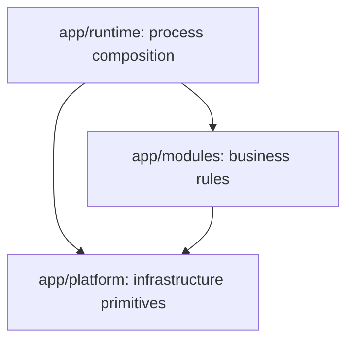

# ADR 0010: Security and Runtime Foundation

Status: Accepted

## Product and ingress

NoteVerse is a consumer product for individual users. ScoreMembership and
GuestPreview express score collaboration and preview access. They do not create
tenants, organizations, workspaces, shared storage accounts or quota hierarchies.
Each user owns one storage entitlement and usage account.

The edge gateway routes `app.<domain>/api/*` to Customer API and
`admin.<domain>/api/*` to Control Plane. Browser API access is same-origin.
Next.js owns rendering and presentation; it is not an API-proxy BFF.

Control Plane's identity blueprint is email/password, mandatory TOTP MFA and a
static role/permission mapping. OIDC and a generic cross-domain authorization
engine are outside the product scope. Customer and operator principals are
separate identities with separate authentication dependencies.

## Dependency direction

Runtime composition depends on domain modules and platform primitives. Domains
depend on platform primitives. Platform primitives depend on neither runtime nor
business modules. The arrows below express imports, not request flow:

`app/runtime/customer_api`, `control_plane`, `worker`, `beat` and `paddle_ocr`
own their settings, resource construction and process entrypoints. Alembic and
administrative commands own explicit settings compositions too. Customer and
Control Plane composition roots do not import each other. Worker and Beat do not
import either HTTP runtime. Domain code never loads runtime settings.

Settings blocks are pure validated values. Environment loading belongs to the
owning process. Required dependencies arrive through constructor/function
parameters or HTTP dependencies. Process composition roots own database/provider construction; shared modules
do not instantiate a monolithic settings singleton.

## Database ownership

Platform database factories accept an explicit database configuration and create
SQLAlchemy Engine and sessionmaker instances without reading environment state.
HTTP roots attach their sessionmaker to `app.state`; the shared request dependency
uses that exact factory. Control Plane does not resolve sessions through Customer
API. Non-HTTP roots receive independent factories directly.

Session scope and transaction ownership remain distinct. The session dependency
closes its resource and rolls back errors. Command boundaries own commit/rollback;
repositories and transaction-participant services do not commit the caller's
transaction. ObjectWriteCoordinator performs provider IO outside its write transactions.

Database URLs are process inputs. Separate least-privilege database roles and
Secret distribution are an explicit security delivery boundary; configuration
isolation alone does not prove deployed database permissions.

## Security contracts

Customer identity uses PostgreSQL-backed opaque sessions, Argon2id passwords and
Redis identity hints. Control Plane uses mandatory TOTP MFA, opaque challenges,
operator sessions, static permission policy and append-only audit. Request
admission uses Origin/Fetch Metadata and distributed fail-closed auth limits.
Browser responses use route-scoped nonce CSP; document and HTTP admission enforce
streaming resource budgets. Runtime credentials, numeric non-root containers and
network policies isolate process authority.

The authoritative contracts are:

1. [Consumer Sessions](../architecture/consumer-sessions.md).
2. [Control Plane Authentication](../architecture/control-plane-auth.md).
3. [Browser Request Security](../architecture/browser-request-security.md).
4. [Browser Security Baseline](../architecture/browser-security-baseline.md).
5. [Document Admission and Ingress Limits](../architecture/document-admission-and-ingress-limits.md).
6. [Container and Network Hardening](../architecture/runtime/container-and-network-hardening.md).

[Settings Ownership](../architecture/runtime/settings-ownership.md) and
[Database Role and Secret Ownership](../architecture/runtime/database-role-ownership.md)
define the exact process configuration and least-privilege database contracts.
Local automated checks establish these executable boundaries; cluster dataplane,
external provider and hardware acceptance require their own live evidence.

## Enforcement and acceptance

AST architecture tests inspect real imports, including relative imports. They
enforce platform/domain/runtime direction, HTTP surface isolation, Worker/Beat
isolation and the absence of monolithic configuration imports. Settings-schema
tests verify that background runtimes have no customer or operator credentials
and each HTTP runtime excludes the other surface's secrets.

Factory tests prove explicit database input, request-local session selection,
cleanup and transaction semantics. Runtime import tests require only each
process's declared environment. Existing backend, PostgreSQL, OpenAPI and image
entrypoint tests remain acceptance evidence for behavior and deployment wiring.

## Cluster network authority

Self-hosted Kubernetes runs on cloud VMs using Cilium 1.20.5 CNI, Linux kernel
>= 5.10 and a VXLAN/Geneve overlay. Application namespaces contain exclusively
CiliumNetworkPolicy (`cilium.io/v2`), explicit bidirectional default deny and
metadata-IP egress deny. External HTTPS uses exact, default-empty `toFQDNs`
allowlists with L7 DNS proxy inspection; private PostgreSQL/Redis CIDRs remain
explicit and default-empty. Runtime authority, release inputs, offline pinned
CRD schema validation and live-cluster qualification are defined in the
[container/network contract](../architecture/runtime/container-and-network-hardening.md).

## Runtime and database authority

Customer API, Control Plane, Worker and Beat are the four long-lived backend
deployments. A short-lived migrator Job owns schema changes. Each has one distinct
database role and Secret. Ordinary business tables use explicit per-runtime
table-level DML; credential-bearing tables retain column/function boundaries and
operator audit is append-only. New tables require an explicit grant decision.

Control Plane exposes durable application and scheduler metrics only through its
internal `/metrics` endpoint. Prometheus ingress is restricted to TCP 8000 by
Cilium. Gateway routing preserves `/api` and never forwards the internal scrape.
Standard database-owned `postgres_exporter` owns PostgreSQL infrastructure metrics.
