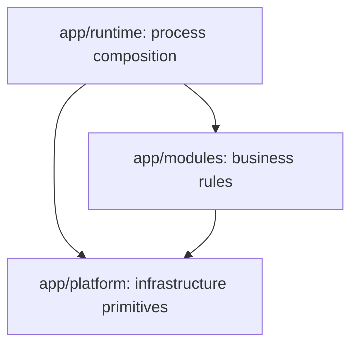

# ADR 0010: Security and Runtime Foundation

Status: Accepted

## Product and ingress

NoteVerse is a consumer product for individual users. ScoreMembership and
GuestPreview express score collaboration and preview access. They do not create
tenants, organizations, workspaces, shared storage accounts or quota hierarchies.
Each user owns one storage entitlement and usage account.

The edge gateway routes `app.<domain>/api/*` to Customer API and
`admin.<domain>/api/*` to Control Plane. Browser API access is same-origin.
Next.js owns rendering and presentation; it is not an API-proxy BFF.

Control Plane's identity blueprint is email/password, mandatory TOTP MFA and a
static role/permission mapping. OIDC and a generic cross-domain authorization
engine are outside the product scope. Customer and operator principals are
separate identities with separate authentication dependencies.

## Dependency direction

Runtime composition depends on domain modules and platform primitives. Domains
depend on platform primitives. Platform primitives depend on neither runtime nor
business modules. The arrows below express imports, not request flow:

`app/runtime/customer_api`, `control_plane`, `worker`, `beat`, `observability` and `paddle_ocr`
own their settings, resource construction and process entrypoints. Alembic and
administrative commands own explicit settings compositions too. Customer and
Control Plane composition roots do not import each other. Worker and Beat do not
import either HTTP runtime. Domain code never loads runtime settings.

Settings blocks are pure validated values. Environment loading belongs to the
owning process. Required dependencies arrive through constructor/function
parameters or HTTP dependencies. Process composition roots own database/provider construction; shared modules
do not instantiate a monolithic settings singleton.

## Database ownership

Platform database factories accept an explicit database configuration and create
SQLAlchemy Engine and sessionmaker instances without reading environment state.
HTTP roots attach their sessionmaker to `app.state`; the shared request dependency
uses that exact factory. Control Plane does not resolve sessions through Customer
API. Non-HTTP roots receive independent factories directly.

Session scope and transaction ownership remain distinct. The session dependency
closes its resource and rolls back errors. Command boundaries own commit/rollback;
repositories and transaction-participant services do not commit the caller's
transaction. ObjectWriteCoordinator performs provider IO outside its write transactions.

Database URLs are process inputs. Separate least-privilege database roles and
Secret distribution are an explicit security delivery boundary; configuration
isolation alone does not prove deployed database permissions.

## Security blueprint and implementation boundary

The security blueprint uses opaque customer/operator sessions, mandatory operator
TOTP MFA, JSON command bodies with Fetch Metadata and Origin admission, bounded
MusicXML admission and process-specific database roles/secrets. Each capability
has its own implementation and acceptance work. This decision does not claim
that those capabilities are already implemented by configuration decoupling.

Customer identity uses PostgreSQL-backed opaque sessions and Redis identity hints.
Platform security primitives own Argon2id password hashing, CSPRNG opaque tokens
and host-only cookies. Customer API owns session issuance, validation and
revocation; other runtimes have no direct session-ledger privileges. See
[Consumer Sessions](../architecture/consumer-sessions.md) for the executable
HTTP, lifecycle and cache contract. Operator identity, CSRF and MusicXML each
retain their independent domain contracts.

## Enforcement and acceptance

AST architecture tests inspect real imports, including relative imports. They
enforce platform/domain/runtime direction, HTTP surface isolation, Worker/Beat
isolation and the absence of monolithic configuration imports. Settings-schema
tests verify that background runtimes have no customer or operator credentials
and each HTTP runtime excludes the other surface's secrets.

Factory tests prove explicit database input, request-local session selection,
cleanup and transaction semantics. Runtime import tests require only each
process's declared environment. Existing backend, PostgreSQL, OpenAPI and image
entrypoint tests remain acceptance evidence for behavior and deployment wiring.
