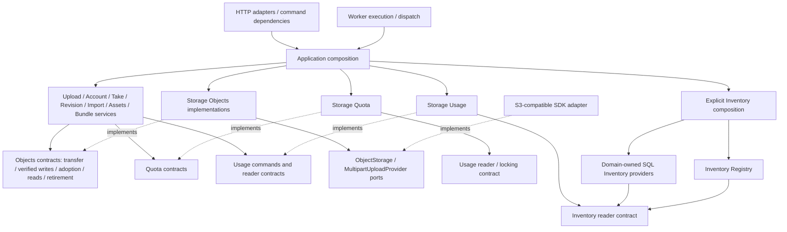
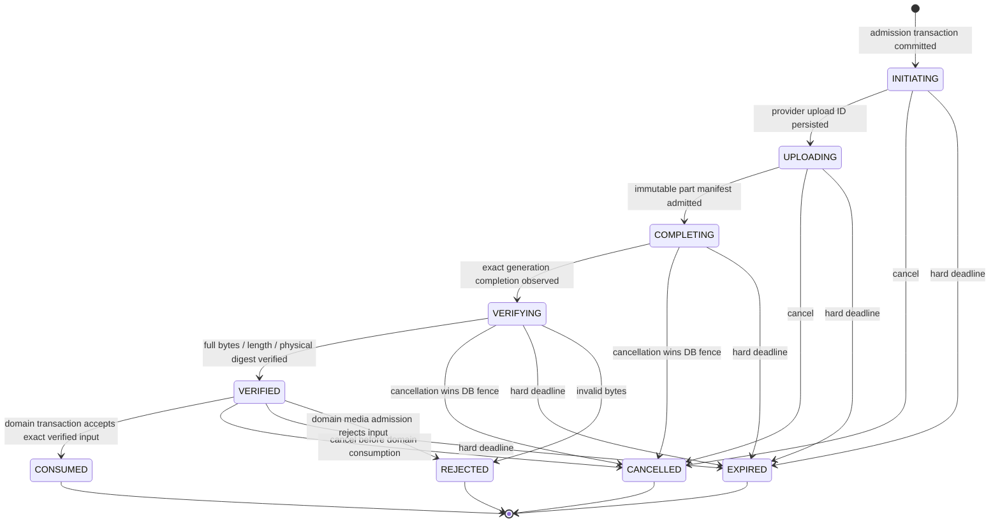
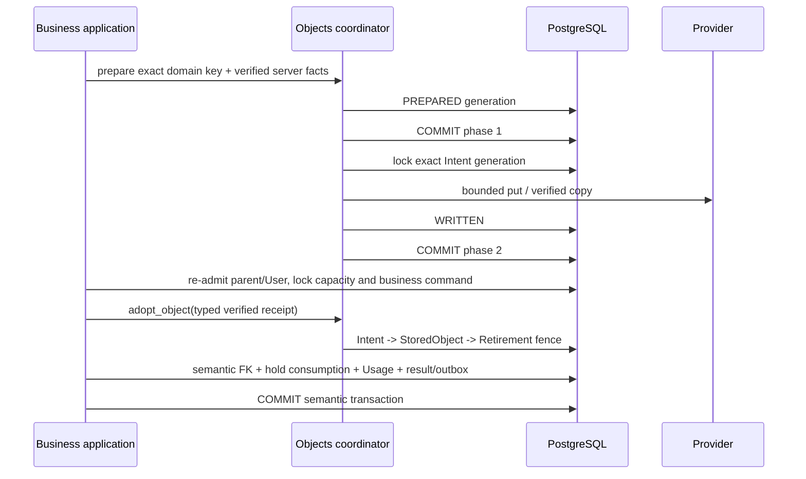

# Asset Infrastructure Re-foundation RFC

状态：**架构审查提案，尚未批准，不是当前运行时契约。**

调查基准：`refactor/practice-foundation-v2`，
`cfe83a5c845d29d83e26c3ba6f3e1fa749e9f891`，2026-11-25。
Task 0.5 复核基准：`b0870f96d92aed99236ad8e4ffabec695d68178a`，2026-11-26。
Task 0/0.1/0.2/0.3/0.4/0.5 仅调查和设计；没有创建下文的生产模型、接口、迁移或任务。
锁序、Account erasure、receipt/copy、binding 及 N1–N8 的详细审查依据见
[Architecture Gate Closure](asset-infrastructure-gates.md)；实际存储实验见
[Provider Qualification](asset-provider-qualification.md)。两份材料属于本 RFC 的审查证据，
不改变 Accepted Contracts；架构仍未取得生产实施授权。
“现状”指该提交可核实的代码；“目标”指建议由负责人审查的唯一实现；
“待验证/待决策”不得直接变为产品参数或实施授权。

## 调查证据与现状

| 路径和调用链 | 核实的当前事实 | 对本 RFC 的影响 |
| --- | --- | --- |
| [Provider port](../../backend/app/storage/base.py)、[S3 adapter](../../backend/app/storage/s3_compatible.py)、[factory](../../backend/app/storage/factory.py) | 一个部署一个私有 namespace；同步 boto3/SigV4，支持 put、copy、读/范围读、stat、delete、签名 PUT/GET；没有 multipart port | 不能把底层 SDK 具有 multipart 方法当成应用已有可靠 multipart 协议 |
| [开发 Compose](../../docker-compose.backend-dev.yml) 与本地 `backend/.env.docker` | Compose 声明 MinIO `RELEASE.2025-04-22T22-12-26Z`，实际开发凭据指向阿里云 OSS；真实请求返回 AliyunOSS | Task 0.1/0.2 实测 OSS；Task 0.3/0.4 只验证工具分类逻辑；生产 Provider 仍 UNKNOWN，不能由开发或 staging 推断 |
| [Upload router](../../backend/app/modules/uploads/router.py) → [UploadService.create_upload](../../backend/app/modules/uploads/service.py) → [repository](../../backend/app/modules/uploads/repository.py) | HTTP multipart/form-data → API 读取完整图片 → Hold/请求 generation 提交 → ObjectWriteIntent → Upload/消费/Allocation 原子提交 | 普通 Upload 不是浏览器直传会话；请求幂等和容量 lineage 已存在，应保留 |
| [图片准入](../../backend/app/modules/uploads/upload_admission.py) | 最多读取 20 MiB + 1；真实解码/验证 PNG、JPEG、BMP、GIF、WebP、TIFF，检查后缀和容器 | 20 MiB 是当前图片政策，不是通用资产大小限制 |
| [Upload](../../backend/app/db/models/upload.py)、[UploadCreationRequest](../../backend/app/db/models/upload_creation_request.py) | Upload 是语义资源；请求表唯一 `(user_id, client_request_id)`，记录 fingerprint、generation、Hold、结果；删除后结果 FK SET NULL，但 completed_at 保留 | 不能用传输会话替代业务幂等证据，或重放已经删除的结果 |
| [Avatar router](../../backend/app/modules/account/router.py) → [AvatarService](../../backend/app/modules/account/avatar_service.py) | Router 先完整读取请求，service 再校验 5 MiB 上限并规范化为 200×200 JPEG；随机不可变 key；Intent → User reference 替换 → 旧对象 Retirement | 业务大小校验不构成读入前的内存上限；原图与成品不是同一个对象；不计入 Usage/Quota，仍受物理治理 |
| [Take reservation](../../backend/app/modules/performance_takes/upload_reservation/reservation_service.py) → [finalization](../../backend/app/modules/performance_takes/finalization.py) → [final media](../../backend/app/modules/performance_takes/final_media.py) → [writer](../../backend/app/modules/performance_takes/writer.py) | Manifest/Reservation/Hold 持久化；签名 PUT staging；独立 finalize lease；完整读取 staging、复制唯一 candidate、再次完整哈希；Writer 直接调用 object_to_row | 保留业务状态机和未知 COMMIT 恢复；物理操作及最后的 row construction 应收敛到 Objects 的正式接口 |
| [Take lifecycle](../../backend/app/modules/performance_takes/upload_reservation/domain.py)、[cleanup](../../backend/app/modules/performance_takes/upload_reservation/cleanup.py)、[recovery](../../backend/app/modules/performance_takes/upload_reservation/recovery.py) | RESERVED/FINALIZING/COMPLETED/CANCELLED/EXPIRED；单独的候选清理、签名能力期限、孤儿宽限和 fresh-session recovery | 不把这些业务状态复制到 UploadSession，也不把 candidate 强塞进普通 Intent 状态机 |
| [writes](../../backend/app/modules/storage_objects/writes.py)、[Intent ORM](../../backend/app/db/models/object_write_intent.py) | PREPARED 先提交；持有精确 Intent 锁进行 put 并提交 WRITTEN；采用不 commit；key/generation/facts 都校验 | 已有正确机制应保留；不是给每个业务增加另一套写入框架 |
| [StoredObject](../../backend/app/db/models/stored_object.py)、[facts](../../backend/app/modules/storage_objects/facts.py)、[persistence](../../backend/app/modules/storage_objects/persistence.py) | 仅 id/key/byte_size/sha256/content_type/created_at；key 唯一，hash 不唯一；物理事实没有业务 owner 或 quota 字段 | 统一采用必须保留该模型；不建立万能 Asset Catalog |
| [references](../../backend/app/modules/storage_objects/references.py)、[retirement](../../backend/app/modules/storage_objects/retirement.py)、[retirement execution](../../backend/app/worker/execution/stored_object_retirement.py) | 9 条显式语义 FK 均为 RESTRICT；删除 fence 在 IO 前提交；随后重验、flush FK 保护删除、物理删除和完成；失败保留 fence | 不修改已批准的引用保护、不可逆 fence、历史快照和重试语义 |
| [Quota](../../backend/app/modules/storage_quota/service.py)、[Usage](../../backend/app/modules/storage_usage/service.py)、[Inventory](../../backend/app/modules/storage_inventory/registry.py) | User 唯一主体；有限 FREE/PLUS/PRO；Hold 与 committed bytes 独立；Inventory 聚合真实语义资源 | 会话不是 Hold、Allocation 或 Inventory；暂存物理成本不等于用户用量 |
| [RevisionWriter](../../backend/app/modules/revisions/writer.py)、[rendering](../../backend/app/modules/score_assets/score_revision_rendering.py)、[playback](../../backend/app/modules/playback/service.py) | 使用 Intent 预写；重新验证父资源/执行 lease 后采用；Revision 记 SOURCE，派生资源分别记非配额 Usage | 保留 domain key builder、父锁、生成器版本、结果准入和 outbox |
| [Import artifact recorder](../../backend/app/modules/import_jobs/pipeline/artifact_recorder.py)、[execution recorder](../../backend/app/modules/import_jobs/execution_recorder.py)、[review](../../backend/app/modules/import_jobs/review/service.py) | 临时业务 Artifact 也可引用正式 StoredObject；Review 写入/确认与普通 Upload、最终 Source 不同 | TEMP_IMPORT 不表示“可以绕过 Objects 直接删”；确认仍由 Import/Score 协作 |
| [Practice Bundle writer](../../backend/app/modules/practice/bundle/writer.py)、[retention](../../backend/app/modules/practice/bundle/retention.py) | 两个正式对象；Bundle 自己决定 CREATING/READY、复用和保留 | 不把物理存在当成 Bundle ready；不引入用户 Usage |
| [Customer Upload API](../../apps/customer-web/src/lib/api/uploads.ts) → [Import workflow](../../apps/customer-web/src/features/imports/submission/use-import-upload-workflow.ts) | 每个文件稳定 clientRequestId，串行上传，随后提交 ImportJob；无分片/恢复协议 | 迁移应保留“先 Upload 再 Import”的业务步骤和幂等性 |
| [Take save command](../../apps/customer-web/src/lib/practice/performance-take/save-command.ts) → [Take API](../../apps/customer-web/src/lib/api/performance-takes.ts) → [signed upload helper](../../apps/customer-web/src/lib/http/direct-object-upload.ts) | 显式 Save，保留本地媒体 lease；一次 fetch PUT；credentials omit；没有 part receipt、断点恢复和传输 AbortSignal | 不改变自然完成、显式保存或本地录音所有权；替换传输而非重写 Practice |

ORM 实际检查：没有 UploadSession 表；StoredObject 有上述 6 列，显式引用数为 9。
Alembic 实际 head 为 `0008_collaboration_closure`，链为 0001…0008。
[0002](../../backend/alembic/versions/0002_storage_quota.py) 分离 Quota，
[0003](../../backend/alembic/versions/0003_object_retirement_fence.py) 增加 fence，
[0004](../../backend/alembic/versions/0004_finite_storage_plans.py) 收敛有限套餐，
[0005](../../backend/alembic/versions/0005_account_resource_commands.py) 增加账户/Upload command lineage。
后续任务应在当前 head 后新增迁移，本 RFC 不改这些迁移。

已定位的边界缺口，而非推测：

- `uploads/service.py`、`revisions/service.py`、`revisions/writer.py`、
  `scores/input_asset_lifecycle.py`、`import_jobs/review/service.py`、
  `performance_takes/account_cleanup.py`、`auth/email_verification_service.py`、
  `storage_quota/router.py` 直接导入 `app.composition.storage_resources`。
- 业务服务仍接收原始 ObjectStorage 并从 factory/global 取得 Provider port；Take 自己签发 PUT、copy、delete。
- `PerformanceTakeWriter.adopt` 是普通 Intent 采用路径之外的正式 row 创建点。
  它目前有业务 lease 和媒体验证，不能描述成“没有协议”，但不满足新的唯一采用入口要求。
- 当前 `object_metadata().checksum_sha256` 来自用户 metadata `sha256`，不是服务端验证的完整文件摘要；
  Take 当前正确地重新读取完整字节，不依赖该 metadata 建立 StoredObject SHA。
- 生产 multipart、Provider capability qualification、browser resume 均尚未实现；独立工具已有部分 OSS 观察，下面设计不等于完整能力获批。
- Take 的底层 `copy` 现在固定调用单次 `copy_object`，而 Take 没有独立产品文件大小上限。
  Provider 的单次 copy 上限因此是必须核实的端到端能力缺口，不能只增加浏览器 multipart 后宣称大录音已支持。

## A. 目标依赖图



业务 services/规则/repositories **不导入 Composition Root，不接收原始 Provider，不调用 boto3**。
HTTP/Worker 外层显式组装并构造 services；构造器要求具体的窄 ports，取消 `storage or object_storage`
和 `StorageQuotaService(...)` 等隐藏默认组装。不是用全局 service locator 包装现有依赖。

Objects 不调用业务 Service、Quota 或 Usage；Quota 不导入业务 ORM；Usage 不导入 Quota 或业务 ORM；
Inventory 不执行 mutation/IO。既有 `references.py` 显式导入语义 FK 的 ORM 是经过审查的物理引用目录，
不是业务服务反向依赖；保留这一个明确例外，不借本次 RFC 搬移已批准的引用 authority。
Inventory 的具体 provider 仍只由其显式 composition 文件集中导入。

业务决定正式语义 key、权限、媒体政策、ready、何时释放。
UploadSession 自己决定其**协议暂存 key**（session UUID + generation，不带可解释业务 owner 前缀）；
这是传输自己的资源身份，不是替业务构造 key。任何 key 前缀都不能授权或推断业务归属。

## B. 目标目录与文件职责

以下为待批准的目标目录，不要求为对称性建立空文件。

```text
backend/app/
  storage/
    base.py                    # narrow provider read/write values and port
    multipart.py               # MultipartUploadProvider / physical DTOs
    s3_compatible.py            # SDK, signing, pagination, provider error normalization
    async_adapter.py           # scheduling/cancellation only
    factory.py                 # deployment namespace, instantiated by outer wiring
  modules/storage_objects/
    contracts.py               # consumer ports; no business owner discriminator
    facts.py                   # immutable physical facts
    persistence.py             # private physical row mapping
    writes.py                  # durable server-write Intent phases
    copying.py                 # exact-source/exact-target physical copy phases and verification
    adoption.py                # sole StoredObject admission implementation
    reads.py                   # admitted read targets and integrity errors
    references.py              # explicit repository-wide semantic FK authority
    retirement.py              # reference fence / durable retirement admission
    upload_sessions/
      contracts.py             # immutable transfer plans/receipts/read models
      domain.py                # pure transfer transitions and guards
      repository.py            # Session/Part/Operation SQL, never commit
      service.py               # caller-transaction session commands
      delivery.py              # phase attempt fencing, rearm, recovery
      execution.py             # one physical phase; injected Provider, no business service
      schemas.py               # authenticated HTTP session/part projections
  db/models/
    upload_session.py           # Session, verified part observations, phase operation
    object_copy_operation.py    # physical multipart-copy progress, not business completion
  composition/
    storage_resources.py       # wire Objects + Quota + Usage + Inventory
    upload_commands.py         # wire Upload, Avatar, Take collaborators
  api/dependencies/
    storage_resources.py       # HTTP adapter dependency bindings
  api/v1/upload_sessions.py    # thin authenticated transfer routes; domain creates sessions
  worker/
    dispatch/upload_session.py # existing durable producer / Celery adapter
    execution/upload_session.py# explicit phase Session boundaries and post-commit dispatch
```

Upload filename/fingerprint/result/Hold remain in `modules/uploads` and UploadCreationRequest。
Account 负责 Avatar image normalization 和 replacement command；Take 保留 Manifest、Reservation、
finalize/candidate/unknown-COMMIT orchestration。API routers 只绑定请求、依赖、调用和返回。
新增 SessionOperation 复用 DurableDeliveryLifecycle、structured failure、Beat、Ops SQL projection，
不是第二套 queue、通用 CommandBus 或万能 ResourceManager。
现有 `modules/<domain>/dependencies.py` 中的 HTTP factory 若需要调用跨域 composition，
应迁到 API adapter 层并修改全部 router imports；领域 service 仍只接收 contracts。
这是针对反向依赖的目录提案，实施须经审查，不同时保留两个 dependency factory。

## C. UploadSession 模型和完整状态机

推荐统一浏览器 ingress 为 multipart，包括小文件的一片上传；是否接受小 Avatar 的额外协议成本见 N1。
服务器生成的 Revision/Render/Audio/Avatar 成品不建立浏览器 UploadSession，继续使用 Intent。

UploadSession 是“某一代已准入的字节传输”，不是 Upload、Take、Hold、StoredObject 或用户资产目录。
没有 `owner_type/owner_id`，没有可随意绑定资源的通用 endpoint。它不保存业务状态、filename、Quota limit、
Usage counter、Score readiness，也不把 Provider upload ID 返回作应用授权身份。



- CONSUMED 仅表示业务接受该份 input；不表示 Take 已生成、Quota 已消费、原图已成为正式头像或物理清理完成。
  接受 input 的具体事务必须由其业务协议定义；见 G。Session 不能单独让业务变为 ready。
- 终态不可重启；业务允许的新一代传输使用新 Session UUID 和新 key。Upload/Avatar 顺序重试与 Take 单代规则分别见 Gate D5；不能把 transport generation 与 Take finalize physical generation 混为一谈。
  重新签发某一分片 URL 不创建 generation、不延长 hard deadline/Hold。
- complete 是一个带稳定 command identity 的请求；有序 manifest 冻结后，相同请求重放，变更请求 conflict。
- 任何阶段的 Provider/网络临时失败保留当前 phase，不自动改成业务 REJECTED。
  Operation 记录 FAILED/retryability；只有明确永久性媒体/协议拒绝才 REJECTED。
- CANCELLED/EXPIRED 立即阻止 renew、complete admission、verification publication、consume。
  已发出的 URL 和已在 Provider 执行的 IO 不因此神奇撤回；仍有独立持久化 cleanup。
- CONSUMED 的 raw staging 通常仍需清理；其 cleanup 不回写/重启业务终态。
  若物理 authority 已通过统一采用转移给 StoredObject，则只由 Retirement 清除正式对象。

SessionOperation 的 delivery status 与 Session phase 是不同事实：前者说明一次后台工作的调度/租约/失败，
后者说明传输进度。按 INITIATE、COMPLETE、VERIFY、CLEANUP 记录真实协议工作，失败原地重试，
使用现有有界尝试和 Domain rearm。不得通过 Session status 再复制一套相同的 queue status。
Operation 的命令 kind 不可变；INITIATE 成功返回的 handle 以 CREATED_BY 登记为不可变资源行；未知结果后发现的 handle 以 DISCOVERED_BY 关联真实 discovery operation，不能补造原 INITIATE 成功。result 通过明确来源 FK 引用 resource UUID；
VERIFY 的物理结果和 CLEANUP 的逐资源确认分别保有执行证据，不复制可独立修改的原始 locator。Session 只引用匹配结果 identity，不复制可独立修改的 handle 或摘要。
INITIATE/COMPLETE 的永久 Provider 配置错误停留在对应 phase 的不可自动重试失败中，
由修复配置后的 operator rearm 或业务取消/到期处理，不伪装成媒体 REJECTED。
每次 phase claim 和 publication 都核对 Session state、generation、attempt 和冻结的输入；
cleanup 不得因旧执行 lease 到期便假定那次物理调用已经停止。

## D. Multipart Upload Provider Contract

只有 Objects 的传输/物理执行实现接收该 port，业务 modules 不接收它。
实现使用不可变 DTO；异常区分 NotFound/NoSuchUpload、transient unavailable、invalid part、
precondition conflict、ambiguous outcome，不能把所有异常变成“对象不存在”。

| 能力 | 输入和返回语义 |
| --- | --- |
| `initiate_multipart` | exact private key、content type、server-controlled session/generation marker、选定 checksum policy → opaque provider upload ID；不承诺应用幂等 |
| `sign_upload_part` | key/upload ID、合法 part number、服务端推导的 offset/length、已准入 checksum、绝对截止时间 → URL/method/required headers/expiry；不返回 complete/delete 能力 |
| `list_parts` | exact upload ID + opaque pagination cursor → bounded observed number/size/ETag/available checksum + continuation；ETag 是 opaque token |
| `complete_multipart` | exact upload ID + 已冻结有序 part manifest → observed completion；必须解析 SDK/响应中的错误，不能只检查 HTTP 200 |
| `inspect_completed_upload` | exact generation key → size/type/provider observations；不是创建 StoredObject 或授予业务权限 |
| `abort_multipart` | exact upload ID → observed abort result；NoSuchUpload 不等于能证明没有完成对象 |
| `list_multipart_uploads` | exact generation namespace、bounded cursor → unadopted initiation recovery observations；逐页过滤 exact key，不扫描以重建业务所有权 |
| `copy_part` | 服务端调用：只读 source key/version或已验证不可变generation、精确range、目标MPU handle和part number → observed part token；不向浏览器签发来源访问权 |
| existing stream/copy/delete | 仅供 Objects 内部验证、Intent、临时清理和 Retirement；正式删除不能绕过 Retirement |

客户端可报告 part ETag，但 complete 必须与服务端从 Provider 取得的全部分页结果核对：
number 连续且符合已签计划，非尾片长度准确，尾片长度准确，总长度等于 expected bytes，
无缺片/重复/越界/不同 generation。Part 表只缓存经核实的 observations；客户端确认不是 Provider 事实。

Provider DTO 使用如下明确的物理含义，不承载业务 owner：

| DTO | 必需内容 |
| --- | --- |
| `MultipartUploadHandle` | exact key、opaque upload ID、服务端 generation marker；bucket 在部署适配器内，不能来自客户端 |
| `MultipartPartPlan` | 1-based part number、offset、exact expected length、可选已准入 checksum；客户端不能改 length |
| `MultipartPartObservation` | number、observed length、opaque ETag、可用 checksum 的 algorithm/value/type；缺失值不能伪造 |
| `MultipartPartTarget` | signed URL、method、required headers、absolute expires_at；只在签发响应临时返回，不持久化 URL |
| `MultipartCompletionObservation` | exact generation key、available size/type/version/checksum observations；不是 verified receipt |

分页 cursor 是 Provider 内部不透明值，不能用“返回一页parts”声称已完整验证。
如果实际 Provider 无法在签名中强制长度，不在 port 中声称它可以；服务端仍须验证全部实际长度，
并将暂存成本防护作为独立资格项。SDK 自动 retry 也要纳入 phase 的未知结果预算，
不能因 SDK 抛错就启动另一代物理写入。

### 已查证的参考约束，不是 NoteVerse 产品参数

截至调查日，AWS S3 官方 [multipart limits](https://docs.aws.amazon.com/AmazonS3/latest/userguide/qfacts.html)
列出至多 10,000 parts、非尾片 5 MiB…5 GiB、尾片无最小值，ListParts 单页至多 1,000。
这些是 AWS 文档约束，不能直接证明 Compose 固定版本 MinIO 或目标生产 Provider 满足相同限制。
尤其不要从历史记忆复制最大对象尺寸：以选定 Provider 的版本化能力和验证结果为准。

AWS [CompleteMultipartUpload](https://docs.aws.amazon.com/AmazonS3/latest/API/API_CompleteMultipartUpload.html)
说明 200 中可能包含最终错误，且条件写冲突可能要求重新 initiate；
[checksum 文档](https://docs.aws.amazon.com/AmazonS3/latest/userguide/checking-object-integrity-upload.html)
区分 full-object 与 composite。Multipart ETag、composite SHA 或自声明 metadata 都不能替代 StoredObject 的完整 SHA-256。
本提案的基线是服务端流式完整读取并计算 SHA-256；任何 checksum 优化必须另行证明同等完整性。

AWS [CopyObject](https://docs.aws.amazon.com/AmazonS3/latest/API/API_CopyObject.html)
规定单次 copy 至多 5 GB，更大的复制需要
[UploadPartCopy](https://docs.aws.amazon.com/AmazonS3/latest/API/API_UploadPartCopy.html)。
这是 AWS 参考约束，不是对当前 MinIO 版本的实测结论。目标 Objects copy 协调器必须按已验证能力
完成 single/multipart copy，两者是同一声明能力的执行算法，不是旧协议 fallback；
multipart copy 的 upload ID、parts和未知结果也需要持久化，不能把 SDK transfer utility 当作 durable protocol。
推荐在 Objects 增加窄职责 `ObjectCopyOperation`，由 `copying.py` 执行受控复制，
持久化 exact source/target、generation、provider upload ID、已核实的复制parts和既有delivery lease。
Intent write 或 Take candidate明确引用该 operation；它不保存业务owner、Hold、ready或保留策略。
它的成功只产生经过完整读取校验的 physical receipt，不能生成Take或StoredObject。
只有调用者持有的写generation/业务candidate lease允许该receipt进入统一采用入口。
放弃后仍通过该operation的持久化cleanup释放未完成MPU和未采用target；正式采用后只能走Retirement。

AWS [AbortMultipartUpload](https://docs.aws.amazon.com/AmazonS3/latest/API/API_AbortMultipartUpload.html)
说明在途 part 可能仍完成，需要重复 abort/核验；
[CreateMultipartUpload](https://docs.aws.amazon.com/AmazonS3/latest/API/API_CreateMultipartUpload.html)
说明未完成 parts 需要 complete/abort，并可配置 bucket incomplete-upload lifecycle。
数据库取消和一次 abort 都不是物理完成证明。
[CORS](https://docs.aws.amazon.com/AmazonS3/latest/userguide/cors.html) 仍与权限策略独立。

实施前必须对实际 Provider/build/bucket 验证：create/list/complete/abort 的一致性、迟到完成、
条件写支持、版本化/删除标记、checksum 含义、CORS 的 PUT/HEAD/ETag/checksum headers、
内外签名 endpoint、加密、超时、错误分类和 lifecycle。未验证不能宣称支持。

分片尺寸仅能按已验证能力计算：`part_size >= ceil(expected_bytes / max_parts)`，并满足 Provider 的
非尾片下限/上限、浏览器内存与并发预算；part 数据此推导。会话期限、URL TTL、并发数、
verification deadline、cleanup grace、最大对象尺寸均见 N，不在这里硬编码建议值。

## E. ObjectWriteIntent、采用与事务时序

### 已有 server-write 路径：保留机制，收敛接口



`adoption.py` 作为唯一正式 StoredObject 创建实现，接收两种有来源的 evidence：
Intent 的 WrittenObjectReceipt，或 Objects 验证实现产生的 VerifiedCandidateReceipt。
不提供 `adopt(key)`、`adopt(arbitrary facts)` 或接受客户端 metadata 的后门。
Receipt 是 Objects 签发的 opaque evidence identity，采用时重新锁定/读取 Objects 的持久化验证结果；
Python DTO 的构造器或私有命名不是安全边界。任意构造 facts DTO 不能写入或替代该 ledger。
Take 的业务 candidate 包装该 identity，并另行验证 Manifest/lease。
Objects 不读取 Take ORM 来判断它能否完成；调用方在同一事务下验证自己的业务 generation。

两种输入对应不同真实协议，不是新旧兼容路径。所有创建都经过同一 immutable-fact comparison、
retirement fence 和 row admission。Current `object_to_row` 变为实现细节，不能由 Take Writer 导入。
Receipt 不是业务持有者；重启后需要依据持久化 Intent/Session/业务 lease 重新验证，不能信任旧内存对象。

普通图片保持 Upload 自己的内容寻址 key。浏览器**只能写 Session 独有 staging key**，
不能签名 PUT/part 到已存在或可能共享的 canonical blob key。
验证 staging 后，通过受 Intent generation 保护的 verified-copy 写入 canonical key；
已有匹配对象走 retain fence，不覆盖。目标 copy 的长度/完整 digest 必须得到验证，不能把服务端 copy 成功视为已验证事实。
失败则保留 Intent cleanup owner，Session staging 保留自己的 cleanup owner。

### Browser ingress 与业务提交

1. HTTP 业务准入锁定有效 User/必要父资源，解析业务请求 fingerprint；同事务创建或复用业务 command、
   必需 Hold、UploadSession 和 INITIATE operation。提交后才允许 Provider initiate。
2. Worker 以旧 epoch/token CAS claim 并提交 lease，事务外执行 initiate；新事务只在 session/generation/claim 都匹配时登记原始 UploadId 资源并发布 result reference。
   然后才能签发 part URLs；未持久化 upload ID 不能返回上传能力。
3. complete 请求验证会话 ownership、截止时间和 manifest identity，事务内冻结 manifest 并登记 COMPLETE operation。
   Worker 事务外 list/complete，在新事务发布 VERIFYING；再由验证 phase 读取全量字节，核对精确长度/digest。
4. 确认 lease 和截止时间后发布 VERIFIED。业务另行检查图片/录音/规范化政策，
   采用最终对象，在同一语义事务中消费 Hold、记录 Allocation、记录业务结果和 Session 消费。
5. raw staging cleanup admission 与成功消费/取消/拒绝事务关联；后续交给 Objects 的持久化 cleanup 执行。
   外部 IO 成功不等于语义事务成功；任何未正常返回的 COMMIT 都按未知结果处理。

新签名/续签提案使用短事务 User FOR NO KEY UPDATE → Session FOR UPDATE；它与 Closure 的
User FOR NO KEY UPDATE 互斥。当前 KEY SHARE resource admission 与 Closure 兼容，不能独自保证
关闭后不再签发能力。签名准入提交后响应仍可能迟到，已签 URL 无法即时撤销。
part signing 与 complete admission 通过 Session 行锁串行化；进入 COMPLETING 后不再签新parts。
此前签出的 UploadPart 能力可能仍在途，冻结 manifest 不会撤销它们：completion 必须只引用
已核实的精确 ETag/checksum，并把 Provider 的成功完成作为该 upload ID 不再可写的边界。
过期/取消先提交不可消费状态，再登记 cleanup；cleanup 对未知 COMPLETE 同时核对 MPU 与 exact completed key。
multipart staging 只能由 complete 变为完整对象，避免“可重放单次 PUT 覆盖正在验证的 staging”。
采用前的 verified input receipt 必须绑定已关闭写能力的 generation；否则不得用一个可能被重写的 key 证明字节事实。

准备/写入 coordinator 可以拥有明确的外部 IO phase commit；repository、采用 participant 不 commit。
HTTP pure-DB admission 使用现有 `get_command_db`；Worker 为每个 phase 明确开/关 Session。
不得在业务锁/容量锁下等待浏览器、hash 大录音或 Provider complete。
**保留**现有 Intent put、cleanup 和 Retirement 的狭窄 destructive IO fence；
不能为了“无 IO 持锁”口号删除已验证的写/删保护，也不能用它们覆盖整个浏览器传输期。

## F. Retirement 和失败恢复

正式对象仍遵循：业务语义释放 + Usage Release + flush 引用解除 + Retirement admission，同一 caller-owned 事务。
删除只由现有 Retirement Worker 执行：

1. claim attempt 并提交；按 StoredObject → Retirement 加锁。
2. 检查 snapshot、attempt 和全部 9 条语义引用。无 fence 时可因新引用 CANCELLED。
3. 无引用后先提交不可逆 deletion_fenced_at；重新获取并核实相同 authority。
4. flush 删除 StoredObject，让 RESTRICT FK 成为最后屏障；再物理删除并提交完成。
5. 物理缺失可幂等重试；缺少数据库物理 authority、snapshot 冲突或 fenced object 出现引用均 fail closed。
   提交未知不能清 fence、恢复复用、伪造 COMPLETED。快照/重试证据在 FK SET NULL 后仍保留。

UploadSession cleanup 仅处理自己的未采用暂存物和未完成 MPU，绝不根据“某用户删除”批量删 key。
若 exact key 已有正式 StoredObject，不能直接 delete；正式物理 authority 已移交就交给 Retirement。
Take 决定何时放弃 staging/candidate，Objects 执行受其 generation/release evidence 约束的临时删除。
CONSUMED 本身不自动安排 raw staging 删除：Upload/Avatar 成功命令可同事务显式释放 input；
Take 接受 input 后仍保留 staging，直到其完成/取消/过期规则允许释放，再调用 Objects 的
`release_upload_input(session_id, generation)`。该入口只记录原子释放事实并安排cleanup，不更改Take或Hold。
Session 的 `input_released_at` 是唯一释放事实，Operation 的 completion 是物理清理确认；
不在Reservation中复制同一事实，也不让Objects回调业务Service来猜测保留策略。
不得用 local refcount 替代全局 registry；fenced object 有引用仍为 integrity failure，不增加 waiting 状态。

initiate/copy/complete 的迟到结果必须仍有持久化 generation owner；
`cleanup_not_before` 只能表达何时允许检查，不证明 IO 已停止。未知 initiate 的返回 ID 未落库时，
按专有 generation key 查询并记录全部 orphan IDs，反复 abort/核验；禁止盲目再次 initiate 同一代。
如果某 Provider 无法提供足够的在途结果边界，不能宣称一次缺失观察已经 CLEANUP 完成；
需保留可重扫证据、部署 incomplete-MPU lifecycle 并在 N3/N4 解决资格问题。
Provider 扫描仅定位已准入的传输孤儿，不生成业务 ownership 或 Usage。

## G. 业务接入方案

| 业务 | 准入/传输 | 正式对象、完成与清理 |
| --- | --- | --- |
| Upload → Import | UploadCreationRequest 保留业务 fingerprint/filename/结果幂等；generation 链接 Session 和 UPLOAD Hold | 图片验证后 Intent copy 至 Upload-owned canonical key；采用 + Upload + Hold consume + UPLOAD Allocation 原子提交；CONSUMED 后清理 raw staging；ImportJob 才引用 Upload |
| Avatar | Account 提交自己的稳定 replacement command，并链接 Session；不创建 Hold/Usage | VERIFIED 原图只供规范化；输出 JPEG 走 Intent/统一采用。User 引用替换、旧 avatar Retirement、命令完成与 input 消费原子提交；原图独立 cleanup，不成为正式 avatar。重放旧命令不得覆盖后来的头像 |
| Performance Take | 仍先验证 Bundle/Manifest、创建 Take Reservation 和 UPLOAD Hold；Reservation 显式链接 Session | Session 只完成 staging 传输。建议在 Reservation 接受 VERIFIED staging 时将 Session CONSUMED 并移交业务保留权；这不消费 Hold。Finalize 保留唯一 candidate/lease/完整媒体校验；最终采用、Take、Reservation completion、Hold consume、Allocation 同事务。候选、取消、过期和未知 COMMIT 仍由 Take 决定 |
| Revision / Restore | 不走浏览器通用二进制上传来替代 canonical MusicXML 编辑命令 | 保留 Source policy、父锁、预写 Intent、expected-head/no-op、SOURCE Hold 和 post-commit outbox |
| Render / Playback | 不建立浏览器 Session | 保留 worker attempt/fingerprint/profile、Intent 和 DERIVED_RENDER/DERIVED_AUDIO Usage；替换/retention 释放并 Retirement |
| Import Artifact / Review | 不把 pipeline artifact 变成 Upload | 保留 job-owned keys、attempt admission、TEMP_IMPORT Allocation/Release 和正式引用；确认交由 Score/Revision/InputAsset lifecycle |
| Practice Bundle | 无用户 Hold/Usage | 保留内容复用、CREATING/READY、双对象采用和 domain retention |

Take 的 staging/candidate 仍不是 ObjectWriteIntent 对象。通过窄 physical verification/copy/release ports
替换 raw Provider 调用；不替换它的业务状态机。Reservation 仍拥有 quota_hold_id、Manifest 和候选 generation。
Session 掌握签名能力期限和物理传输事实；Take 掌握何时还需要 input/candidate。
不继续在两处写同一个 `last_put_url_expires_at` 或同一项 physical cleanup acknowledgment。
具体字段替换要与领域 transition/effects/persistence 原子修改，不能让 staging key 成为双 authority。

Account Closure 后拒绝新的能力准入；已签 part URL 是外部短期能力，不能承诺立即撤销。
提案在现有 UPLOADS 与 FINALIZE 之间加入 TRANSFERS phase，处理三类业务传输和 Avatar 未完成命令，
不把外部 IO 收尾塞进最终 User 删除事务。先按业务规则释放 Take/input，保留未知 initiate/copy/complete
责任；TAKES 仅完成语义取消/删除与 input/candidate release，不等待物理 ACK。
TRANSFERS 取得 Objects 唯一 ACK 后，同一事务删除 parts、binding、Session；保留 Request/Reservation/Manifest 到
FINALIZE 有界擦除，Avatar 终结命令可在 TRANSFERS 解绑定后擦除。User RESTRICT 防止提前消失。
不能沿用当前混合语义与物理条件的 account_take_cleanup_pending 作为目标 TAKES guard。
最小 Operation 快照在 Session 删除后继续存在，保留期限待决策；不等待正式 StoredObject Retirement。
详细阶段完成条件和锁序以 [Gate B](asset-infrastructure-gates.md) 为准。

## H. Quota / Usage / Inventory 边界

- 保留 User 为唯一容量主体；FREE/PLUS/PRO 的有限 policy、降级不撤销已有有效 Hold 的规则不变。
  缺失 entitlement/usage authority 仍 fail closed；不新增无限模式、个人 override 或付费入口。
- Hold 只由计入配额的业务正向分配创建，类别仍为 SOURCE/UPLOAD/INPUT_ASSET。
  同时传输多少 parts 不产生多少 Hold；Session 无自己的 reserve/consume 账本。
- Session expected size 与业务 Hold 大小必须一致。大小改变是新的业务 generation/准入，不能原地放大 Hold。
  传输/验证超时不能暗中延长业务 Hold；已过期 Hold 即使对象上传完成也不能消费。
- Usage 只在语义业务资源创建/删除事务中记账；Avatar、Bundle、staging、MPU parts、candidate 不新增类别。
  不因为“物理复制两份”重复计费，也不因为“物理共享一份”免除语义 multiplicity。
- 保留 Upload 首次 promotion 的 UPLOAD → INPUT_ASSET 同用户净零转换，以及后续语义 input 的独立分配；
  Session 不介入 [ScoreInputAssetLifecycle](../../backend/app/modules/scores/input_asset_lifecycle.py) 的授权/重新分类。
- Inventory 仍从领域 SQL 聚合得出 committed semantic usage，不计 Session/Provider listing。
  Reconciliation 锁 UsageAccount 后读 Inventory；不重建 Hold，不绕过业务修复 ownership，不删除物理对象。
- 预留 expected bytes 不自动限制恶意浏览器实际暂存成本。签名长度约束、part plan、请求速率和临时成本预算
  必须在 Provider/产品资格验证中单独解决，不把用户 Quota 宣称为云成本防护。

## I. 并发、幂等与未知结果矩阵

### 锁顺序

现状是条件偏序，不能将 Counter、Account 和 Hold 合并为一个 Usage lock。
完整实际函数、SQL、事务边界、IO 与逆序分析见 [Gate A](asset-infrastructure-gates.md)。
参与 Usage 的目标语义提交建议在 Objects 前取得 Account；不是要求所有 Outbox INSERT 都位于最后。
多父/多 User 按稳定 ID 排序。以下只表达适用时的主干顺序：

```text
business parents -> active User admission
-> UserStorageEntitlement -> StorageUsageAccount
-> business command / Take Reservation -> StorageQuotaHold
-> UploadSession (consume only; no Provider IO)
-> ObjectWriteIntent -> StoredObject -> StoredObjectRetirement
-> StorageUsageCounter
```

Hold API 内部按 entitlement/account → hold 获取锁。现有计数 mutation 均先锁 Account 再锁 Counter；
部分释放流程在 Objects 前改 Counter，采用流程在 Objects 后改 Counter，同 User 已由 Account 串行化。
纯 Objects 路径不会在持有 Object 后首次反向取得容量锁。Take 的新 Object INSERT 在 Hold 消费前，
但它此前已经持有 Entitlement/Account。不能因此声称存在 O→首次 Account 的逆序，也不能将这种
条件证明扩展为尚不存在的 Session 全系统无死锁证明。新增 PG 证据及覆盖边界见 Gate A。
传输 worker 仅锁 Session/Operation 的短 DB phase，不在其锁下获取业务父资源/容量锁。
清理先提交不可消费的语义 fence，再 IO，再以匹配 attempt 发布观察；不能反向锁 User/Score。
Account 最终擦除保留既有 exclusive User + nonblocking capacity/email busy 规则，不能倒序阻塞等会话 worker。
Retirement 不获取 Intent 锁。

| 交错/故障 | 持久化证据与必须满足的结果 | 验收方法 |
| --- | --- | --- |
| 相同业务命令并发创建 | 同 user/request 唯一 business command；一代一个 Session/Hold，冲突 fingerprint 不创建第二结果 | 两个 PG connection 同时准入 |
| INITIATE DB commit 未知 | fresh Session 查 command/session/operation；没有确证前不返回 URL、不重复创建这一代 | COMMIT 前失败/已提交但 ACK 丢失两组 |
| Provider initiate 响应丢失 | generation key/operation 保留；枚举 exact key 的 orphan upload IDs；不假设 provider幂等；新 generation 必须有明确放弃/恢复决策 | 真 Provider + 延迟响应/进程退出 |
| Part 重试/同号覆盖 | 不重复加 Usage；使用最终 observed part token/size/checksum，冻结后不同 manifest conflict | 同 part 不同 bytes、超过一页 ListParts |
| Complete HTTP 200 含错误/ACK 丢失 | 完整解析错误；fresh DB phase + exact physical key 重验；NoSuchUpload 同时检查 completed object；不立即删可能成功对象 | Provider contract fault injection |
| Complete 与 cancel/expiry | 只有当前 attempt 可发布 VERIFIED；取消先赢则不能消费，迟到对象仍由 cleanup 负责 | PG + 在途 provider call barrier |
| 验证/媒体拒绝 | 无正式业务结果/Allocation，业务释放 Hold；原始 staging 与可能的 Intent 各有 cleanup owner | 存储成功、媒体失败与 DB rollback |
| 消费/语义提交未知 | fresh Session 查询业务 command/result、Session、Hold、adoption lineage 的原子组合；不依赖 rollback/identity map 或异常类型 | 已提交/未提交/取消/断连矩阵 |
| 旧 operation lease 迟到 | 旧 token 不能发布状态/消耗 input/清新 generation；exact-key orphan 仍可诊断 | lease takeover + late IO result |
| 两用户使用相同图片 | 业务仍各自 Allocation；Upload canonical reuse 必须经过 Objects retain fence，无跨 domain 自动去重 | 两 User + 共享物理 FK |
| 已完成后业务删除再重放 | command 保留已完成/删除 lineage，返回 unavailable，不重新上传/分配/创建业务对象 | 当前 Upload/Take replay 测试扩展 |
| adopt 与 Retirement | 一个安全赢家；fence 后拒绝 retain，不能覆盖旧 key 使迟到删除误删新对象 | 保留真实 row-lock tests |
| Account closure/finalization | 不再签名/最终准入；预准入 writer 由父/User fence 串行化；临时清理可由现有 executor 协调 | 关闭与 complete/consume/cleanup 并发 |
| Cleanup 已观察缺失但 IO 仍在途 | 缺失不是永久不存在证明；不能无证据删掉最后的 retry lineage | 超过业务 lease/grace 的真实迟到写测试 |

业务 DTO 的结果存在、Session CONSUMED、Hold CONSUMED、Usage allocation 必须形成对应协议规定的原子组合。
Take 的“接受 staging”和“生成 Take”是两个不同事务，前者不能消费 Hold；不得套用普通 Upload 的完成组合。
不使用在丢失 ACK 后“补一遍 Allocation”来修复不确定结果。

## J. 目标数据库设计

下面是约束设计，不是本次实际 DDL。BIGINT PK、UTC TIMESTAMPTZ、UUID/string 映射和 enum策略遵循仓库规范。

| 表 | 主要字段/关系 | 约束与索引 |
| --- | --- | --- |
| `upload_sessions` | id、session_uuid、user_id FK users RESTRICT、generation、admission_fingerprint、expected_bytes、admitted_content_type、optional expected_sha256、opaque staging_key、initiate_operation_id、verification_operation_id、cleanup_operation_uuid、resources_closed、capability_policy_version、part_size/part_count、state、hard_deadline_at、last_capability_expires_at、completion_fingerprint、provider_completed_at、consumed_at、terminal_at、input_released_at、created/updated | UUID/key 唯一；bytes/generation/part size/count 正整数；SHA 格式；结果 identity/manifest/终态 tuple CHECK；结果通过 session/generation/kind 复合 FK 和锁定 ledger 核验，不以跨表 CHECK 冒充完整性；cleanup UUID 一次绑定，resources_closed 是不可逆的完整登记声明；deadline 必须在创建后；能力期限不能超过 hard deadline；input仅可在CONSUMED或取消/过期/拒绝终态释放，CONSUMED需显式业务释放命令；user/state/created 与 state/deadline/id 索引；不加 StoredObject FK以免把传输证据变成第十条语义引用 |
| `upload_session_parts` | session_id FK RESTRICT、part_number、expected_length、admitted_checksum、observed size/ETag/checksum、observed_at | 唯一(session_id,part_number)，number/length 正值；传输计划不可变；跨行总量由锁定 Session 的服务核验，不能声称单行 CHECK 已保证全 manifest |
| `upload_session_operations` | operation_uuid、session_id FK SET NULL、session_uuid_snapshot、generation、不可变 kind INITIATE/COMPLETE/VERIFY/CLEANUP，独立 DISCOVER、物理 resource UUID references、cleanup_not_before、既有 delivery timestamps/current claim_epoch/attempt token/count/due、published epoch/attempt token、operation_result、settlement_status、structured failure facts | 主协议 phase 唯一(session_uuid_snapshot,generation,kind)，避免FK置空后唯一性丢失；独立 discovery 使用稳定 operation UUID；INSERT 必须在 Session NO KEY UPDATE 下匹配 id/UUID/gen/open fence；Session 当前可发布命令由明确 operation identity/attempt 条件更新决定；取消后 cleanup 可与旧未知结果的历史证据共存，不以“所有非终态 operation 唯一”阻止清理；snapshot identity在Session删除后仍可诊断；精确 UUID/generation/kind/单调 claim epoch/current-vs-published token/result/settlement CHECK；旧状态 CAS + immutable claim journal + token UNIQUE；只有 Coordinator 可 claim/assignment，Worker 无 ledger SELECT/表写权限，通过 exact assigned claim 的受控函数发布；identity/result 不可 retarget；status/due/id 索引；snapshot 不是业务 ownership |
| `upload_session_physical_resources` | resource_uuid、Session UUID/gen、expected cleanup operation UUID、source_operation_uuid、provenance_kind、observation UUID/method、resource_kind、原始 exact object_key / provider_upload_id / physical_generation / version_id、locator_fingerprint | 明确资源子行；CREATED_BY/DISCOVERED_BY 与 CLEANUP_TARGET 是不同关系，来源/目标须匹配同一 Session generation；登记先锁 Session NO KEY UPDATE 再验证来源 Operation，与集合关闭冲突；同 key 多 MPU 是不同原始 UploadId；locator/来源/observation 不可 retarget；MPU UploadId 非空、version 为空；对象无 UploadId，version 可空；raw locator 内部受保护，fingerprint 只作安全日志 |
| `upload_session_resource_settlements` | resource UUID、cleanup UUID、claim epoch/token、执行 locator snapshots、result/settlement | 当前 claim 与原始 locator 逐项匹配；每资源每 claim 一结果，immutable；root CLEANED 只在完整已关闭资源集均正确 settled 且无未知 operation 时发布 |
| `upload_session_operation_claims` | operation UUID、claim_epoch、token、previous epoch/token | 唯一 token / operation epoch，前驱 FK，immutable；CAS function 固定 search_path/权限，只从匹配旧状态推进，不允许 token 回退或重用 |
| `upload_creation_requests` | 保留 user/request/fingerprint/generation/Hold/结果和完成时间；不增加独立可修改 Session FK | 通过下述 concrete binding 查询每代 Session；新 generation 不 retarget 旧 binding，旧 Session 保留 cleanup evidence |
| `performance_take_upload_reservations` | 保留 Manifest、client id、quota_hold_id、业务 status/finalize candidate/lease 和 orphan lineage；通过 concrete binding 关联 Session；增加 finalizing_copy_operation_id FK RESTRICT；orphan candidate保留对应copy operation identity | 移除被 Session 替代的 raw PUT/staging locator/URL期限物理事实；copy operation完成不是Take完成；业务 retention条件与物理 ack分别通过 contract取得，禁止同一事实双写；Manifest/owner复合FK和quota_hold_id唯一性保持 |
| `avatar_change_requests` | Account-owned replacement idempotency：user_id、client_request_id、request_fingerprint、normalized Intent identity、applied_at、result identity snapshot | 唯一(user_id,client_request_id)；重复完成不再次覆盖当前头像；不把旧头像 FK当作保留引用，不记录 Signed URL；未采用input由Session清理 |
| `upload_session_bindings` | session_id PK、user_id、command_generation；三个具体 nullable FK：upload_creation_request_id / avatar_change_request_id / take_reservation_id | CHECK num_nonnulls(三 FK)=1；Session 和各 command 的 (id,user_id) 复合 FK 均 RESTRICT；各 command/generation UNIQUE；Session PK 保证跨表全局 at-most-one；BEFORE UPDATE identity trigger 禁止 retarget；deferred constraint triggers 保证每个已提交 Session 有 binding，且 unlink 必须同事务删除 Session；删除前核对 terminal 与精确 UUID/generation/CLEANUP/current published attempt 的 SETTLED result；相关 physical operations 不得有未解决项；不使用 Boolean ACK |
| `object_copy_operations` | copy_uuid、source key/可用version及已验证size/SHA、target key、write_generation、provider upload ID、physical phase INITIATE/COPY_PARTS/COMPLETE/VERIFY/CLEANUP、持久化有序part observations、verified target facts、released_at、cleanup acknowledgment、现有delivery/structured failure字段 | copy_uuid唯一；同target同时至多一个未释放physical generation（partial unique）；exact facts不可变，part observation有明确typed codec及上限；status/due/id索引；无User/Score业务owner；terminal/failure tuple沿用既有约束；不得在未解决迟到IO前释放该generation |

Intent-driven copy在ObjectWriteIntent中增加明确的copy_operation_id FK RESTRICT；
Take的current/orphan candidate分别保留copy operation identity，不能仅保留一个key然后丢弃MPU责任。
`ObjectCopyOperation`无任何Storage Usage/Quota职责；objects adoption在调用方事务中确认copy receipt的
physical generation和对应的Intent/Take lease。ObjectCopyOperation不获取业务parent锁，
发布physical结果前只核对自己的attempt；调用方负责最终业务准入。
其payload不是无界原始objects数组：parts是有界provider observations，
格式和查询预算由已验证max_parts确定。是否改为独立part子表由持久化规模测试决定，不暴露松散Any契约。

Binding 的完整结构与 PostgreSQL 原型证据见 [Gate D](asset-infrastructure-gates.md)。
Task 0.5 SQL 原型进一步验证登记/关闭互斥、Operation INSERT 身份、来源关联和 Coordinator/Worker 权限；保留 Task 0.4 locator/claim/generation 证明。
Binding UNIQUE 只约束活跃行；旧 command generation 在 binding 删除后仍须由 domain 终态 lineage 拒绝重放。
原型通过具体 FK 的各自 generation 表证明该约束，不要求机械复制为生产表，不引入通用 owner/生命周期模型。
历史 parent command 正式擦除后的 API 身份不重用和保留政策仍需 domain/Owner 决策，不能宣称 UNIQUE 无限保存历史。
Session UUID 由服务端产生，外部 API 不允许绑定已有 Session；数据库 FK arc 同时阻止跨域竞争和跨用户移交。
业务完成从自己的 concrete binding 解析 Session，并锁定 VERIFIED→CONSUMED；不由客户端选择 input owner。
Quota ownership/category/bytes 仍由业务在容量锁下校验。
SessionOperation 的 INITIATE/VERIFY/CLEANUP 结果是唯一物理执行证据；current attempt token/epoch 是当前 fencing identity，不是独立的 Lease Authorization，
published attempt token 是成功结果的不可变执行快照。旧 claim CAS 必须更新零行；
精确 CLEANUP SETTLED 还必须引用原始资源 locator 的逐项 ACK；Session.resources_closed 是可信协调器的完整登记声明。
它们不代表数据库自行验证了 Provider 内部迟到 IO 已终结。Objects Service 必须保留并核实所有未知副作用，
不能仅靠轮换 token 清除 UNKNOWN。Session 只存匹配的结果 identity；
parts 保存可追溯观测，不能替代最终全量验证。自动 retry 复用 DurableFailure，禁止记录 Signed URL、secret 或原始异常正文到 Ops。

### Registration、来源与授权的审查边界

参见 [Gate D6–D8](asset-infrastructure-gates.md) 的锁序、结果矩阵和权限证明。
Registration 在 Session FOR NO KEY UPDATE 下重验 open/UUID/gen，Closure 的非键 UPDATE 取得冲突锁；
登记先提交的资源必须被后续 Closure 看见并获得逐项 ACK，关闭先提交则迟到登记拒绝。
隔离 SQL 原型要求 READ COMMITTED，登记和首次关闭在更高的固定快照隔离级别下 fail closed；不能只凭行锁推导任意隔离级别的可见性。
Root publication 与 Binding release 都只能处理已封闭且完整结算的已登记集合。
此线性化不意味着数据库发现了所有外部资源；未知 initiate/copy 的完整 discovery 与迟到 IO 终结仍未证明。

资源的首次来源为明确不可变 FK，记录 CREATED_BY 或 DISCOVERED_BY、observation UUID/method，
而 cleanup FK 显式表示 CLEANUP_TARGET。INITIATE/COMPLETE/COPY 成功不能缺少对应资源引用，
DISCOVER 的非空/空结果与 VERIFY 的只读结果分开；未知原操作仍保持 UNKNOWN，发现资源不自动解除它。
SQL 原型用 COPY kind 代表 copy 的物理来源；它不新增或复制生产 ObjectCopyOperation 状态机。
将该来源契约映射到真实 ObjectCopyOperation 的具体 FK/receipt 接口仍属 N7 审查项，不能据原型提前实施。
observation UUID 是可信执行器的证据标识，不是数据库自行验证 Provider 结果的办法。

Schema Owner 在原型中模拟可信 Objects registrar；生产普通 Worker 不使用该权限。
Coordinator 只获必要 claim 列读取和 claim/assignment 函数权限，Provider Worker 无任意 ledger 读取/写入权限。
Worker 只能用已分配的 operation UUID/epoch/token 和 locator 调用固定 search_path、PUBLIC EXECUTE 已撤销的发布函数。
函数检查调用 principal 的分配事实、当前 CAS 身份及结果约束，旧 claim 不可发布；SETTLED 不可重新 claim。
Coordinator 是否有权接管真实 lease、Worker principal/dispatch 如何认证和签发仍为 UNRESOLVED。
角色权限、单调 epoch、不可变 token history 不能冒充 lease clock/合法 Holder 验证，也不停止 Provider 内部旧请求。

Account 擦除的 TAKES 只提交 semantic release；TRANSFERS 确认 Session/Copy 临时责任关闭后，
在同一有界事务先删除 parts、binding、Session，再允许 FINALIZE 擦除 Request/Reservation/Manifest；
不使用 User CASCADE 静默删除尚有物理责任的会话。Operation 的独立最小快照和其保留期限须按 N5 审批。
终态、计数、约束的完整 SQLModel/Alembic实现必须在后续任务一起提交并验证。

Session CHECK 的最低完整状态组合如下；取消/过期必须保留已有physical lineage，不能为满足CHECK擦掉证据：

| Session state | 数据约束 |
| --- | --- |
| INITIATING | initiate result identity、completion fingerprint、verification identity、consumed_at 均为空；未终结 |
| UPLOADING | 匹配 INITIATE 成功结果非空；manifest/verification/consumed_at 为空；未终结 |
| COMPLETING / VERIFYING | INITIATE 结果和冻结 manifest 非空；verification identity/consumed_at 为空；VERIFYING 需已观察 completed object |
| VERIFIED | matching VERIFY result identity 非空；读取 ledger 证明 exact generation、size/SHA/type，size 等于 expected_bytes；无 consumed_at/terminal_at |
| CONSUMED | 保留 verification identity；consumed_at 和 terminal_at 非空且一致 |
| CANCELLED / EXPIRED / REJECTED | terminal_at 非空，consumed_at 为空；不清除已有结果 identity/manifest；EXPIRED 不早于 hard deadline |

Session 单行 CHECK 只保证本行组合；跨表结果必须通过匹配 Session/generation/kind 的明确 FK 和结果状态检查保证，
不能用 SQL CHECK 查询其他表。Operation kind 不可变；成功 publication 在同一事务推进 Session 并登记下一命令。
CLEANUP 只确认已释放 input 的物理结果，不改写业务终态。FAILED/过期 lease 不释放尚未解决的 physical generation。

### 迁移约束

后续新增 forward migration，不能修改 0001…0008 或 runtime create_all。
现有 Upload/Take 和 Hold/Intent lineage 不得丢弃。已有待处理 single-PUT reservation 不能凭 key
伪造 provider multipart upload ID；在切换前必须明确 drain/cancel 并确认清理，无法判断则迁移拒绝并报告内部标识。
已完成历史行没有传输会话是自然的历史事实，可以只对新的/未完成准入要求非空 binding，
但不能据此保留旧上传 endpoint/运行时 fallback。是否采用可保数据升级还是显式获批的空开发库重建，见 N6。
不可重建的回滚、仍活跃的 multipart或新 durable state 应阻止 downgrade，不得静默丢弃。
必须验证 fresh upgrade、已填数据升级、fail-closed preflight、downgrade拒绝、可逆空库往返和严格 Schema parity。

## K. API 与 Customer Web 改造

建议路由是 review proposal，操作名最终由 API review 确认；不在本次生成 OpenAPI。

| 边界 | 请求/响应设计 |
| --- | --- |
| Domain admission | 普通 Upload command、Avatar replacement command、Take reserve 分别接收业务 client_request_id 和元数据，返回业务 command identity + authenticated upload_session_id；不提供可选 owner_type 的万能创建 API |
| `GET /upload-sessions/{session_id}` | 当前 User 有权访问的阶段/到期/已验 part 信息，分页/有界；不返回 bucket、key、provider upload ID、内部 failure detail；不是公开 bearer endpoint |
| `POST /upload-sessions/{session_id}/parts/authorize` | 有界 part numbers/checksums；服务端核对计划，返回短期 part targets、headers、expiry；禁止用户传 key/upload ID/任意 URL |
| `POST /upload-sessions/{session_id}/complete` | 稳定 command key + ordered manifest fingerprint；202 表示已受理物理完成/验证，不能当作 Upload/Take创建成功；重放相同请求返回同阶段 |
| `DELETE /upload-sessions/{session_id}` | 幂等申请取消未消费的传输；业务 command cancellation 负责对应 Hold/state，不能靠generic DELETE暗改Take；CONSUMED不撤销业务结果 |
| Domain completion | Upload completion、Avatar apply、Take finalize 各自校验业务资格与结果；返回各自现有产品资源/语义，不返回 StoredObject raw key 或把Session UUID当资源ID |

HTTP成功表示事务已提交；202 后可对传输状态有界退避查询，这是上传进度，不是 Account deletion进度。
client主权仍受 authentication principal boundary；不能把 Session cache 标为 principal-independent。
取消 browser fetch 不等于后台/Provider取消；必须调用相应 Domain cancellation，失败由持久化 expiry/cleanup收敛。

Customer 目标代码归属：新增 `features/uploads` 管 Upload API/command/transport view，
`lib/http/multipart-object-upload.ts` 只做签名 part byte IO、AbortSignal、bounded concurrency、ETag读取。
它不读 AuthContext、不带 Session Cookie/Authorization、不解析 Customer API error body。
API 调用仍使用 generated SDK + customerTransport；传输控制器通过窄的 typed plan组织 Blob.slice和重试，
不把所有文件读入一个 ArrayBuffer，也不手写第二套 API DTO。

Import 保留每文件稳定 clientRequestId与已完成 upload_id，上传成功后才提交 ImportJob；
Take Save 保留同一录音媒体 lease和显式保存，先匹配 Manifest，再传输/绑定 staging，再 finalize；
Avatar 仅显示自己的验证/替换结果。断网刷新先读server progress，不从本地进度推断完成；
若 Blob 已不可恢复，提示重新选择并走明确取消/新请求，不伪造原文件。
不得持久化 Signed URL、Provider credentials 或把媒体自动保存策略改掉。
成功/取消造成的 StorageUsage stale 仍经现有 semantic cache consequence，不能 broad clear QueryClient。

删除旧 multipart/form-data create 和原始 direct PUT client路径时，同批迁移真实调用方/测试/SDK；
不保留 alias、自动回落到旧 PUT、re-export facade、双读或 dual write。

## L. 测试与验收策略

当前证据来自源码和模型调查，并不声称新协议已有测试或本批已执行运行时完整 suite。
已有 [Upload command tests](../../backend/tests/test_upload_creation_commands.py)、
[Intent PG tests](../../backend/tests/test_object_write_postgres.py)、
[generation tests](../../backend/tests/test_object_write_generation_postgres.py)、
[Retirement PG tests](../../backend/tests/test_stored_object_retirement_postgres.py)、
[Take unknown-COMMIT tests](../../backend/tests/test_performance_take_unknown_commit_postgres.py)、
[Quota PG tests](../../backend/tests/test_storage_quota_postgres.py)、
[Inventory PG tests](../../backend/tests/test_storage_inventory_postgres.py) 是需要保留的回归基线。
现有 [ObjectStorage contract](../../backend/tests/test_object_storage_contract.py) 明确区分 SDK fake和真实外部服务，不能把 fake 当实测。

| 层次 | 后续必须实际执行的验收 |
| --- | --- |
| Pure rules | Session 全 transition矩阵、终态拒绝、deadline边界、part计划整数与总量、manifest fingerprint、媒体政策分离 |
| PG / ORM | binding唯一性和owner复合FK；并发同command、续签/complete/cancel/expiry/consume；lease takeover；Session/User erasure；无锁序反转 |
| Atomicity | 业务结果+采用+Hold消费+Usage一起commit/rollback；Avatar原图与输出不同；Take staging接受不提前扣Usage；旧完成结果删除重放不重建 |
| Provider资格 | 实际部署版本；多页parts、最后小片、同号覆盖、checksum缺失/错误、CORS/签名域、conditional conflict、200嵌入error、complete/abort在途、unknown initiate和迟到copy |
| Recovery | 每个DB commit前失败及已提交ACK丢失；Provider成功后DB失败；worker crash；取消 await；过期lease/URL；cleanup观察后迟到IO；重试耗尽与Ops rearm |
| Existing domains | Upload/InputAsset reclassification、Revision no-op/restore、Import确认/删除、Render/Audio替换、Take完成/删除/候选、Avatar替换、Bundle复用；共享对象及精确记账不变 |
| Architecture | AST递归解析普通/相对/动态import；业务不触及Provider/factory/composition；唯一row admission；9个真实语义FK与registry一致；Usage/Quota/Inventory边界；无环；不以迁移路径黑名单代替当前不变量 |
| Frontend | 文件分片/取消/刷新恢复、URL失效、无Cookie上传、部分失败、旧principal切换、Manifest不符、重复Save、不可恢复Blob；真实浏览器到隔离对象存储 |
| Schema/contracts | fresh/populated升级、downgrade拒绝及往返、Alembic check、enum/FK/index/CHECK parity、OpenAPI/SDK/browser freshness、Customer typecheck/lint/build、Ruff/mypy/完整backend suite |

并发测试使用真实 PostgreSQL独立connection和同步屏障，不靠SQLite、sleep、扩大timeout或重试掩盖竞态。
Provider-specific保障必须由真实兼容服务测试，不因不可用而改fake后标为通过；报告BLOCKED。
任何后续实现批次都应先完成自己的本地门禁再commit/push/stop，不等待Hosted CI。

## M. 保留、修改、删除清单

本节是实施影响清单，不是本批文件变更。路径均相对于仓库根；成组路径中的每项都有同一明确职责。

| 决策 | 当前文件 | 原因/目标 |
| --- | --- | --- |
| 保留语义 | `backend/app/db/models/stored_object.py`, `backend/app/modules/storage_objects/facts.py`, `references.py`, `retirement.py`, `backend/app/db/models/stored_object_retirement.py` | 物理事实、9个引用和不可逆fence不是重写对象 |
| 保留语义 | `backend/app/modules/storage_quota/{domain,entitlements,repository,service,expiry}.py`, `storage_usage/{service,reconciliation}.py`, `storage_inventory/{contracts,registry,composition}.py` 及六个domain-owned `storage_inventory.py` | 单User有限quota、独立记账和SQL库存；不迁移其authority |
| 保留业务规则/改接口 | `backend/app/modules/performance_takes/{manifest,manifest_persistence,finalization,final_media,writer}.py`, `upload_reservation/{domain,effects,persistence,reservation_service,cleanup,recovery}.py`, `backend/app/db/models/performance_take_upload_reservation.py` | 保留Manifest/业务lease/unknown-COMMIT；注入Objects ports，显式Session binding；删除direct row creation和直接Provider调用 |
| 保留业务规则/改接口 | `backend/app/modules/uploads/{router,dependencies,service,repository,upload_admission}.py`, `backend/app/db/models/{upload,upload_creation_request}.py` | 保留媒体和业务command；接入Session和canonical copy/adoption；删除API buffer上传路径 |
| 修改 | `backend/app/modules/account/{router,avatar_service,deletion_service,resource_ownership}.py`, `backend/app/composition/account_deletion.py` | Avatar replacement幂等/Session接入、临时责任清理、显式User FK策略；不重写账户删除基础架构 |
| 修改 | `backend/app/storage/{base,s3_compatible,async_adapter,factory,__init__}.py` | 分离Provider能力、签名、错误/分页；只由外层构造Provider；删除business-facing global默认组装，不做compat export |
| 修改 | `backend/app/modules/storage_objects/{writes,persistence,reads}.py`；新增 `adoption.py`, `copying.py`, `db/models/object_copy_operation.py`（位于backend/app下）和本提案B中的 `upload_sessions` 文件 | 唯一采用和证据类型；受控流式read/copy/临时清理，不建立万能对象服务 |
| 修改调用方 | `backend/app/modules/revisions/{service,writer}.py`, `scores/input_asset_lifecycle.py`, `score_assets/{service,score_revision_rendering}.py`, `playback/{service,delivery}.py`, `import_jobs/{execution_recorder,pipeline/artifact_recorder,review/service}.py`, `practice/bundle/{service,writer,content}.py` | 传入窄ports/Quota依赖，移除Provider和Composition Root导入；保留key、授权、父锁、ready与Allocation规则 |
| 修改组装 | `backend/app/composition/storage_resources.py`, `backend/app/modules/auth/email_verification_service.py`, `storage_quota/router.py`, `performance_takes/account_cleanup.py`, 相关HTTP dependencies和Worker execution | 外层组装服务图；业务服务不向上寻找dependencies；保留原子provisioning/擦除语义 |
| 修改 | `backend/app/worker/{tasks.py,dispatch/object_write_cleanup.py,execution/object_write_cleanup.py,dispatch/stored_object_retirement.py,execution/stored_object_retirement.py}`, `backend/app/task_queue/schedule.py` | 复用同一生产者/调度/lease；按phase增加Session adapter，保留现有Intent/Retirement任务 |
| 修改 | `backend/app/modules/ops/{schemas,operation_projection,command_service}.py`, `backend/app/observability/async_operation_metrics.py` | Session operation可诊断、失败可恢复；query-time projection，不复制业务状态表 |
| 替换并删除旧文件 | `apps/customer-web/src/lib/api/uploads.ts`, `apps/customer-web/src/lib/http/direct-object-upload.ts`，以及各自测试中的旧transport契约 | 所有调用方一起迁到 `features/uploads` 和multipart byte helper后删除；不保留旧FormData/directPUT façade |
| 修改 | `apps/customer-web/src/features/imports/submission/use-import-upload-workflow.ts`, `features/account/profile/api.ts`, `src/lib/api/performance-takes.ts`, `src/lib/practice/performance-take/save-command.ts`（后三者同在customer-web） | Generated SDK业务adapter和新的Session控制器；不搬Practice目录、不改录音/评估/保存产品语义 |
| 删除具体旧实现 | `uploads/service.py` 中read-full-body/Provider coordination；Take Writer直接 `object_to_row`；各service的global Provider默认；旧签名PUT/staging重复字段 | 删除失去职责的代码，而非删除仍有domain职责的整个文件；未核实无caller的工具函数不预先断言为死代码 |
| 同步验证/文档 | 本节涉及的现有测试、OpenAPI/SDK输出、[Objects](object-storage.md)、[Governance](storage-resource-governance.md)、[业务生命周期](business-resource-lifecycle.md)、[Take contract](performance-take-reservations.md)、[后端规范](../../backend/docs/backend_engineering_principles.md) | 在批准实现落地时更新current truth；本批不提前改写这些已批准契约 |

不得用新的 UploadSession 表去替换 Upload、Take Reservation、QuotaHold 或 semantic Inventory。
也不为了本清单“全部打勾”重写已正确的Objects、Usage、Quota和Take状态机。

## N. 待负责人决策与待验证事项

N1–N8 的唯一决策状态表在 [Gate F](asset-infrastructure-gates.md)。
N1/N4/N5/N6/N7/N8 为 UNRESOLVED，N2/N3 为 BLOCKED；没有新提案被标为 APPROVED。
本批 PostgreSQL/工具逻辑实验与既有 OSS 观察是可审查证据，不是新生产架构已经通过验收的声明。
生产 Provider、在途结果终结保证、参数和证据保留政策未确认前，不进入 Task 1。
不新增支付、租户、通用 Asset Catalog、兼容路径或 Practice/Realtime/Ops 整体重构。

## O. Owner Decision Checklist

下列输入仍待负责人提供/批准；本批测试不能代替产品和部署决策。
UNKNOWN 参数不填入生产契约，N1–N8 不自动升级为 APPROVED。

| 待提供/批准项 | 当前证据与状态 |
| --- | --- |
| 1. Production Provider、区域、托管服务信息 | UNKNOWN；开发 OSS 和 staging 配置不证明生产目标 |
| 2. IAM 最小权限依据 | UNKNOWN；只实测 probe 实际行使的权限，需明确 role/policy 与 bucket 范围 |
| 3. Encryption / KMS 策略 | UNKNOWN；S3 兼容查询不支持不能推断未加密 |
| 4. Incomplete multipart lifecycle | 开发查询无配置，生产 UNKNOWN；N3 BLOCKED，需批准策略和部署证据 |
| 5. 实际 Customer Web Origin | UNKNOWN；仅 localhost:3000 浏览器实测，不自动作为正式 Origin |
| 6. 产品最大文件尺寸 | UNKNOWN；不把图片/Avatar 现有限制转为通用 Take 上限 |
| 7. part size 与最大 parts | UNKNOWN；5 MiB / MaxParts=1 是测试负载/分页参数，不是产品参数 |
| 8. 最大并发上传数 | UNKNOWN；需客户端资源、带宽与请求成本证据 |
| 9. Session hard deadline | UNKNOWN；需与业务 Hold 期限、恢复和清理责任一致 |
| 10. Signed URL TTL | UNKNOWN；probe 的短期签名不构成产品承诺 |
| 11. Copy 最大尺寸及方案 | UNKNOWN；只验证小对象 single/multipart copy，不套用 AWS 上限 |
| 12. Full-object SHA-256 验证策略 | UNKNOWN；建议 Objects 全量流式读取，仍待批准；composite/metadata 不替代 full hash |
| 13. 物理清理证据保留政策 | UNRESOLVED；禁止 secret/Signed URL，原始 locator 按内部敏感关联数据管理；不能因 Session/User 删除丢掉未知 IO 责任 |

Account 新阶段、immutable/deferred binding triggers 和 receipt/copy 接口仍为待审批设计。
[Task 0.5 findings](asset-infrastructure-gates.md) 区分实际验证、原型约束与尚未证明的物理保证。
