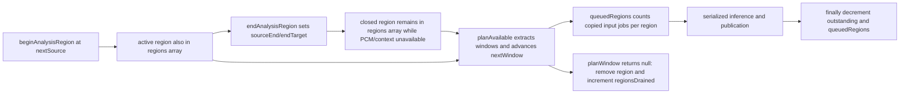

# Practice Acoustic Resource and Liveness Semantics

Round 23 characterizes approved baseline
`51a8616753e01451673cf53c5ba58adcf3476861`. It complements the
[parameter provenance ledger](practice-acoustic-parameter-provenance.md) without
changing its 93-row inventory or any production policy. This round changes only
existing tests and this document. No resource/timing value, source implementation,
identity/hash, schema, workflow or dependency changes.

Round 24, based on `2ac94b2357d1b251e542a8c2f67b6ab78fcf9154`, fixes only
R03's synchronous controller failure-propagation defect. The Round 23 reachability
witness remains valid. The semantic necessity of maxScheduledBoundaries=8 remains
**UNRESOLVED**; fixing its failure handling does not qualify this cap. The source,
publication, timing, resource values and identity contracts remain unchanged.

The order is **semantic necessity → reachable valid workload → failure effect →
ownership alternative → identity impact**. Reachability in a deterministic legal
state does not estimate frequency on real hardware. A deferred worker represents
a silent/stalled inference service; fake timers advance observation time without
waiting real seconds. None of these experiments qualifies a cap or recommends
raising/lowering it. No accepted evidence may be silently discarded.

## Decision matrix

| Item | Validly reachable? | Minimal trigger | Required stall/lag | What state grows? | Current failure effect | Correctness necessity | Alternative ownership/dataflow | Identity/provenance impact | Recommended next action |
| --- | --- | --- | --- | --- | --- | --- | --- | --- | --- |
| R01 outstanding model inputs | Yes: source runtime and admitted Continuous controller, current cap4 | Four copied ready inputs; attempt to queue fifth; first INFER held | Worker/GPU service slower than ready-window arrival; no main-thread/transport stall needed | Queued+active PCM arrays, chain closures/window records, queuedRegions counters | ACOUSTIC_BACKPRESSURE_LIMIT_EXCEEDED before fifth extract; source terminal; admitted controller pauses under analysis intervention, retained session/no Result | Ordered single-worker ownership is necessary to current protocol; numeric 4 and terminal response are not mathematically required by it | Review producer admission/pull-driven planning and finite evidence/context ownership before numeric headroom; stalled capture cannot simply drop required input | Resource policy is deliberately outside evidence-core provenance; selected executor byte changes still cascade core/adapters | REDESIGN BEFORE TUNING; NEEDS REAL DEVICE/WORKLOAD EVIDENCE |
| R02 pending source regions | Yes: legal source API; also schema-valid short-meter controller with complete 2048-sample capture blocks | Four positive closed regions still waiting future PCM, fifth BEGIN; four Pause/Resume cycles from initial running region | Less than 170ms real tail between short regions; no worker stall required; normal long count-ins instead allow planning retirement | regions[] awaiting geometry/PCM, active region pointer; not queued inference history | ACOUSTIC_SEGMENT_LIMIT_EXCEEDED; terminal source analysis; controller retains ACTIVE attempt paused under analysis intervention | No proof that 4 region records or this terminal response is necessary | Prove bounded representation/earlier retirement; positive historical source→performance intervals cannot be erased | Leaf cap deliberately outside evidence-core provenance; representation/source edits still change selected byte anchors | REDESIGN BEFORE TUNING; NEEDS REAL DEVICE/WORKLOAD EVIDENCE |
| R03 pending capture boundaries | Yes: public controller Start/Pause/Resume, logical clock advances while PCM delivery lags | Four preserved BEGIN/PAUSE pairs pending; next Resume attempts ninth BEGIN | Canonical 15.625ms one-bar initial/resume count-ins plus 10ms running intervals; total PCM lag 102.5ms, below transport credit payload envelope | Ordered physical-boundary queue, IDs, source/performance segment history not yet consumed | CAPTURE_BOUNDARY_LIMIT_EXCEEDED aborts bridge; **Round 24 FIXED synchronous reentrancy**: controller remains ACTIVE with canonical PAUSED transport and input-required resource intervention before Resume returns | Bounded ownership is required in principle; 8 is a temporary defensive safety fuse, not a qualified workload limit; its semantic necessity remains UNRESOLVED | Preserve all historical positive intervals; investigate bounded representation/cancellation independently of the fixed ownership reentrancy; no general BEGIN/PAUSE deletion proof | Bridge/controller are outside current file attestation; cap leaf also excluded; this failure behavior is deliberately outside evidence-core provenance | REDESIGN BEFORE TUNING; [evidence identity boundary resolved](practice-acoustic-identity-boundary.md) |
| R04 Worklet transport credits | Yes: existing tests accept 32 unacked blocks and fail 33rd; new ACKed stream independently reaches R01 |33rd full 2048-sample block without ordered ACK | Main-thread delivery/acceptance/ACK stall; not equivalent to worker/GPU stall | Transferred PCM messages/buffers awaiting main-thread synchronous acceptance | ACOUSTIC_CAPTURE_TRANSPORT_LIMIT_EXCEEDED; Worklet stops rather than dropping PCM; capture/infrastructure owner handles fault | Finite message ownership matters; numeric 32 and exact terminal policy need workload/product justification | Retain explicit ownership/ACK integrity; review admission/backpressure separately from inference scheduling | Worklet/transport contract not directly attested by core; availability policy is deliberately outside evidence-core provenance | KEEP + QUALIFY; NEEDS REAL DEVICE/WORKLOAD EVIDENCE |
| R14 worker/RPC liveness | Yes: valid LOAD, BEGIN_SESSION, INFER, END_SESSION and idle DISPOSE can await an unanswered RPC indefinitely | One unanswered pending request; no malformed message required | Silent worker/driver/GPU hang or absent response, rather than crash/messageerror | Pending RPC promise/record, busy session ownership; chain/window PCM; retirement/completion promises | No intrinsic RPC deadline; preparation/FINALIZING/RETIRING can remain pending with no failure notification | No finite completion guarantee follows from promises or existing tail timeout | Define cancellation/ownership and stalled-service product policy before choosing any deadline; worker termination ownership already differs from normal lease retirement | Client/engine liveness is deliberately outside evidence-core provenance; selected source drain bytes remain attested | REDESIGN BEFORE TUNING; [evidence identity boundary resolved](practice-acoustic-identity-boundary.md) |
| R18 readiness predicate observation | Yes: tests deliver the requested 5ms timer at5 or 50ms with identical source/evidence geometry | Real preroll becomes ready while wait timer remains pending | Timer scheduling/clamping affects observation only | At most current wait timer/abort listener; repeated wakeups while predicate false | Readiness discovered later; independent 15s/60s predicate deadlines remain; no 5ms latency guarantee | Predicate observation/cancellation is necessary, polling itself is not proved necessary | Local one-shot readiness/failure subscription owned by input, with snapshot/subscribe recheck and disposal generation fence; no global bus | continuous-microphone-input.ts is not directly attested; readiness notification/liveness is deliberately outside evidence-core provenance | REDESIGN BEFORE TUNING; [evidence identity boundary resolved](practice-acoustic-identity-boundary.md) |
| R05 unused resource-policy alias: maxUnacknowledgedBlocks | No executable production read | Declaration and assertion only | None | No runtime state | Editing this alias alone cannot change actual Worklet credit behavior | Redundant ownership; real authority is capture transport constant/standalone producer | Later remove dead field/assertion while retaining actual transport contract and drift checks | resource-policy.ts is not attested; deletion does not mechanically change current core hash | DELETE AS REDUNDANT |

## Test validity and owners

All new resource witnesses use current caps, shipped FIR coefficient bytes, real
SourceAnalysisRuntime/ContinuousAcousticProjection, finite chronological PCM,
nonempty regions, synchronous publication sinks and the production controller
where stated. Deferred promises affect only inference/RPC completion. Controller
witnesses use public commands, actual source/performance mapping and full 2048-sample
transport messages. No private state/queue is injected, cap lowered, timeout added,
production function exported or behavior switched for tests.

A direct schedule of nine arbitrary BEGINs would not prove learner/controller
reachability: schedule() validates coordinates, not the complete product protocol.
The tests instead exercise actual controller cancellation rules. The source-only
region test separately labels public source API reachability; the controller test
establishes the stronger product path.

The short-meter fixture uses a valid 1/128 time signature at 120 BPM: a canonical
resume count-in is one bar, 1/32 quarter-note beat, 15.625ms. The existing MusicXML
meter parser accepts positive beat-type values and emits this duration; artifact
validation admits the consistent meter fields. No policy constant is shortened.
Initial and resume count-ins both use that same canonical score-derived bar in
the short-meter witnesses; the 4/4 witnesses use their normal four-beat initial
bar. This is adversarial,
schema-valid geometry, not a claim that a learner can or normally will perform
these UI actions at this frequency. Measurements are still needed for incidence.

## R01 — copied inputs and failure ordering

SourceAnalysisRuntime.append validates the block, advances nextSource, resamples
and appends to the raw ring, then calls planAvailable. A ready window first checks
`outstanding === maxOutstandingWindows`, then extracts 29120 float32 samples, and
only then enqueues the owned copy. Outstanding counts **one active plus queued
inputs**, not active GPU executions alone. The worker chain is serialized.

The source witness begins at source 96000 (48kHz, after real preroll), holds the
first inference, and feeds legitimate blocks through 219392. Four inputs are copied;
only job0 has started. Feeding toward 248320 makes a fifth window ready. A spy on
the existing AcousticPcmRing.extract observes exactly four calls before and after
failure. The accepted source prefix has advanced before planning throws. Four
copies total 465920 payload bytes; no fifth copy exists. The source failure clears
region planning state, but outstanding copied inputs remain owned until the active
promise settles and queued closures are skipped. These tests have no published
observations before the stall; accepted PCM is not the same as accepted evaluation
observations. They do not claim raw PCM must be retained as a completed-result ledger.

Disposal calls the inference port disposal once, but SourceAnalysisRuntime also
awaits its chain. A deliberately non-settling fake inference keeps that disposal
promise pending. After release, late result delivery is fenced, queued work is not
restarted, outstanding returns to zero and no publication appears. The real engine's
normal lease retirement likewise waits on its pending service (R14).

The admitted-controller witness confirms the source backpressure failure first
reaches the analysis owner: transport PAUSED, analysis intervention latched,
evaluation feedback null, retained ACTIVE session, no natural callback/Result,
borrowed root untouched. It does not make 4 necessary. Removing the cap alone leaves
copied buffers, closures and counters growing when inference cannot keep up.
A pull-driven planner could bound copies by ownership rather than4, but source PCM
still arrives and real-context retention must be accounted for. It is not a proof
that indefinite stall can be handled losslessly with finite memory and no failure.

## R02 — region lifecycle and valid reachability

`regions.length` is neither inference history nor queuedRegions.size. A region may
leave regions[] after all its windows are **planned**, while its inference still
owns PCM. The new test closes a positive short region, finishes source regions,
feeds real tail and observes pendingRegions=0, outstanding=1, hasRegionWork(index)=true
and tailReady=true. Only inference completion removes the queuedRegions ownership.
Empty regions retire without windows (existing tests); zero-duration toggles do not
establish the same pressure as positive intervals.

The direct source witness repeats four legal begin→128-sample append→end sequences.
Only 512 source samples (10.667ms) elapsed, so their 170ms future inputs are unavailable;
no inference has even started. Fifth begin fails. This is valid source API behavior,
not by itself a proof of normal controller UI reachability.

The controller witness supplies that missing proof with full 2048-sample blocks.
After one full capture block has crossed the score-derived initial BEGIN, the
control-clock origin is recorded. Relative to that origin, user Pause/Resume
actions occur at
1,17.625,34.25 and 50.875ms. Resume BEGINs occur at 16.625,33.25,49.875 and 66.5ms.
The first full capture block is delivered around the fourth Pause: it consumes the
first three closed positive intervals. The next full block consumes the fourth
interval and attempts the fifth BEGIN before any 170ms tail can exist. At failure:
regionsStarted=4, regionsDrained=0, windowsQueued=0, outstanding=0; no worker stall,
model load or forged publication is required. R03 never needs nine boundaries in
this sequence because capture consumption clears earlier controls.

Four closed positive regions plus the next BEGIN is minimal **by region count**
for cap4. These are witnesses, not a minimized human reaction time. Long resume
count-ins with healthy capture normally provide time for old regions to finish
planning; that observation is not a universal bound across admitted meter/tempo
geometry and lag. Worker stall alone does not keep regions[] nonempty after their
windows have been copied, though it can independently hit R01.

Removing the cap alone permits many records inside one future-context interval if
there is no lower bound on legal control spacing. Whether the history can be
represented more compactly/retired earlier requires a source→performance mapping
proof, not a larger number. Deferred inference ownership and completed observation
retention are different dataflows and cannot be deleted as substitutes.

## R03 — controller boundaries and transaction-safe failure propagation

Start/Resume plan a future BEGIN at count-in completion and a TERMINAL at the scope
end. isPending allows cancelPending to ignore already-applied IDs. Pause always
cancels future TERMINAL. During count-in it also cancels the future BEGIN. Once
RUNNING is logically reached, Pause preserves a BEGIN still awaiting PCM and
schedules PAUSE after it: otherwise historical captured PCM would lose its source
segment. Pause during a canceled resume countdown adds no new running interval.
The capture bridge applies pending boundaries only when nextSource exactly reaches
their source coordinate; new control boundaries can coexist with old ones while
that source delivery lags.

The minimal count-growth witness uses initial count-in with unconsumed BEGIN:

| Public operation | Pending after cancellation/application rules |
| --- | --- |
| Start | BEGIN, TERMINAL (2) |
| Reach RUNNING, Pause1 | BEGIN1, PAUSE1 (2) |
| Resume1 | prior pair + BEGIN2, TERMINAL (4) |
| Reach RUNNING, Pause2; Resume2 | two pairs + BEGIN3, TERMINAL (6) |
| Reach RUNNING, Pause3; Resume3 | three pairs + BEGIN4, TERMINAL (8) |
| Reach RUNNING, Pause4 | four BEGIN/PAUSE pairs (8), old TERMINAL canceled |
| Resume4 | ninth BEGIN attempted before new TERMINAL; bridge aborts |

Every preserved interval is positive. Each completed running pause/resume cycle
increases surviving history by two; count-in cancellation cannot accelerate that
growth. From the initial two-boundary state, four pauses/four resumes are the
minimal cycle count to attempt the ninth under these rules. The fixture's source
PCM delivery lag is 102.5ms, compatible with fewer than 32 queued transport blocks
at 48kHz. Main-thread input/control tasks progressing while capture-message tasks
are delayed is a scheduling adversary, not measured hardware behavior. A normal 4/4
count-in would require much longer lag and may encounter R04 first; the short-meter
witness avoids assuming that transport has unlimited credits.

### Historical Round 23 defect; Round 24 status: FIXED

At the Round 23 baseline, schedule's CAPTURE_BOUNDARY_LIMIT_EXCEEDED aborted the
bridge and SourceAnalysisRuntime. Because bridge.failed was already true,
ContinuousPracticeController.analysisFailed classified it as capture infrastructure
and entered inputHealthChanged/updateResourceIntervention. That path attempted
pauseTransport inside Resume's existing AudioContextPerformanceClock transaction,
throwing NESTED_CLOCK_TRANSACTION. Application remained ACTIVE with COUNT_IN,
no resource intervention, and could advance again on refresh. This was a separate
failure-propagation correctness defect, not evidence that a larger cap was needed.

Round 24 preserves the same legal witness and the first capture failure. Controller
callbacks latch input-health facts and pending resource work during the canonical
clock transaction. Analysis/other pause requests use a pending transport-pause
intent; recording facts remain owned by the recorder. Only after the outer clock
transaction releases its latch does transition's finally synchronously drain these
actions, before the public command returns. A drain guard prevents its own pause
transaction from recursively draining; resource application rereads latched input
and recorder facts after pausing. A latched RESTART_REQUIRED input incident cannot
be overwritten by a weaker live-health snapshot or subsequent health notification.
No timer, microtask, retry, exception suppression or boundary-specific branch is
involved. Cleanup clears pending intents and existing lifecycle guards prevent
stale callbacks from reestablishing an intervention after abandonment/disposal.

The updated witness verifies that Resume does not throw and returns with:

- Application ACTIVE; canonical transport PAUSED, with Performance Time frozen
  across a later clock advance and refresh; no Resume/recovery bypass.
- Bridge failed=true, pending boundaries=0; source failureCode remains
  CAPTURE_BOUNDARY_LIMIT_EXCEEDED; no worker inference, publication-derived Result
  or natural-completion callback.
- analysisIntervention=null; resource intervention reason CAPTURE_PIPELINE_INVALID,
  recoverability RESTART_REQUIRED, state WAITING_FOR_USER, impact INPUT_REQUIRED
  for recording OFF, and pauseOrigin INTERVENTION.
- Exactly one additional canonical, recorder-port and metronome pause; exactly one
  resource-intervention diagnostic. End/dispose abandons and releases once while
  preserving borrowed root ownership.

A separate non-cap regression emits a real AudioContext statechange synchronously
from the metronome's Resume port. It verifies one canonical/media pause, stable
session identity/time, SAME_PIPELINE_RECOVERABLE classification, and explicit
same-owner recovery with normal Resume Count-In. Four transaction-local input or
analysis + recording order permutations verify one pause and no bypass of the
remaining learner choice. Another non-cap capture abort followed by weaker clock
and recording facts verifies that hard first-cause ownership survives the drain.
Existing USER-paused, INITIAL/RESUME count-in, analysis-pause-once and teardown
regressions remain applicable. These tests establish failure ownership; they do
not qualify cap8 or implement queue redesign.

### Round 26 — temporary defensive safety fuse and honest recovery

Bounded ownership/backpressure is required in principle: when capture source PCM
does not advance, learner control chronology cannot consume unbounded retained
memory. The current `maxScheduledBoundaries=8` is a **temporary defensive safety
fuse, not a qualified workload limit**. There is no proof that 8 is mathematically
necessary, a browser safety limit or the supported ceiling for normal learner
interaction. Worklet32 credits do not derive cap8. Raising the number would not
resolve the ownership/chronology problem. R03 remains **REDESIGN BEFORE TUNING**;
compact representation/queue redesign and workload qualification are future work.
No cap value or queue algorithm changes in Round 26.

Overflow remains fail-closed: bridge/runtime retain first cause
CAPTURE_BOUNDARY_LIMIT_EXCEEDED; the bridge is failed and its pending queue aborts.
This is an explicit attempt failure, not silent removal of positive BEGIN/PAUSE
history followed by continued analysis. No accepted positive interval is silently
coalesced, no failed bridge is retried, no Result is fabricated and Performance Time
stays PAUSED. The current attempt cannot safely resume its failed capture pipeline.
Application attempt ownership remains ACTIVE until explicit learner End or existing
page teardown; overflow itself is neither abandonment nor natural completion.

The existing application reason CAPTURE_PIPELINE_INVALID is sufficient to distinguish
capture processing failure from MICROPHONE_SOURCE_LOST. For hard capture incidents,
ResourceInterruptionDialog says “Audio input processing stopped” / “音频输入处理已停止”,
with “Audio processing for this attempt could not continue safely. End this attempt,
then start a new one.” / “本次练习的音频处理无法安全继续。请结束本次练习，然后重新开始。”
It exposes only **End**. It does not claim physical disconnection, expose technical
codes, offer Resume/degradation/Restart/Retry or silently restart. Physical source
loss retains its input-loss copy; recoverable AudioContext and recording-only
incidents retain their existing actions and wording. Device icons continue to
represent actual Device Lease health, not internal capture failure.

End uses the existing abandon/dispose path: no Result or natural-completion callback,
release of the failed capture graph/worker lease/attempt clock/metronome, and no stop
of a healthy borrowed root. The hook waits for release and returns READY/IDLE with
no stale intervention. **When workspace readiness and Device Lease remain healthy,
explicit Start is allowed directly**, without forced Setup. It creates a new
controller/session/capture bridge and inference lease; the failed graph/session is
never reused. It can enter normal count-in/running. If actual device/environment
readiness is unhealthy, the existing Setup/requalification owner still applies.
This is explicit End → new Start, not a new universal Restart action.

Regression evidence is compositional: the real ninth-boundary controller witness
now includes release and a fresh successful admission on the same healthy borrowed
root; hook tests verify READY and a new controller after explicit End/Start; page
and EN/ZH component tests verify honest copy, End-only action and healthy Start
availability. No private-state injection or production test-only hook is used.
The Round 25 evidence-core boundary remains intact: capture/resource failure policy
is outside that identity, and no acoustic/core/composite hash or Result schema changes.

### Coalescing is not yet a safe policy

A new bridge regression delivers two 10ms positive intervals with one 10ms pause.
It emits distinct observations at (performance 0ms,source 96000) and
(performance 10ms,source 96960), then exact terminal 20ms. Dropping a BEGIN/PAUSE pair
would remove real historical evidence and/or change later performance anchors.
Combining separated intervals without retaining their gap/mapping also corrupts
Source Time→Performance Time. Zero-length regions may publish nothing, but region
indices/observation IDs/coverage and controller state still require proof before
calling even that deletion observationally equivalent. Pending TERMINAL cancellation
already has explicit ownership. No general coalescing implementation or proof is
introduced. Compact representation preserving **all** intervals remains a research
candidate; erasing positive history is not an approved optimization.

## R04 — three distinct backpressure positions

BrowserAcousticCapture receives a full block, calls bridge.receive synchronously,
checks the consumer returned undefined and capture is not stopped, then posts ACK.
The inference Promise is not awaited. A capture test records accept→ACK while its
accepted inference remains pending. A second test runs the actual standalone
Worklet with chronological PCM and ACKs each accepted block. More than 32 cumulative
blocks pass; a held first inference independently fills the four copied-input slots
and reaches R01 without a Worklet credit failure. The isolated transport fixture
then sends STOP explicitly; production capture cleanup is separately exercised at
the BrowserAcousticCapture/controller owner. Existing Worklet tests prove that
32 simultaneously unacked blocks pass and 33rd fails, with no new accumulator.

- **Main-thread/capture delivery stall:** unacked transferred blocks grow at R04.
- **Worker service stall:** main-thread can still ACK; copied inference inputs grow
  at R01. regions[] may already be retired.
- **GPU stall:** INFER may remain unanswered inside the worker; it can look like a
  silent worker hang to the client, but is not the same queue as Worklet credits.

Credits do not structurally bound outstanding model inputs, future control boundary
count, or source-region count. They count unaccepted PCM messages, not model work
or user controls. There can be correlations in actual scheduling, not a mathematical
substitution for the other bounds. `32×2048/rate` is 1.486077s at 44.1k and 1.365333s
at 48k, solely **payload duration conversion**, not a safe-stall SLO or a liveness
proof. Current sample/block/credit values remain unchanged.

## R14 — no finite completion guarantee for silent service

The client regression withholds a response for each valid RPC, advances fake time
120000ms and verifies no deadline/retry/failure notification or extra request.
The Promise settles only after an explicit response or error/messageerror event.
Those events terminate the client and reject pending work; silence does neither.
A finite virtual-time checkpoint corroborates the source inspection: send stores a
pending resolver and has no timer/other transition that could settle it by time.
It is that ownership/await structure, not a two-minute wait, that establishes the
absence of a finite automatic guarantee.

| RPC / await | Valid pending ownership | Upper-level effect if silent | Existing escape / limit |
| --- | --- | --- | --- |
| LOAD | Worker/client load request; engine preparation | Explicit Setup qualification can remain CHECKING/preparing | External owner cancellation/disposal can terminate preparation; no independent RPC deadline |
| BEGIN_SESSION | Exclusive engine acquisition marked LEASED before its response; usable lease not returned yet | Attempt preparation or smoke acquisition can remain pending | Engine/worker owner teardown; ordinary lease disposer is not yet returned |
| INFER | Active worker request + copied model input + source chain | Subsequent jobs/drain/seal wait; during ACTIVE capture may later hit R01, but not if no more ready windows arrive | Explicit worker crash/termination; normal lease retirement waits for in-flight inference |
| END_SESSION | Lease RETIRING; engine refuses another lease | Attempt cleanup and Setup engine-retirement handoff can remain pending | Service response/failure or a separately authorized worker termination policy; no normal-retirement timeout |
| DISPOSE (idle worker) | Awaited disposal RPC | Engine/layout cleanup can remain pending | Response/crash/explicit termination; no independent disposal deadline |

Idle DISPOSE itself does not set the client's busy flag; its valid disposing owner
issues no concurrent work. The test does not invent an exclusivity guarantee for
that method. Existing client.dispose while busy deliberately terminates pending
work, but **AcousticEngine's normal lease disposal first awaits run/endSession**.
These different owners cannot be conflated into a claim that every page teardown
always forcibly terminates a silent inference.

The source test proves tailReady=true/pendingRegions=0 can coexist with outstanding=1
and hasRegionWork(region)=true. drain and seal remain pending; no failure is
reported. The controller test reaches real natural FINALIZING with tailReady=true,
outstanding=2 and no analysis error. Another 120000ms fake time produces no Result
or completion callback. Releasing inference permits one normal completion.
ContinuousMicrophoneInput.finish()'s 60000ms timer covers only the tailReady predicate;
subsequent runtime.seal awaits drain without that deadline. Healthy recorder freeze
may already have occurred while finalization is still waiting; this is not an
unavailable completed Result or an active intervention yet.

A separate engine test holds END_SESSION: lease retirement and engine.dispose stay
pending, state RETIRING, no replacement lease/automatic termination, until response.
Therefore **yes**, legal preparation, finalization and retirement states exist with
no finite completion guarantee under silent worker/service hangs. Crash/messageerror
and explicit cancellation are different modes and do not prove a silence deadline.
This conclusion does not authorize an arbitrary new timeout.

## R18 — observation polling and a local notification alternative

Two input-owner tests use identical real PCM/window/source geometry while the
requested 5ms timer is delivered at 5ms or simulated-clamped 50ms. Preroll becomes
ready before delivery; connect remains pending until the timer fires. Source event
sample, projected event Performance Time, exact terminal coverage and injected
availability clock remain identical. The timer does not timestamp audio, set
context length or guarantee latency. Delayed dispatch changes when readiness is
noticed; if the predicate remains false, sufficiently delayed dispatch can encounter the
existing independent predicate timeout on its next check. This is not a new recognition timing policy. The comparison holds source geometry
fixed; it does not assert an entire attempt starts at the same physical instant
when real capture continues during a delayed readiness callback.

A narrowly owned alternative, **not implemented**, can be specified without a global
bus/store: SourceAnalysisRuntime owns committed readiness/failure transitions;
ContinuousMicrophoneInput owns each one-shot wait subscription. Subscribe and
recheck the current predicate to close the snapshot/subscribe race. Once satisfied,
failed, aborted or disposed, the input detaches listener and abort hook exactly
once. Per-owner generation/disposed fencing prevents an already queued callback
from reviving a departed attempt. Publish only after committed source transitions;
callback delivery must respect controller transaction reentrancy (R03), rather than
calling application transitions from a half-mutated source state. The signal should
distinguish real-input tail readiness from completed inference drain; removing 5ms
polling cannot itself solve R14. Any retained deadline still needs separate necessity
and device/workload qualification. These are future proof obligations, not a new API.

## Acoustic identity and runtime-policy boundary — resolved in Round 25

The normative [acoustic evidence identity boundary](practice-acoustic-identity-boundary.md)
defines ACOUSTIC_ANALYSIS_IDENTITY/acousticCoreIdentitySha256 as the
evidence-producing acoustic semantic core: model, decoder, source mapping,
window ownership and successful publication contents/source identity/analyzed-through
semantics. Selected file attestations are deliberate integrity anchors, not an
executable transitive closure. The hash is a versioned declaration/build identity;
behavior-neutral edits to attested files can change it, so it is not a pure
semantic-equivalence hash.

resource-policy.ts, capture transport/bridge admission, input readiness polling and
deadlines, worker/client/engine liveness and controller intervention policies are
explicitly outside that provenance boundary. Attested executor bytes can still
change when a resource-related implementation is edited; this incidental byte
sensitivity does not identify all runtime policy or make the declaration transitive.
No core JSON/hash/composite/schema change implements this clarification.

Result evidenceProvenance identifies the configured evidence-producing semantics
used/intended by the attempt. COMPLETE identifies the accepted evidence stack;
UNAVAILABLE identifies the intended stack without claiming successful publication.
It is not full execution provenance and cannot replay every COMPLETE/UNAVAILABLE,
intervention or hang cause. A future product requirement for runtime outcome
reproducibility requires a separate versioned runtime-policy provenance owner and
schema decision, not an expansion/redefinition of the existing core hash.

This resolves only provenance scope. R01/R02/R03/R04/R14/R18 retain their existing
numeric/semantic-necessity status: cap8 remains UNRESOLVED; R14 has no finite
silent-service guarantee; maxUnacknowledgedBlocks remains a deletion candidate.

## Exact-reference audit

Repository command: `rg -n "maxUnacknowledgedBlocks" .` (feature branch, local exact search).
At the approved baseline it finds four lines: resource-policy.ts:3 (declaration),
acoustic/continuous/runtime.test.ts:65 (assertion), and the parameter-provenance
ledger:158/402 (documentation). There is **no executable production consumer**.
This companion adds only two documentation hits (its matrix row and the command
above). The completion report includes the final full path/line hit set and an
external copy of the unfiltered command output. The enforced Worklet constant is
uppercase CAPTURE_TRANSPORT_MAX_UNACKED and is a different, live owner. No deletion,
rename or alias is performed in this characterization round.

## Round 23 validation and remaining release concerns

New tests are colocated with existing source runtime, capture bridge, transport,
capture owner, worker/model lifecycle and Continuous controller tests. Shared-source
STEP and architecture/attestation regressions run unchanged. All new liveness
observations use deferred Promises or fake/manual clocks, not real-time sleeps;
120000ms checkpoints and 5/50ms timer-delivery axes are test observations, not newly
introduced production policy values. Controller fixture changes only allow full
2048-sample blocks and a schema-valid short meter; existing defaults are unchanged.
The final related focused run passed **18 files / 459 tests**, including all 28 new
characterization cases and unchanged shared-source STEP/architecture/attestation
regressions. Typecheck, lint with zero warnings, documentation guards/structure/
links and diff-check also pass. Full E2E/backend/coverage/build are not claimed.

| Existing test owner | New cases | Executable evidence |
| --- | ---: | --- |
| [source-analysis-runtime.test.ts](../../apps/customer-web/src/lib/practice/acoustic/runtime/source-analysis-runtime.test.ts) | 3 | R01 copy ordering/cleanup; R02 region pressure; R14 region vs drain ownership |
| [capture-bridge.test.ts](../../apps/customer-web/src/lib/practice/acoustic/continuous/capture-bridge.test.ts) | 1 | Positive short intervals retain distinct source/performance evidence |
| [capture.test.ts](../../apps/customer-web/src/lib/practice/acoustic/continuous/capture.test.ts) | 1 | Synchronous acceptance→ACK before deferred inference |
| [capture-transport.test.ts](../../apps/customer-web/src/lib/practice/acoustic/source/capture-transport.test.ts) | 1 | ACKed Worklet stream reaches R01 independently of transport32 |
| [inference.test.ts](../../apps/customer-web/src/lib/practice/acoustic/model/inference.test.ts) | 15 | Five valid RPCs × response/crash/messageerror, silent checkpoint before settlement |
| [acoustic-engine.test.ts](../../apps/customer-web/src/lib/practice/acoustic/model/acoustic-engine.test.ts) | 1 | Silent END_SESSION holds retirement/disposal and excludes another lease |
| [continuous-practice-controller.test.ts](../../apps/customer-web/src/lib/practice/continuous/continuous-practice-controller.test.ts) | 6 | R01/R02 admitted failure; R03 reentrancy; R14 FINALIZING; R18 two timer-delivery cases |

**R03 was an observed correctness blocker in Round 23 and is FIXED in Round 24**
by the synchronous controller fence described above, independently of resource
qualification. R14 has a demonstrated absence of finite liveness under
silence; resolving its product/ownership requirement is necessary before a bounded
completion/retirement guarantee can be claimed. Round 23 characterization did not
fix those concerns or infer real device incidence. Round 24 fixes only R03 failure propagation; R14 remains unresolved.

The remaining future conclusions are:

- **REDESIGN BEFORE TUNING:** R01/R02/R03 retained-state/cap necessity,
  R14 silent-service handling and R18 readiness delivery.
- **KEEP + QUALIFY:** required transport ordering/ACK integrity, with remaining
  numeric credit/headroom justified by actual supported workloads rather than tests.
- **DELETE AS REDUNDANT:** the unused resource-policy alias after its exact-reference
  audit; do not remove the real Worklet credit contract.
- **DERIVE:** diagnostic/resource accounting duplicated from actual owners, after
  boundary and consumer review; no numerical replacement policy is inferred.
- **IDENTITY BOUNDARY RESOLVED IN ROUND 25:** the [normative contract](practice-acoustic-identity-boundary.md)
  deliberately excludes runtime admission/failure/liveness from the evidence core;
  future outcome-replay provenance requires its own versioned owner/schema decision.
- **NEEDS REAL DEVICE/WORKLOAD EVIDENCE:** frequency/headroom, scheduler task lag,
  short-control workloads, GPU/worker silence, and any eventual liveness policy.

Round 24 does not implement cap adjustment, queue coalescing, retry/fallback, silent
drop, automatic calibration, global coordination or R14 timeout work.

## Round 24 validation

The controller suite passes 117 tests, including the corrected R03 witness and
six new synchronous callback regressions. The related focused run passes 37 files /
847 tests, including clock, capture/transport, microphone/controller, source runtime,
publication, recording, architecture boundaries and acoustic file-attestation tests.
The full Customer Web unit suite passes 209 files / 2,425 tests. Typecheck, lint
with zero warnings, documentation structure/links and diff-check pass. This round
does not rerun E2E, backend, coverage or production build. No resource, timing,
identity/hash, Result schema or evidence-publication contract changes.
