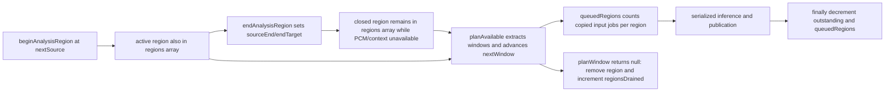

# Practice Acoustic Resource and Liveness Semantics

Round 23 characterizes approved baseline
`51a8616753e01451673cf53c5ba58adcf3476861`. It complements the
[parameter provenance ledger](practice-acoustic-parameter-provenance.md) without
changing its 93-row inventory or any production policy. This round changes only
existing tests and this document. No resource/timing value, source implementation,
identity/hash, schema, workflow or dependency changes.

The order is **semantic necessity → reachable valid workload → failure effect →
ownership alternative → identity impact**. Reachability in a deterministic legal
state does not estimate frequency on real hardware. A deferred worker represents
a silent/stalled inference service; fake timers advance observation time without
waiting real seconds. None of these experiments qualifies a cap or recommends
raising/lowering it. No accepted evidence may be silently discarded.

## Decision matrix

| Item | Validly reachable? | Minimal trigger | Required stall/lag | What state grows? | Current failure effect | Correctness necessity | Alternative ownership/dataflow | Identity/provenance impact | Recommended next action |
| --- | --- | --- | --- | --- | --- | --- | --- | --- | --- |
| R01 outstanding model inputs | Yes: source runtime and admitted Continuous controller, current cap4 | Four copied ready inputs; attempt to queue fifth; first INFER held | Worker/GPU service slower than ready-window arrival; no main-thread/transport stall needed | Queued+active PCM arrays, chain closures/window records, queuedRegions counters | ACOUSTIC_BACKPRESSURE_LIMIT_EXCEEDED before fifth extract; source terminal; admitted controller pauses under analysis intervention, retained session/no Result | Ordered single-worker ownership is necessary to current protocol; numeric 4 and terminal response are not mathematically required by it | Review producer admission/pull-driven planning and finite evidence/context ownership before numeric headroom; stalled capture cannot simply drop required input | resource-policy value itself is not attested; changing executor dataflow is attested and cascades core/adapters | REDESIGN BEFORE TUNING; NEEDS REAL DEVICE/WORKLOAD EVIDENCE |
| R02 pending source regions | Yes: legal source API; also schema-valid short-meter controller with complete 2048-sample capture blocks | Four positive closed regions still waiting future PCM, fifth BEGIN; four Pause/Resume cycles from initial running region | Less than 170ms real tail between short regions; no worker stall required; normal long count-ins instead allow planning retirement | regions[] awaiting geometry/PCM, active region pointer; not queued inference history | ACOUSTIC_SEGMENT_LIMIT_EXCEEDED; terminal source analysis; controller retains ACTIVE attempt paused under analysis intervention | No proof that 4 region records or this terminal response is necessary | Prove bounded representation/earlier retirement; positive historical source→performance intervals cannot be erased | Leaf cap not in current core attestation; representation/source edits would change attested bytes | REDESIGN BEFORE TUNING; NEEDS REAL DEVICE/WORKLOAD EVIDENCE |
| R03 pending capture boundaries | Yes: public controller Start/Pause/Resume, logical clock advances while PCM delivery lags | Four preserved BEGIN/PAUSE pairs pending; next Resume attempts ninth BEGIN | Canonical 15.625ms one-bar initial/resume count-ins plus 10ms running intervals; total PCM lag 102.5ms, below transport credit payload envelope | Ordered physical-boundary queue, IDs, source/performance segment history not yet consumed | CAPTURE_BOUNDARY_LIMIT_EXCEEDED aborts bridge; **synchronous resource-pause reentrancy throws NESTED_CLOCK_TRANSACTION; no completed intervention and transport can advance again** | Limit 8 is not a source-mapping theorem; current failure handling also has a separate correctness defect | Preserve all historical positive intervals; investigate bounded representation/cancellation only after fixing ownership reentrancy; no general BEGIN/PAUSE deletion proof | Bridge/controller are outside current file attestation; cap leaf also excluded; current core does not identify this failure behavior | REDESIGN BEFORE TUNING; IDENTITY BOUNDARY MUST BE RESOLVED |
| R04 Worklet transport credits | Yes: existing tests accept 32 unacked blocks and fail 33rd; new ACKed stream independently reaches R01 |33rd full 2048-sample block without ordered ACK | Main-thread delivery/acceptance/ACK stall; not equivalent to worker/GPU stall | Transferred PCM messages/buffers awaiting main-thread synchronous acceptance | ACOUSTIC_CAPTURE_TRANSPORT_LIMIT_EXCEEDED; Worklet stops rather than dropping PCM; capture/infrastructure owner handles fault | Finite message ownership matters; numeric 32 and exact terminal policy need workload/product justification | Retain explicit ownership/ACK integrity; review admission/backpressure separately from inference scheduling | Worklet/transport contract not directly attested by core; availability behavior is not fully identified | KEEP + QUALIFY; NEEDS REAL DEVICE/WORKLOAD EVIDENCE |
| R14 worker/RPC liveness | Yes: valid LOAD, BEGIN_SESSION, INFER, END_SESSION and idle DISPOSE can await an unanswered RPC indefinitely | One unanswered pending request; no malformed message required | Silent worker/driver/GPU hang or absent response, rather than crash/messageerror | Pending RPC promise/record, busy session ownership; chain/window PCM; retirement/completion promises | No intrinsic RPC deadline; preparation/FINALIZING/RETIRING can remain pending with no failure notification | No finite completion guarantee follows from promises or existing tail timeout | Define cancellation/ownership and stalled-service product policy before choosing any deadline; worker termination ownership already differs from normal lease retirement | Client/engine/liveness owners are not in current file-attestation set; source drain await is attested | REDESIGN BEFORE TUNING; IDENTITY BOUNDARY MUST BE RESOLVED |
| R18 readiness predicate observation | Yes: tests deliver the requested 5ms timer at5 or 50ms with identical source/evidence geometry | Real preroll becomes ready while wait timer remains pending | Timer scheduling/clamping affects observation only | At most current wait timer/abort listener; repeated wakeups while predicate false | Readiness discovered later; independent 15s/60s predicate deadlines remain; no 5ms latency guarantee | Predicate observation/cancellation is necessary, polling itself is not proved necessary | Local one-shot readiness/failure subscription owned by input, with snapshot/subscribe recheck and disposal generation fence; no global bus | continuous-microphone-input.ts is not directly attested; notification redesign would require explicit provenance boundary decision | REDESIGN BEFORE TUNING; IDENTITY BOUNDARY MUST BE RESOLVED |
| R05 unused resource-policy alias: maxUnacknowledgedBlocks | No executable production read | Declaration and assertion only | None | No runtime state | Editing this alias alone cannot change actual Worklet credit behavior | Redundant ownership; real authority is capture transport constant/standalone producer | Later remove dead field/assertion while retaining actual transport contract and drift checks | resource-policy.ts is not attested; deletion does not mechanically change current core hash | DELETE AS REDUNDANT |

## Test validity and owners

All new resource witnesses use current caps, shipped FIR coefficient bytes, real
SourceAnalysisRuntime/ContinuousAcousticProjection, finite chronological PCM,
nonempty regions, synchronous publication sinks and the production controller
where stated. Deferred promises affect only inference/RPC completion. Controller
witnesses use public commands, actual source/performance mapping and full 2048-sample
transport messages. No private state/queue is injected, cap lowered, timeout added,
production function exported or behavior switched for tests.

A direct schedule of nine arbitrary BEGINs would not prove learner/controller
reachability: schedule() validates coordinates, not the complete product protocol.
The tests instead exercise actual controller cancellation rules. The source-only
region test separately labels public source API reachability; the controller test
establishes the stronger product path.

The short-meter fixture uses a valid 1/128 time signature at 120 BPM: a canonical
resume count-in is one bar, 1/32 quarter-note beat, 15.625ms. The existing MusicXML
meter parser accepts positive beat-type values and emits this duration; artifact
validation admits the consistent meter fields. No policy constant is shortened.
Initial and resume count-ins both use that same canonical score-derived bar in
the short-meter witnesses; the 4/4 witnesses use their normal four-beat initial
bar. This is adversarial,
schema-valid geometry, not a claim that a learner can or normally will perform
these UI actions at this frequency. Measurements are still needed for incidence.

## R01 — copied inputs and failure ordering

SourceAnalysisRuntime.append validates the block, advances nextSource, resamples
and appends to the raw ring, then calls planAvailable. A ready window first checks
`outstanding === maxOutstandingWindows`, then extracts 29120 float32 samples, and
only then enqueues the owned copy. Outstanding counts **one active plus queued
inputs**, not active GPU executions alone. The worker chain is serialized.

The source witness begins at source 96000 (48kHz, after real preroll), holds the
first inference, and feeds legitimate blocks through 219392. Four inputs are copied;
only job0 has started. Feeding toward 248320 makes a fifth window ready. A spy on
the existing AcousticPcmRing.extract observes exactly four calls before and after
failure. The accepted source prefix has advanced before planning throws. Four
copies total 465920 payload bytes; no fifth copy exists. The source failure clears
region planning state, but outstanding copied inputs remain owned until the active
promise settles and queued closures are skipped. These tests have no published
observations before the stall; accepted PCM is not the same as accepted evaluation
observations. They do not claim raw PCM must be retained as a completed-result ledger.

Disposal calls the inference port disposal once, but SourceAnalysisRuntime also
awaits its chain. A deliberately non-settling fake inference keeps that disposal
promise pending. After release, late result delivery is fenced, queued work is not
restarted, outstanding returns to zero and no publication appears. The real engine's
normal lease retirement likewise waits on its pending service (R14).

The admitted-controller witness confirms the source backpressure failure first
reaches the analysis owner: transport PAUSED, analysis intervention latched,
evaluation feedback null, retained ACTIVE session, no natural callback/Result,
borrowed root untouched. It does not make 4 necessary. Removing the cap alone leaves
copied buffers, closures and counters growing when inference cannot keep up.
A pull-driven planner could bound copies by ownership rather than4, but source PCM
still arrives and real-context retention must be accounted for. It is not a proof
that indefinite stall can be handled losslessly with finite memory and no failure.

## R02 — region lifecycle and valid reachability

`regions.length` is neither inference history nor queuedRegions.size. A region may
leave regions[] after all its windows are **planned**, while its inference still
owns PCM. The new test closes a positive short region, finishes source regions,
feeds real tail and observes pendingRegions=0, outstanding=1, hasRegionWork(index)=true
and tailReady=true. Only inference completion removes the queuedRegions ownership.
Empty regions retire without windows (existing tests); zero-duration toggles do not
establish the same pressure as positive intervals.

The direct source witness repeats four legal begin→128-sample append→end sequences.
Only 512 source samples (10.667ms) elapsed, so their 170ms future inputs are unavailable;
no inference has even started. Fifth begin fails. This is valid source API behavior,
not by itself a proof of normal controller UI reachability.

The controller witness supplies that missing proof with full 2048-sample blocks.
After one full capture block has crossed the score-derived initial BEGIN, the
control-clock origin is recorded. Relative to that origin, user Pause/Resume
actions occur at
1,17.625,34.25 and 50.875ms. Resume BEGINs occur at 16.625,33.25,49.875 and 66.5ms.
The first full capture block is delivered around the fourth Pause: it consumes the
first three closed positive intervals. The next full block consumes the fourth
interval and attempts the fifth BEGIN before any 170ms tail can exist. At failure:
regionsStarted=4, regionsDrained=0, windowsQueued=0, outstanding=0; no worker stall,
model load or forged publication is required. R03 never needs nine boundaries in
this sequence because capture consumption clears earlier controls.

Four closed positive regions plus the next BEGIN is minimal **by region count**
for cap4. These are witnesses, not a minimized human reaction time. Long resume
count-ins with healthy capture normally provide time for old regions to finish
planning; that observation is not a universal bound across admitted meter/tempo
geometry and lag. Worker stall alone does not keep regions[] nonempty after their
windows have been copied, though it can independently hit R01.

Removing the cap alone permits many records inside one future-context interval if
there is no lower bound on legal control spacing. Whether the history can be
represented more compactly/retired earlier requires a source→performance mapping
proof, not a larger number. Deferred inference ownership and completed observation
retention are different dataflows and cannot be deleted as substitutes.

## R03 — controller boundaries and the observed reentrancy defect

Start/Resume plan a future BEGIN at count-in completion and a TERMINAL at the scope
end. isPending allows cancelPending to ignore already-applied IDs. Pause always
cancels future TERMINAL. During count-in it also cancels the future BEGIN. Once
RUNNING is logically reached, Pause preserves a BEGIN still awaiting PCM and
schedules PAUSE after it: otherwise historical captured PCM would lose its source
segment. Pause during a canceled resume countdown adds no new running interval.
The capture bridge applies pending boundaries only when nextSource exactly reaches
their source coordinate; new control boundaries can coexist with old ones while
that source delivery lags.

The minimal count-growth witness uses initial count-in with unconsumed BEGIN:

| Public operation | Pending after cancellation/application rules |
| --- | --- |
| Start | BEGIN, TERMINAL (2) |
| Reach RUNNING, Pause1 | BEGIN1, PAUSE1 (2) |
| Resume1 | prior pair + BEGIN2, TERMINAL (4) |
| Reach RUNNING, Pause2; Resume2 | two pairs + BEGIN3, TERMINAL (6) |
| Reach RUNNING, Pause3; Resume3 | three pairs + BEGIN4, TERMINAL (8) |
| Reach RUNNING, Pause4 | four BEGIN/PAUSE pairs (8), old TERMINAL canceled |
| Resume4 | ninth BEGIN attempted before new TERMINAL; bridge aborts |

Every preserved interval is positive. Each completed running pause/resume cycle
increases surviving history by two; count-in cancellation cannot accelerate that
growth. From the initial two-boundary state, four pauses/four resumes are the
minimal cycle count to attempt the ninth under these rules. The fixture's source
PCM delivery lag is 102.5ms, compatible with fewer than 32 queued transport blocks
at 48kHz. Main-thread input/control tasks progressing while capture-message tasks
are delayed is a scheduling adversary, not measured hardware behavior. A normal 4/4
count-in would require much longer lag and may encounter R04 first; the short-meter
witness avoids assuming that transport has unlimited credits.

**Current correctness defect:** schedule's CAPTURE_BOUNDARY_LIMIT_EXCEEDED aborts
the bridge and SourceAnalysisRuntime. Because bridge.failed is already true,
ContinuousPracticeController.analysisFailed classifies it as capture infrastructure
and enters inputHealthChanged/updateResourceIntervention. That path immediately
calls pauseTransport inside Resume's existing AudioContextPerformanceClock
transaction. The nested transaction throws NESTED_CLOCK_TRANSACTION. The first
failure callback exception may be swallowed by the source's first-cause protection;
the repeated boundary error handling can still propagate the nested exception.

The characterization catches the actual exception, not an idealized pause. Source
failureCode remains CAPTURE_BOUNDARY_LIMIT_EXCEEDED; bridge pending queue is cleared;
no region/inference has started from the delayed controls. Application remains
ACTIVE with transport COUNT_IN, analysisIntervention=null, resourceIntervention=null,
no Result/callback. Advancing the clock and refreshing then yields RUNNING and a
larger performance position. Thus this path currently has **no guaranteed canonical
failure pause/intervention**, beyond the independent question of whether 8 is needed.
End/dispose still abandons and releases once, retaining borrowed root ownership.
This is newly exercised evidence at unchanged production behavior, rather than a
newly introduced fault. No production fix is included; it is a release-correctness blocker for a separate
approved production change, not a reason to hide the trigger or increase a cap.

### Coalescing is not yet a safe policy

A new bridge regression delivers two 10ms positive intervals with one 10ms pause.
It emits distinct observations at (performance 0ms,source 96000) and
(performance 10ms,source 96960), then exact terminal 20ms. Dropping a BEGIN/PAUSE pair
would remove real historical evidence and/or change later performance anchors.
Combining separated intervals without retaining their gap/mapping also corrupts
Source Time→Performance Time. Zero-length regions may publish nothing, but region
indices/observation IDs/coverage and controller state still require proof before
calling even that deletion observationally equivalent. Pending TERMINAL cancellation
already has explicit ownership. No general coalescing implementation or proof is
introduced. Compact representation preserving **all** intervals remains a research
candidate; erasing positive history is not an approved optimization.

## R04 — three distinct backpressure positions

BrowserAcousticCapture receives a full block, calls bridge.receive synchronously,
checks the consumer returned undefined and capture is not stopped, then posts ACK.
The inference Promise is not awaited. A capture test records accept→ACK while its
accepted inference remains pending. A second test runs the actual standalone
Worklet with chronological PCM and ACKs each accepted block. More than 32 cumulative
blocks pass; a held first inference independently fills the four copied-input slots
and reaches R01 without a Worklet credit failure. The isolated transport fixture
then sends STOP explicitly; production capture cleanup is separately exercised at
the BrowserAcousticCapture/controller owner. Existing Worklet tests prove that
32 simultaneously unacked blocks pass and 33rd fails, with no new accumulator.

- **Main-thread/capture delivery stall:** unacked transferred blocks grow at R04.
- **Worker service stall:** main-thread can still ACK; copied inference inputs grow
  at R01. regions[] may already be retired.
- **GPU stall:** INFER may remain unanswered inside the worker; it can look like a
  silent worker hang to the client, but is not the same queue as Worklet credits.

Credits do not structurally bound outstanding model inputs, future control boundary
count, or source-region count. They count unaccepted PCM messages, not model work
or user controls. There can be correlations in actual scheduling, not a mathematical
substitution for the other bounds. `32×2048/rate` is 1.486077s at 44.1k and 1.365333s
at 48k, solely **payload duration conversion**, not a safe-stall SLO or a liveness
proof. Current sample/block/credit values remain unchanged.

## R14 — no finite completion guarantee for silent service

The client regression withholds a response for each valid RPC, advances fake time
120000ms and verifies no deadline/retry/failure notification or extra request.
The Promise settles only after an explicit response or error/messageerror event.
Those events terminate the client and reject pending work; silence does neither.
A finite virtual-time checkpoint corroborates the source inspection: send stores a
pending resolver and has no timer/other transition that could settle it by time.
It is that ownership/await structure, not a two-minute wait, that establishes the
absence of a finite automatic guarantee.

| RPC / await | Valid pending ownership | Upper-level effect if silent | Existing escape / limit |
| --- | --- | --- | --- |
| LOAD | Worker/client load request; engine preparation | Explicit Setup qualification can remain CHECKING/preparing | External owner cancellation/disposal can terminate preparation; no independent RPC deadline |
| BEGIN_SESSION | Exclusive engine acquisition marked LEASED before its response; usable lease not returned yet | Attempt preparation or smoke acquisition can remain pending | Engine/worker owner teardown; ordinary lease disposer is not yet returned |
| INFER | Active worker request + copied model input + source chain | Subsequent jobs/drain/seal wait; during ACTIVE capture may later hit R01, but not if no more ready windows arrive | Explicit worker crash/termination; normal lease retirement waits for in-flight inference |
| END_SESSION | Lease RETIRING; engine refuses another lease | Attempt cleanup and Setup engine-retirement handoff can remain pending | Service response/failure or a separately authorized worker termination policy; no normal-retirement timeout |
| DISPOSE (idle worker) | Awaited disposal RPC | Engine/layout cleanup can remain pending | Response/crash/explicit termination; no independent disposal deadline |

Idle DISPOSE itself does not set the client's busy flag; its valid disposing owner
issues no concurrent work. The test does not invent an exclusivity guarantee for
that method. Existing client.dispose while busy deliberately terminates pending
work, but **AcousticEngine's normal lease disposal first awaits run/endSession**.
These different owners cannot be conflated into a claim that every page teardown
always forcibly terminates a silent inference.

The source test proves tailReady=true/pendingRegions=0 can coexist with outstanding=1
and hasRegionWork(region)=true. drain and seal remain pending; no failure is
reported. The controller test reaches real natural FINALIZING with tailReady=true,
outstanding=2 and no analysis error. Another 120000ms fake time produces no Result
or completion callback. Releasing inference permits one normal completion.
ContinuousMicrophoneInput.finish()'s 60000ms timer covers only the tailReady predicate;
subsequent runtime.seal awaits drain without that deadline. Healthy recorder freeze
may already have occurred while finalization is still waiting; this is not an
unavailable completed Result or an active intervention yet.

A separate engine test holds END_SESSION: lease retirement and engine.dispose stay
pending, state RETIRING, no replacement lease/automatic termination, until response.
Therefore **yes**, legal preparation, finalization and retirement states exist with
no finite completion guarantee under silent worker/service hangs. Crash/messageerror
and explicit cancellation are different modes and do not prove a silence deadline.
This conclusion does not authorize an arbitrary new timeout.

## R18 — observation polling and a local notification alternative

Two input-owner tests use identical real PCM/window/source geometry while the
requested 5ms timer is delivered at 5ms or simulated-clamped 50ms. Preroll becomes
ready before delivery; connect remains pending until the timer fires. Source event
sample, projected event Performance Time, exact terminal coverage and injected
availability clock remain identical. The timer does not timestamp audio, set
context length or guarantee latency. Delayed dispatch changes when readiness is
noticed; if the predicate remains false, sufficiently delayed dispatch can encounter the
existing independent predicate timeout on its next check. This is not a new recognition timing policy. The comparison holds source geometry
fixed; it does not assert an entire attempt starts at the same physical instant
when real capture continues during a delayed readiness callback.

A narrowly owned alternative, **not implemented**, can be specified without a global
bus/store: SourceAnalysisRuntime owns committed readiness/failure transitions;
ContinuousMicrophoneInput owns each one-shot wait subscription. Subscribe and
recheck the current predicate to close the snapshot/subscribe race. Once satisfied,
failed, aborted or disposed, the input detaches listener and abort hook exactly
once. Per-owner generation/disposed fencing prevents an already queued callback
from reviving a departed attempt. Publish only after committed source transitions;
callback delivery must respect controller transaction reentrancy (R03), rather than
calling application transitions from a half-mutated source state. The signal should
distinguish real-input tail readiness from completed inference drain; removing 5ms
polling cannot itself solve R14. Any retained deadline still needs separate necessity
and device/workload qualification. These are future proof obligations, not a new API.

## Acoustic identity and runtime-policy boundary

The current [core declaration](../../apps/customer-web/src/lib/practice/acoustic/model/acoustic-core-identity.json)
attests selected source files/assets and declares model/runtime/decoder/source
geometry. [ACOUSTIC_ANALYSIS_IDENTITY](../../apps/customer-web/src/lib/practice/acoustic/model/analysis-identity.ts)
calls this the decoder-qualified source-analysis implementation identity, but the
selection is **not a transitive executable dependency closure**.

The attested source executor imports resource-policy.ts, whose values can alter
admission/failure without changing that executor's bytes. Worker-client/engine,
capture transport/bridge and Continuous input liveness also lie outside the direct
file-attestation set. Conversely, a behavior-neutral change in an attested file
changes the digest. Thus the current hash is accurately described as **a selective
model/decoder/source-geometry declaration plus selected implementation/asset
attestations**. It is neither a complete executable implementation identity nor a
pure equivalence hash of successful publication contents alone.

No current declared contract clearly states that resource-policy exclusion is an
intentional semantic exemption. Relative to a claim of complete implementation
identity it is a coverage gap; relative to a selective snapshot it is observable
scope. The intended normative boundary remains unresolved, not retroactively
justified by tests. Approved adf43ba6 repaired declaration↔selected files; it did
not prove or implement transitive closure.

| Possible intended boundary | Resource/liveness changes | Result provenance implication |
| --- | --- | --- |
| Complete source-analysis executable contract | Must identify relevant dependencies/policies or a deliberate canonical policy projection; current set insufficient | Reproducible admission/failure/liveness claims need the corresponding execution contract |
| Successful-evidence semantic contract | A policy that changes only failure/availability might be deliberately outside, but that exclusion must be explicit; byte attestations are also over-sensitive to nonsemantic edits | Current successful content provenance alone cannot explain COMPLETE vs UNAVAILABLE or a hang |
| Model/decoder/source geometry contract with selective attestation (current descriptive scope) | A leaf resource-policy edit does not mechanically change core; an executor/planner edit does | Current schema6 preserves these exact identities but records no separate cap/liveness policy fingerprint |

Changing a cap can change whether a learner obtains COMPLETE, UNAVAILABLE, an
intervention or no completion even when successful publication contents would be
identical. **If Result provenance is intended to reproduce that outcome, these
policies should be represented by an explicit scoped contract**; successful-content
identity alone is insufficient. Whether this belongs in core identity or a separate
runtime-policy provenance owner requires an approved boundary decision. This round
chooses no new field/schema/policy ID and makes no claim current Result already
records it. Diagnostics may answer a narrower engineering question, but cannot be
silently substituted for a promised provenance contract.

Until resolved, do not assume either that every cap edit must bump core by current
mechanics, or that failure-only changes are provenance-neutral. File-based executor
redesign would cascade core and source-adapter hashes; leaf resource/capture/liveness
changes may not. Boundary definition must precede a future attestation expansion,
cleanup or semantic behavior change. No identity JSON/hash/name/schema changes here.

## Exact-reference audit

Repository command: `rg -n "maxUnacknowledgedBlocks" .` (feature branch, local exact search).
At the approved baseline it finds four lines: resource-policy.ts:3 (declaration),
acoustic/continuous/runtime.test.ts:65 (assertion), and the parameter-provenance
ledger:158/402 (documentation). There is **no executable production consumer**.
This companion adds only two documentation hits (its matrix row and the command
above). The completion report includes the final full path/line hit set and an
external copy of the unfiltered command output. The enforced Worklet constant is
uppercase CAPTURE_TRANSPORT_MAX_UNACKED and is a different, live owner. No deletion,
rename or alias is performed in this characterization round.

## Validation and remaining release concerns

New tests are colocated with existing source runtime, capture bridge, transport,
capture owner, worker/model lifecycle and Continuous controller tests. Shared-source
STEP and architecture/attestation regressions run unchanged. All new liveness
observations use deferred Promises or fake/manual clocks, not real-time sleeps;
120000ms checkpoints and 5/50ms timer-delivery axes are test observations, not newly
introduced production policy values. Controller fixture changes only allow full
2048-sample blocks and a schema-valid short meter; existing defaults are unchanged.
The final related focused run passed **18 files / 459 tests**, including all 28 new
characterization cases and unchanged shared-source STEP/architecture/attestation
regressions. Typecheck, lint with zero warnings, documentation guards/structure/
links and diff-check also pass. Full E2E/backend/coverage/build are not claimed.

| Existing test owner | New cases | Executable evidence |
| --- | ---: | --- |
| [source-analysis-runtime.test.ts](../../apps/customer-web/src/lib/practice/acoustic/runtime/source-analysis-runtime.test.ts) | 3 | R01 copy ordering/cleanup; R02 region pressure; R14 region vs drain ownership |
| [capture-bridge.test.ts](../../apps/customer-web/src/lib/practice/acoustic/continuous/capture-bridge.test.ts) | 1 | Positive short intervals retain distinct source/performance evidence |
| [capture.test.ts](../../apps/customer-web/src/lib/practice/acoustic/continuous/capture.test.ts) | 1 | Synchronous acceptance→ACK before deferred inference |
| [capture-transport.test.ts](../../apps/customer-web/src/lib/practice/acoustic/source/capture-transport.test.ts) | 1 | ACKed Worklet stream reaches R01 independently of transport32 |
| [inference.test.ts](../../apps/customer-web/src/lib/practice/acoustic/model/inference.test.ts) | 15 | Five valid RPCs × response/crash/messageerror, silent checkpoint before settlement |
| [acoustic-engine.test.ts](../../apps/customer-web/src/lib/practice/acoustic/model/acoustic-engine.test.ts) | 1 | Silent END_SESSION holds retirement/disposal and excludes another lease |
| [continuous-practice-controller.test.ts](../../apps/customer-web/src/lib/practice/continuous/continuous-practice-controller.test.ts) | 6 | R01/R02 admitted failure; R03 reentrancy; R14 FINALIZING; R18 two timer-delivery cases |

**R03 reentrant failure handling is an observed correctness blocker**, independent
of resource qualification. R14 has a demonstrated absence of finite liveness under
silence; resolving its product/ownership requirement is necessary before a bounded
completion/retirement guarantee can be claimed. No test converts those concerns
into an approved behavior, fixes them, or infers real device incidence.

Only the following future conclusions are made; none is implemented here:

- **REDESIGN BEFORE TUNING:** R01/R02/R03 retained-state and failure ownership, the
  R03 clock-transaction defect, R14 silent-service handling and R18 readiness delivery.
- **KEEP + QUALIFY:** required transport ordering/ACK integrity, with remaining
  numeric credit/headroom justified by actual supported workloads rather than tests.
- **DELETE AS REDUNDANT:** the unused resource-policy alias after its exact-reference
  audit; do not remove the real Worklet credit contract.
- **DERIVE:** diagnostic/resource accounting duplicated from actual owners, after
  boundary and consumer review; no numerical replacement policy is inferred.
- **IDENTITY BOUNDARY MUST BE RESOLVED:** selective source attestation versus runtime
  admission/failure/liveness and successful-evidence contracts.
- **NEEDS REAL DEVICE/WORKLOAD EVIDENCE:** frequency/headroom, scheduler task lag,
  short-control workloads, GPU/worker silence, and any eventual liveness policy.

No subsequent production round, cap adjustment, coalescing, retry/fallback, silent
drop, automatic calibration or global coordinator starts as part of this document.
