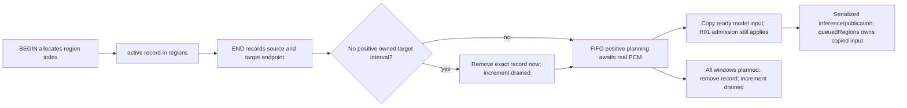

# Practice Acoustic Resource and Liveness Semantics

Round 23 characterizes approved baseline
`51a8616753e01451673cf53c5ba58adcf3476861`. It complements the
[parameter provenance ledger](practice-acoustic-parameter-provenance.md) without
changing its 93-row inventory or any production policy. This round changes only
existing tests and this document. No resource/timing value, source implementation,
identity/hash, schema, workflow or dependency changes.

Round 24, based on `2ac94b2357d1b251e542a8c2f67b6ab78fcf9154`, fixes only
R03's synchronous controller failure-propagation defect. The Round 23 reachability
witness remains valid. At Round24 the admission mechanism's semantic necessity was
**UNRESOLVED**; Round30 resolves it below, independently of numeric8. Fixing failure
handling did not qualify this cap. The source,
publication, timing, resource values and identity contracts remain unchanged.

The order is **semantic necessity → reachable valid workload → failure effect →
ownership alternative → identity impact**. Reachability in a deterministic legal
state does not estimate frequency on real hardware. A deferred worker represents
a silent/stalled inference service; fake timers advance observation time without
waiting real seconds. None of these experiments qualifies a cap or recommends
raising/lowering it. No accepted evidence may be silently discarded.

## Decision matrix

| Item | Validly reachable? | Minimal trigger | Required stall/lag | What state grows? | Current failure effect | Correctness necessity | Alternative ownership/dataflow | Identity/provenance impact | Recommended next action |
| --- | --- | --- | --- | --- | --- | --- | --- | --- | --- |
| R01 outstanding model inputs | Yes: source runtime and admitted Continuous controller, current cap4 | Four copied ready inputs; attempt to queue fifth; first INFER held | Worker/GPU service slower than ready-window arrival; no main-thread/transport stall needed | Queued+active PCM arrays, chain closures/window records, queuedRegions counters | ACOUSTIC_BACKPRESSURE_LIMIT_EXCEEDED before fifth extract; source terminal; admitted controller pauses under analysis intervention, retained session/no Result | Ordered single-worker ownership is necessary to current protocol; numeric 4 and terminal response are not mathematically required by it | Review producer admission/pull-driven planning and finite evidence/context ownership before numeric headroom; stalled capture cannot simply drop required input | Resource policy is deliberately outside evidence-core provenance; selected executor byte changes still cascade core/adapters | REDESIGN BEFORE TUNING; NEEDS REAL DEVICE/WORKLOAD EVIDENCE |
| R02 pending source regions | More than4 is valid and now accepted at both supported rates | Positive intervals accumulate inside fixed future-context lag; zero-duration regions retire immediately even behind a blocked head | No worker stall is required | Only positive region records not yet planned, plus at most one active region; copied inputs remain R01-owned | Old explicit cap/error producer deleted; no replacement numeric cap | Discrete positive source intervals + finite adapter/model horizon bound retention independently of session length; see proof below | KEEP exact-region empty retirement and FIFO positive planning; no coalescing or silent drop | Runtime admission/lifecycle change edits selected executor bytes, mechanically advancing core/composite hashes without changing evidence semantics or provenance shape | DELETE AS REDUNDANT: implemented; no device/memory qualification claim |
| R03 pending capture boundaries | Yes: public controller Start/Pause/Resume, logical clock advances while PCM delivery lags | Four preserved BEGIN/PAUSE pairs pending; next Resume attempts ninth BEGIN | Canonical 15.625ms one-bar initial/resume count-ins plus 10ms running intervals; total PCM lag 102.5ms, below transport credit payload envelope | Ordered physical-boundary queue, IDs, source/performance segment history not yet consumed | CAPTURE_BOUNDARY_LIMIT_EXCEEDED aborts bridge; **Round 24 FIXED synchronous reentrancy**: controller remains ACTIVE with canonical PAUSED transport and input-required resource intervention before Resume returns | Round30 proves finite fail-closed admission necessary for exact accepted positive history without an alternate spill owner; numeric8 is still an unqualified temporary resource-safety value | KEEP admission in principle; redesign/qualify exact representation and counting unit; no silent positive-history deletion/coalescing | Bridge/controller and cap leaf remain outside evidence-core provenance; tests/docs change no identity/schema | KEEP + QUALIFY mechanism; REDESIGN BEFORE TUNING representation; NEEDS REAL DEVICE/WORKLOAD EVIDENCE for8 |
| R04 Worklet transport credits | Yes: existing tests accept 32 unacked blocks and fail 33rd; new ACKed stream independently reaches R01 |33rd full 2048-sample block without ordered ACK | Main-thread delivery/acceptance/ACK stall; not equivalent to worker/GPU stall | Transferred PCM messages/buffers awaiting main-thread synchronous acceptance | ACOUSTIC_CAPTURE_TRANSPORT_LIMIT_EXCEEDED; Worklet stops rather than dropping PCM; capture/infrastructure owner handles fault | Finite message ownership matters; numeric 32 and exact terminal policy need workload/product justification | Retain explicit ownership/ACK integrity; review admission/backpressure separately from inference scheduling | Worklet/transport contract not directly attested by core; availability policy is deliberately outside evidence-core provenance | KEEP + QUALIFY; NEEDS REAL DEVICE/WORKLOAD EVIDENCE |
| R14 worker/RPC liveness | Yes: all five valid RPCs can receive no service response | One unanswered request with no legal liveness signal | Worker/driver/GPU silence; main-thread event loop still executes | Pending RPC/PCM/chain/lease ownership until settlement | Round27: finite silent-RPC safety fuse implemented; ACOUSTIC_WORKER_RPC_TIMEOUT terminates client/worker and rejects pending | Finite silent-service liveness is required; numeric60000ms is UNQUALIFIED_RESOURCE_SAFETY_POLICY | KEEP mechanism; qualify silence window using real supported workloads/devices; no retry/fallback | Worker liveness is deliberately outside evidence-core provenance; no core/composite/schema change | KEEP + QUALIFY; NEEDS REAL DEVICE/WORKLOAD EVIDENCE |
| R18 readiness predicate observation | Yes: real PCM preroll and TERMINAL/tail transitions | Source readiness commits; local bridge notifies after receive/schedule/abort | No observation timer or polling stall; Promise continuation follows source stack unwind | One attempt-owned subscription/abort hook/deadline per pending wait | Round28: 5ms polling removed; local event-driven observation implemented; failure/abort/dispose wake waits | Predicate truth is unchanged;5ms numerical poll was unnecessary implementation magic | KEEP local snapshot-subscribe-recheck and one-shot cleanup;15s/60s deadline qualification stays separate | Non-core Continuous bridge/input notification; source executor and all evidence identities unchanged | Polling DELETED; KEEP local observer; NEEDS REAL DEVICE/WORKLOAD EVIDENCE for remaining deadlines |
| R05 deleted resource-policy alias: maxUnacknowledgedBlocks | No executable production reader before deletion; code references removed in Round31 | Historical declaration and assertion only | None | No runtime state | Deletion changes no admission/ACK/overflow behavior; R04 remains enforced | Redundant ownership removed; real authority is transport contract/standalone producer | KEEP DELETED; qualification belongs only to R04 | resource-policy.ts is not attested; deletion changes no core/composite hash/schema | DELETE AS REDUNDANT: implemented; KEEP DELETED |

## Test validity and owners

All new resource witnesses use current caps, shipped FIR coefficient bytes, real
SourceAnalysisRuntime/ContinuousAcousticProjection, finite chronological PCM,
nonempty regions, synchronous publication sinks and the production controller
where stated. Deferred promises affect only inference/RPC completion. Controller
witnesses use public commands, actual source/performance mapping and full 2048-sample
transport messages. No private state/queue is injected, cap lowered, timeout added,
production function exported or behavior switched for tests.

A direct schedule of nine arbitrary BEGINs would not prove learner/controller
reachability: schedule() validates coordinates, not the complete product protocol.
The tests instead exercise actual controller cancellation rules. The source-only
region test separately labels public source API reachability; the controller test
establishes the stronger product path.

The short-meter fixture uses a valid 1/128 time signature at 120 BPM: a canonical
resume count-in is one bar, 1/32 quarter-note beat, 15.625ms. The existing MusicXML
meter parser accepts positive beat-type values and emits this duration; artifact
validation admits the consistent meter fields. No policy constant is shortened.
Initial and resume count-ins both use that same canonical score-derived bar in
the short-meter witnesses; the 4/4 witnesses use their normal four-beat initial
bar. This is adversarial,
schema-valid geometry, not a claim that a learner can or normally will perform
these UI actions at this frequency. Measurements are still needed for incidence.

## R01 — copied inputs and failure ordering

SourceAnalysisRuntime.append validates the block, advances nextSource, resamples
and appends to the raw ring, then calls planAvailable. A ready window first checks
`outstanding === maxOutstandingWindows`, then extracts 29120 float32 samples, and
only then enqueues the owned copy. Outstanding counts **one active plus queued
inputs**, not active GPU executions alone. The worker chain is serialized.

The source witness begins at source 96000 (48kHz, after real preroll), holds the
first inference, and feeds legitimate blocks through 219392. Four inputs are copied;
only job0 has started. Feeding toward 248320 makes a fifth window ready. A spy on
the existing AcousticPcmRing.extract observes exactly four calls before and after
failure. The accepted source prefix has advanced before planning throws. Four
copies total 465920 payload bytes; no fifth copy exists. The source failure clears
region planning state, but outstanding copied inputs remain owned until the active
promise settles and queued closures are skipped. These tests have no published
observations before the stall; accepted PCM is not the same as accepted evaluation
observations. They do not claim raw PCM must be retained as a completed-result ledger.

Disposal calls the inference port disposal once, but SourceAnalysisRuntime also
awaits its chain. A deliberately non-settling fake inference keeps that disposal
promise pending. After release, late result delivery is fenced, queued work is not
restarted, outstanding returns to zero and no publication appears. The real engine's
normal lease retirement awaits its pending service, now subject to the separate R14 silence fuse.

The admitted-controller witness confirms the source backpressure failure first
reaches the analysis owner: transport PAUSED, analysis intervention latched,
evaluation feedback null, retained ACTIVE session, no natural callback/Result,
borrowed root untouched. It does not make 4 necessary. Removing the cap alone leaves
copied buffers, closures and counters growing when inference cannot keep up.
A pull-driven planner could bound copies by ownership rather than4, but source PCM
still arrives and real-context retention must be accounted for. It is not a proof
that indefinite stall can be handled losslessly with finite memory and no failure.

### Round32 — R11 snapshot maximum is derived

The historical `maximumOutstandingInputBytes: 4 * R.inputBytes` diagnostic repeated
R01's multiplier. It now uses R.maxOutstandingWindows × R.inputBytes, retaining
465920 bytes under unchanged4/116480 owners. The real four-outstanding R01 witness
asserts that maximum and outstandingInputBytes=outstanding×inputBytes, then still
fails the fifth ready window before ring extraction/copy. No admission, source
region, worker/publication or readiness path changes. KEEP DERIVED; R01 remains
UNQUALIFIED_RESOURCE_SAFETY_POLICY and R09 remains a separate byte relationship.
The selected executor byte change mechanically advances core/composite identities
under the [existing boundary](practice-acoustic-identity-boundary.md#round32-diagnostic-derivation-and-selected-byte-identity-advance);
Result shape/evidence meaning and numeric policies are unchanged.

### Round35 — R09 input PCM accounting is derived

The historical `inputBytes: 29120 * 4` in resource policy is now
M.inputSamples × Float32Array.BYTES_PER_ELEMENT. Model geometry owns29120 and the
typed representation owns width4; the scalar remains116480. Its only production
reads are snapshot outstandingInputBytes=outstanding×inputBytes and
maximumOutstandingInputBytes=maxOutstandingWindows×inputBytes, still465920 at4.
It does not size allocations, tensors or wire messages, enforce admission or enter
a persisted/API contract. Real R01 regression checks the authoritative relationship,
representation fact and unchanged scalar, while retaining fifth-window failure
before extraction. Object/message/worker/ORT/GPU/GC/total-heap overhead is excluded.
KEEP DERIVED; R01 resource qualification remains separate. At Round35, R12 retained
targetRingBytes×4 as well as16 samples/ms and other conversions. Round36 below
derives only the former; time-rate conversions remain for later subrounds.
Resource policy imports only the existing
model authority in an allowed direction; model-contract has no reverse runtime
dependency. No selected byte attestation or evidence identity changes.

### Round36 — target-ring payload reporting follows Float32 storage

AcousticPcmRing still allocates new Float32Array(targetRingSamples), at65536 samples.
The snapshot's historical `targetRingBytes: R.targetRingSamples * 4` becomes
R.targetRingSamples × Float32Array.BYTES_PER_ELEMENT. Its262144-byte value reports
only that PCM payload, not object/allocator/runtime overhead or total ring memory.
There is no independent production reader or persisted/API contract for the field;
it does not control allocation, wrap, extraction or admission. A real four-outstanding
runtime witness checks the derived relationship and unchanged scalar/representation.
Resource policy, R09 inputBytes, R01 threshold and the ring implementation are untouched.

Round29's746/685 output bounds,29870/29809 sufficient retention bounds,29120 input
samples and65536 ring capacity remain unchanged. This does not qualify R08, prove
65536 minimum/optimal or qualify total memory. R12 remains partially unresolved
derivation debt for16/16000/1000 and other time-rate expressions. Only the selected
executor's diagnostic expression bytes change; executor/core/composite attestations
mechanically advance without changing evidence meaning, identity scope or Result shape.

### Round33 — R07 source block maximum is derived from R06

R06's `CAPTURE_TRANSPORT_BLOCK_SAMPLES=2048` is the numeric format authority,
with a verified standalone Worklet declaration. BrowserAcousticCapture checks
message samples.length equals that exact value **before** bridge acceptance/ACK.
The production SourceAnalysisRuntime.append callers are
[StepAcousticCaptureBridge.receive](../../apps/customer-web/src/lib/practice/step/step-acoustic-capture-bridge.ts)
and [ContinuousAcousticProjection.append](../../apps/customer-web/src/lib/practice/acoustic/continuous/continuous-projection.ts).
The former passes the accepted chunk's identical Float32Array without expansion;
the latter only forwards its block. Its sole production upstream,
[ContinuousCaptureBridge.receive](../../apps/customer-web/src/lib/practice/acoustic/continuous/capture-bridge.ts),
first validates SourceChronology, then takes subarrays partitioned by boundaries
inside that chunk. Each slice is bounded by its parent; ordered slices cover the
same source coordinates without padding/combining. No file-input, batch or synthetic
production producer exists. The runtime's internal ring.append is a resampled-ring
operation, not another source producer.

Thus source/runtime maximum <= current transport block size is a structural
pipeline relationship, not an independent numeric choice. Round33 deletes the
historical resource-policy.maxSourceBlockSamples alias; SourceChronology and source
runtime directly import the transport constant. Both retain `length > maximum`
validation, not exact-size admission. SourceChronology still rejects empty chunks;
all other source/rate/finite/chronology checks and failure codes are unchanged.
Real-owner regressions accept2048 and smaller chunks, reject oversized input before
source truth advances, preserve Continuous within-block slices and STEP pass-through.
Runtime→source is an existing permitted dependency direction; no guard is relaxed.
KEEP DERIVED; R06's numeric2048 still requires device/latency/allocation qualification.
The selected executor's import/expression bytes mechanically advance core/composite
attestations; no evidence meaning or Result shape changes.

### Round34 — T14 gesture count guard deleted under the accepted contract

Before retaining observations, StepAcousticAttemptAssembler calls the unchanged
SourcePublicationSequence. It rejects publication length>maxEventsPerWindow=16104;
sourcePublication also rejects oversized raw inference output. This upstream bound
is retained. Accepted same-region successors require consecutive window indices,
next start at previous start+owned600ms, and previous owned end equal to that start.
Hence a nonfinal predecessor is full-width; a partial final has no same-region
successor. H50=50ms<600ms, so an active half-open gesture can touch at most its
initial publication and one successor. A full successor seals before a third;
a partial successor either seals or leaves the gesture active with no legal
same-region successor. A region change while active still fails
STEP_ACOUSTIC_GESTURE_COVERAGE_GAP, rather than accumulating another region.

Thus at most2×16104=32208 observations can be retained for any accepted gesture,
below the historical32768 guard. Round34 deletes the independent constant and
internal failure branch; it installs **no replacement cap**. Cross-window tests
show sealing at window1 and no contribution from window2; partial-final tests cover
both enough/not-enough frontier and rejected successors. The upstream length-gate
tests use sparse invalid arrays, not tens of thousands of generated gesture events.
Existing malformed/sequence/duplicate/mapping/retirement/reentrancy failures and
the6000-publication ownership regression remain. Copy/freeze/order/dedupe and the
current-H50-plus-previous-summary lifecycle are unchanged.

Production implementation changes; runtime/product behavior changes **NO for all
inputs accepted by the current source-publication contract**. This is not a claim
about arbitrary JavaScript objects or a device/learner-density qualification.
KEEP DELETED; retain upstream bounds and topology regressions. H50 and R10/R06
retain their independent evidence classifications. The STEP assembler is not a
selected evidence-core byte anchor, so no core/composite identity changes occur.

## R02 — explicit region cap deleted with structural lifecycle bounds

Round23's historical cap4 witness was legal: four short closed positive regions
awaited real future PCM (regionsStarted=4, regionsDrained=0, windowsQueued=0,
outstanding=0); the fifth BEGIN produced ACOUSTIC_SEGMENT_LIMIT_EXCEEDED. It did not
require a worker stall. Round29 removes the explicit count check and
maxPendingSegments field/error producer. There is **no replacement numeric cap**.
The same public-controller short-meter/full-block witness now admits the fifth
region, stays ACTIVE/RUNNING, and has no intervention, bridge failure or Result.
R03 remains a separate cap8 safety fuse with unchanged ninth-boundary failure.

### Exact-region empty retirement closes the no-progress loophole

Simply deleting cap4 was unsafe. FIFO planAvailable returns when a positive head
window lacks future PCM. Zero-duration followers behind it would never reach their
own planWindow=null branch and could accumulate without source progress.

endAnalysisRegion now closes the active record, and if endTarget===originTarget
removes **that exact record** from regions immediately. It consumes its original
monotonically allocated region index, increments regionsStarted/regionsDrained
truthfully, clears active, returns IDLE and then calls normal planAvailable.
An empty region owns no window, copied input, publication or observation. No
positive head is shifted out, and no later region/job/window identity is renumbered.
In particular, actual zero-source-duration BEGIN/END always satisfies this empty
ownership condition. Existing finite-coordinate/representability checks remain;
this lifecycle rule does not repair or normalize source coordinates.

regions[] is pending **planning**, not inference history. queuedRegions/outstanding
can remain nonempty after a region is removed and tailReady becomes true. R14 owns
silent worker settlement; deletion of R02 does not create another inference queue.

### Finite source-progress retirement horizon (both rates)

Use relative source count N=absoluteSource−base, source rate r, model ratio
u/d=16000/r and FIR center c=(tapCount−1)/2. Shipped pairs are:

| r | u | d | taps | c | Declared conservative real lookahead ceil(c/u) |
| --- | ---: | ---: | ---: | ---: | ---: |
| 44100 | 160 | 441 | 8821 | 4410 | 28 source samples |
| 48000 | 1 | 3 | 61 | 30 | 30 source samples |

The real adapter emits target sample m exactly when its actual emission predicate
floor((m*d+c)/u)<received holds. Thus a final window with exclusive integer input
end F needs samples through m=F−1 and becomes ready at the exact adapter threshold
N_required(F)=floor(((F−1)*d+c)/u)+1 (using the actual Float64 operations for an
implementation threshold). No padded samples are admitted.

For a closed endpoint E, the last partial input end is
F=round(endTarget+170*16)=round(endTarget+2720). In exact arithmetic,
endTarget=(E−base)*u/d. Therefore the exact-arithmetic required progress is
N_required(round(N*u/d+2720))−N. Its phase repeats after d source samples, adding u
target samples. Exhausting all d residues gives worst cases **7524 at44100** and
**8189 at48000**. These are derived equation results, not latency or policy values.

A strict implementation bound must also cover the existing Float64 expressions,
not assume arbitrary source-coordinate translations are bit-exact. The following
conservative bounds apply throughout the existing nonnegative safe-integer source
index range (and when the subsequent source progress is representable):

1. Relative source differences are exact integers. Multiplying one by16000 stays
   below2^67, so round-to-nearest product error is at most8192. The subsequent
   division is below2^52 target samples and has error at most1/4 target sample.
2. endTarget is the sum of two such conversions (origin and region duration).
   Include at most1/4 for that sum,1/4 for adding2720, and1/2 for integer rounding.
   Hence |F−(N*u/d+2720)| <= a_r=16384/r+3/2 target samples.
3. For44100, m*441 and its addition of4410 are below2^61, each with at most128
   error; division by160 has error at most1 source sample, including the upper
   safe-index boundary neighborhood. Thus the emission expression differs from
   its real-arithmetic coordinate by at most e_44100=256/160+1=2.6 source samples.
   For48000, m*3 and addition of30 are below2^54 with error at most1 each;
   division by1 is exact, so e_48000=2 source samples.
4. Consequently a uniform sufficient horizon is the derived integer
   H_r=ceil((2720+a_r−1)*d/u+c/u+e_r+1): **7531 source samples at44100** and
   **8196 at48000**. The −1 selects F−1 and the final +1 makes received exclusive.
   These deliberately conservative implementation bounds are not tight minima,
   measured device margins or new production constants.

Every remaining closed **positive** source region consumes at least one discrete
source sample. Closed endpoints are ordered and distinct. At current N, an endpoint
E<=N−H_r has every required window ready; FIFO must plan/remove it unless R01 or an
independent existing integrity guard fails closed. Older endpoints have the same
bound, so earlier regions cannot indefinitely block an otherwise sufficiently old
record. Only a finite H_r-sized suffix of possible positive endpoints can remain,
plus at most one active region. This count relation is independent of session
length, prior region count and worker speed. Near the safe-index ceiling no
out-of-range future append is promised: the implication for representable N and
E<=N−H_r still bounds retained records. Without source progress positive records
cannot increase; zero-duration records no longer persist. No count check implements
this derived relationship.

### Ring-retention proof; R08 and R01 remain separate

Each queued input copies exactly29120 target samples; in-flight inference no
longer relies on the ring. For a not-yet-copied window with input end G, its start
is G−29120. Planning runs after **every admitted append**, which carries at most
CAPTURE_TRANSPORT_BLOCK_SAMPLES=2048 source samples, now directly derived from R06
by both validation owners rather than a separate R07 literal. Given that unchanged
transport format, the proof remains intact; this does not qualify numeric2048.
From the emission error bounds above, a conservative maximum
output increment is D_r=ceil((2048+2*e_r)*u/d)+1: **746 / 685 target samples**.
This follows by comparing the last emitted and first not-emitted sample predicates
before/after the append, not by inventing extra audio context.

Final endpoints are ordered in exact source time; their rounded target input ends
can differ from that order by at most ceil(2*a_r)=4 target samples. Full-window ends
use one source conversion plus exact integer9600-sample strides, whose rounding
error is no larger than the same a_r bound. An earlier head
window never ends after its own final window. A newly closed partial window still
needs2720 future target samples, far more than these roundoff/adapter bounds, so
closing cannot introduce a deeply overdue unplanned input. Once a head crosses
readiness, FIFO immediately extracts all ready work or R01 fails closed. Thus even
a later window delayed by the four-sample ordering skew has L−G <= D_r+4 at its
first extraction opportunity, where L is the ring end.

It suffices that ring capacity >=29120+D_r+4: **29870 at44100 / 29809 at48000**.
The unchanged capacity65536 satisfies both, hence
G−29120 >= L−65536 = firstRetained when the ring has wrapped. At stream origin,
qualified preroll supplies the existing fully-real lower boundary10; a valid short
final input remains above it. This proof concerns admitted real-context workloads,
not forged insufficient-preroll calls, numeric overflow, padded finish or a stalled
main-thread batch outside the2048-source-sample append contract. Those existing
guards still fail closed. The ring has ample *proved retention for this lifecycle*;
this neither qualifies all65536 headroom nor authorizes shrinking R08.

If many windows become ready together and inference cannot drain, the unchanged
R01 maxOutstandingWindows=4 rejects the fifth **before** ring.extract/copy. R02
removal does not bypass it, retain an unbounded copied-PCM backlog or silently drop
any evidence. R01's numeric qualification remains separate.

### Executable witnesses and identity consequences

Both rates test one blocked positive head followed by128 zero-duration regions
without any PCM progress: only the positive head stays pending, all empty indices
are consumed/retired immediately, no worker/publication exists, then real tail
produces exactly the original region's window. Both also retain64 distinct positive
regions beyond4, then append real samples and promptly drain inference: all64
indices/windows publish once, pending/outstanding reach0 and started==drained.
Those tests begin after ring wrap and verify extract start>=firstRetained. Positive
source gaps retain the existing exact publication-order contract at fractional
44100 phases; no source mapping/rounding validator is changed.

Continuous projection separately tests32 positive segments at both rates, distinct
source/performance anchors, ordered unique observation/publication identities and
truthful terminal coverage. The existing public fifth-region controller witness
now succeeds; the ninth-boundary R03 witness remains unchanged. Test counts128/64/32
are witnesses, never replacement production limits. Equation/residue and large
numeric-boundary probes support the analytic inequalities; tests are not the proof
or a device/memory/workload qualification.

Editing source-analysis-runtime.ts changes a selected byte attestation even though
this is an admission/lifecycle change. Round29 updates executor bytes/SHA and
mechanically recomputes core and both adapter composite identities. Model, decoder,
FIR, planner, adapter implementation and evidence semantic declaration are unchanged.
Result remains schema6 with the same evidenceProvenance shape; its current identity
values advance, without adding runtime-policy provenance or full outcome replay.

## R03 — controller boundaries and transaction-safe failure propagation

Start/Resume plan a future BEGIN at count-in completion and a TERMINAL at the scope
end. isPending allows cancelPending to ignore already-applied IDs. Pause always
cancels future TERMINAL. During count-in it also cancels the future BEGIN. Once
RUNNING is logically reached, Pause preserves a BEGIN still awaiting PCM and
schedules PAUSE after it: otherwise historical captured PCM would lose its source
segment. Pause during a canceled resume countdown adds no new running interval.
The capture bridge applies pending boundaries only when nextSource exactly reaches
their source coordinate; new control boundaries can coexist with old ones while
that source delivery lags.

The minimal count-growth witness uses initial count-in with unconsumed BEGIN:

| Public operation | Pending after cancellation/application rules |
| --- | --- |
| Start | BEGIN, TERMINAL (2) |
| Reach RUNNING, Pause1 | BEGIN1, PAUSE1 (2) |
| Resume1 | prior pair + BEGIN2, TERMINAL (4) |
| Reach RUNNING, Pause2; Resume2 | two pairs + BEGIN3, TERMINAL (6) |
| Reach RUNNING, Pause3; Resume3 | three pairs + BEGIN4, TERMINAL (8) |
| Reach RUNNING, Pause4 | four BEGIN/PAUSE pairs (8), old TERMINAL canceled |
| Resume4 | ninth BEGIN attempted before new TERMINAL; bridge aborts |

Every preserved interval is positive. Each completed running pause/resume cycle
increases surviving history by two; count-in cancellation cannot accelerate that
growth. From the initial two-boundary state, four pauses/four resumes are the
minimal cycle count to attempt the ninth under these rules. The fixture's source
PCM delivery lag is 102.5ms, compatible with fewer than 32 queued transport blocks
at 48kHz. Main-thread input/control tasks progressing while capture-message tasks
are delayed is a scheduling adversary, not measured hardware behavior. A normal 4/4
count-in would require much longer lag and may encounter R04 first; the short-meter
witness avoids assuming that transport has unlimited credits.

### Round30 — finite admission necessity, independent of numeric8

#### Positive breakpoints are observable information

Let accepted positive running interval i own source samples `[s_i,e_i)`, at source
rate r, with Performance Time start p_i. Its mapping is
`P(s)=p_i+(s-s_i)*1000/r`. Between intervals there is a real paused source gap,
while `p_(i+1)=p_i+(e_i-s_i)*1000/r`: the gap contributes no Performance Time.
Exact replay therefore needs enough information to recover each source start/end
and its Performance Time relationship until PCM consumes that history. This need
does not depend on AcousticBoundary objects being the eventual representation.

The Round30 bridge regression uses real source adapter/window/projection owners,
the same chronological deterministic PCM and physical fake-inference events in
five counterfactual histories. At48kHz A owns `[96000,96480)`, a10ms pause follows,
and B owns `[96960,97440)`. Original observations are C4 at `(source96000,P0)`
and D4 at `(source96960,P10)`, from distinct region/window/observation identities;
the terminal analyzed-through frontier is20ms. The gap's E4 atsource96720 is excluded.
Deleting A or B loses its valid evidence even when the remaining history is made
internally valid; deleting A also moves B toP0. Replacing all four boundaries with
`BEGIN A → TERMINAL B` while retaining P20 fails the real
`ACOUSTIC_SEGMENT_END_MISMATCH` invariant: the envelope owns30ms, not20ms.
Changing the terminal toP30 makes the envelope internally valid but wrongly
includes gap E4 atP15 and shifts B toP20. Neither preserves observable history.
This is a semantic counterexample, not a recognition-quality or hardware claim.

#### Information-retention lower bound

For any N within representable source chronology, construct N independent blocks.
Each block has A running10ms, a positive gap g1, B running10ms, and a positive gap g2
before the next block. Choose `(g1,g2)` as either `(20ms,30ms)` or `(30ms,20ms)`.
Both gaps allow the short-meter fixture's15.625ms canonical Resume Count-In plus
paused time; choose a scope long enough for the admitted prefix. Both choices have
identical70ms source duration,20ms Performance Time advance and end anchors.
At48kHz all boundaries and a possible physical event30ms into a block
are on real source/model frame coordinates. That event is inside B for the first
choice and inside a paused gap for the second. The N choices yield2^N histories
with identical aggregate/end summaries but independently distinguishable evidence
membership. Any exact lossless representation must distinguish these histories,
requiring at least N bits. Encoding them in one arbitrary-precision number still
uses growing storage; a constant number of fields is not constant space.

Thus there is no fixed-space exact representation of arbitrary accepted positive
history independent of its length. This is a family/lower-bound argument within
the existing safe-integer chronology, not an assertion of literally infinite JS
coordinates or an exact browser delivery-lag distribution. The finite numeric
coordinate universe is not a supported memory budget. Some particular regular
histories can compress, and redundant/cancellable controls can disappear; the
counterexample proves that internal positive breakpoints cannot **generally** be
deleted or envelope-coalesced. Arbitrary possible events are enough for this
necessity argument; no assumption that a real decoder always detects them is needed.

#### Current owners and finite admission consequence

The capture bridge retains pending exact source/performance boundaries and IDs.
Projection segments/source regions are populated as that PCM history is consumed,
not an external store for unconsumed controls. Controller future-BEGIN/TERMINAL
handles are cancellation handles, not a lossless archive. The canonical
[performance clock](../../apps/customer-web/src/lib/practice/continuous/domain/performance-clock.ts)
also retains `clockSegments` for historical session/performance conversion; this
is growing in-memory history, not bounded external persistence, nor a replacement
source-sample boundary replay owner. Worklet credits retain PCM, not control topology.
No current capture/controller owner spills accepted chronology to disk or another
lossless external persistence owner. Moving history between these in-memory owners
would not defeat the information lower bound or establish a finite browser budget.
The present fuse bounds pending bridge admission, not all canonical-clock memory
or total supported session duration; no whole-application memory qualification is implied.

Given finite resources, exact accepted positive history, no silent drop/reorder/
coalescing, and no alternate spill owner, some **finite explicit fail-closed
admission** of not-yet-consumed control history is necessary in principle. The
alternative would require a new persistence owner or an explicit product limit
on accepted history. This proves the mechanism requirement, **not** numeric8,
the boundary-array counting unit, or a particular overflow UX. Paired segment
records, byte-budgeted compact exact structures or persisted history may be future
representations, but must preserve every accepted breakpoint's mapping and
explicitly fail or persist at capacity. No such redesign is implemented here.

#### Growth induction and legitimate cancellation

Let H_k be historical positive BEGIN/PAUSE boundaries after k completed RUNNING→Pause
cycles while capture has consumed none of them. H_0 is empty. Start/Resume schedules
a future BEGIN and a cancellable future TERMINAL. If the count-in has not logically
reached BEGIN, Pause may cancel it: no positive interval has been accepted. Once
RUNNING is logically reached, Pause instead retains that BEGIN, cancels the future
TERMINAL and appends PAUSE closing a positive interval. Hence H_1 has two entries.
Inductively Resume retains the entire H_k prefix and appends future BEGIN/TERMINAL;
the next logically reached positive RUNNING→Pause replaces that TERMINAL with PAUSE,
so `|H_(k+1)|=|H_k|+2=2(k+1)`. Source consumption would retire history, but without
it each admitted cycle adds two necessary breakpoints. The induction is conditional
on admission, independent of cap8; current8 stops the prefix from growing beyond
its capacity rather than being a premise of the proof.

The public-controller witness now asserts each preserved prefix with `isPending`,
positive source/performance intervals, a real paused source gap with equal
Performance Time anchors, unchanged source-consumption position and new future
BEGIN/TERMINAL suffixes. Its four completed cycles reach2,4,6,8 historical entries
before the next BEGIN fails admission. Bounded32-entry `boundaryDiagnostics` is
only engineering evidence of operations; the actual pending queue/IDs own replay.
Trimming diagnostics neither retires nor authorizes dropping accepted history.

R04 does not derive8. Its32×2048/48000≈1.365s is a payload-duration conversion,
not a safe-stall SLO or a bound on main-thread control tasks. The legal R03 witness
fails at102.5ms PCM lag, earlier than that payload horizon. PCM credits, model-input
ownership and accepted control chronology have different counters/failure domains.
No exact MessagePort scheduling upper latency is inferred. R01 remains separate;
R02's structurally bounded source-region lifecycle is not re-capped or coupled here.

**Current conclusion:** mechanism KEEP in principle; representation/counting unit
may be REDESIGNED BEFORE TUNING. Numeric8 remains
UNQUALIFIED_RESOURCE_SAFETY_POLICY: a temporary defensive safety fuse, not a
qualified workload, browser or user limit. Why8, real learner control churn,
capture/main-thread scheduling distribution and memory/headroom remain NEEDS REAL
DEVICE/WORKLOAD EVIDENCE. Round30 changes only tests/documentation. Overflow,
explicit End → fresh healthy Start, evidence identities and Result schema6 are unchanged.

### Historical Round 23 defect; Round 24 status: FIXED

At the Round 23 baseline, schedule's CAPTURE_BOUNDARY_LIMIT_EXCEEDED aborted the
bridge and SourceAnalysisRuntime. Because bridge.failed was already true,
ContinuousPracticeController.analysisFailed classified it as capture infrastructure
and entered inputHealthChanged/updateResourceIntervention. That path attempted
pauseTransport inside Resume's existing AudioContextPerformanceClock transaction,
throwing NESTED_CLOCK_TRANSACTION. Application remained ACTIVE with COUNT_IN,
no resource intervention, and could advance again on refresh. This was a separate
failure-propagation correctness defect, not evidence that a larger cap was needed.

Round 24 preserves the same legal witness and the first capture failure. Controller
callbacks latch input-health facts and pending resource work during the canonical
clock transaction. Analysis/other pause requests use a pending transport-pause
intent; recording facts remain owned by the recorder. Only after the outer clock
transaction releases its latch does transition's finally synchronously drain these
actions, before the public command returns. A drain guard prevents its own pause
transaction from recursively draining; resource application rereads latched input
and recorder facts after pausing. A latched RESTART_REQUIRED input incident cannot
be overwritten by a weaker live-health snapshot or subsequent health notification.
No timer, microtask, retry, exception suppression or boundary-specific branch is
involved. Cleanup clears pending intents and existing lifecycle guards prevent
stale callbacks from reestablishing an intervention after abandonment/disposal.

The updated witness verifies that Resume does not throw and returns with:

- Application ACTIVE; canonical transport PAUSED, with Performance Time frozen
  across a later clock advance and refresh; no Resume/recovery bypass.
- Bridge failed=true, pending boundaries=0; source failureCode remains
  CAPTURE_BOUNDARY_LIMIT_EXCEEDED; no worker inference, publication-derived Result
  or natural-completion callback.
- analysisIntervention=null; resource intervention reason CAPTURE_PIPELINE_INVALID,
  recoverability RESTART_REQUIRED, state WAITING_FOR_USER, impact INPUT_REQUIRED
  for recording OFF, and pauseOrigin INTERVENTION.
- Exactly one additional canonical, recorder-port and metronome pause; exactly one
  resource-intervention diagnostic. End/dispose abandons and releases once while
  preserving borrowed root ownership.

A separate non-cap regression emits a real AudioContext statechange synchronously
from the metronome's Resume port. It verifies one canonical/media pause, stable
session identity/time, SAME_PIPELINE_RECOVERABLE classification, and explicit
same-owner recovery with normal Resume Count-In. Four transaction-local input or
analysis + recording order permutations verify one pause and no bypass of the
remaining learner choice. Another non-cap capture abort followed by weaker clock
and recording facts verifies that hard first-cause ownership survives the drain.
Existing USER-paused, INITIAL/RESUME count-in, analysis-pause-once and teardown
regressions remain applicable. These tests establish failure ownership; they do
not qualify cap8 or implement queue redesign.

### Round 26 — temporary defensive safety fuse and honest recovery

Bounded ownership/backpressure is required in principle: when capture source PCM
does not advance, learner control chronology cannot consume unbounded retained
memory. The current `maxScheduledBoundaries=8` is a **temporary defensive safety
fuse, not a qualified workload limit**. There is no proof that 8 is mathematically
necessary, a browser safety limit or the supported ceiling for normal learner
interaction. Worklet32 credits do not derive cap8. Raising the number would not
resolve the ownership/chronology problem. Round26 recorded **REDESIGN BEFORE TUNING**;
Round30 above supersedes its mechanism-necessity uncertainty with a proof. Compact
representation/counting-unit redesign and numeric workload qualification remain future work.
No cap value or queue algorithm changes in Round 26.

Overflow remains fail-closed: bridge/runtime retain first cause
CAPTURE_BOUNDARY_LIMIT_EXCEEDED; the bridge is failed and its pending queue aborts.
This is an explicit attempt failure, not silent removal of positive BEGIN/PAUSE
history followed by continued analysis. No accepted positive interval is silently
coalesced, no failed bridge is retried, no Result is fabricated and Performance Time
stays PAUSED. The current attempt cannot safely resume its failed capture pipeline.
Application attempt ownership remains ACTIVE until explicit learner End or existing
page teardown; overflow itself is neither abandonment nor natural completion.

The existing application reason CAPTURE_PIPELINE_INVALID is sufficient to distinguish
capture processing failure from MICROPHONE_SOURCE_LOST. For hard capture incidents,
ResourceInterruptionDialog says “Audio input processing stopped” / “音频输入处理已停止”,
with “Audio processing for this attempt could not continue safely. End this attempt,
then start a new one.” / “本次练习的音频处理无法安全继续。请结束本次练习，然后重新开始。”
It exposes only **End**. It does not claim physical disconnection, expose technical
codes, offer Resume/degradation/Restart/Retry or silently restart. Physical source
loss retains its input-loss copy; recoverable AudioContext and recording-only
incidents retain their existing actions and wording. Device icons continue to
represent actual Device Lease health, not internal capture failure.

End uses the existing abandon/dispose path: no Result or natural-completion callback,
release of the failed capture graph/worker lease/attempt clock/metronome, and no stop
of a healthy borrowed root. The hook waits for release and returns READY/IDLE with
no stale intervention. **When workspace readiness and Device Lease remain healthy,
explicit Start is allowed directly**, without forced Setup. It creates a new
controller/session/capture bridge and inference lease; the failed graph/session is
never reused. It can enter normal count-in/running. If actual device/environment
readiness is unhealthy, the existing Setup/requalification owner still applies.
This is explicit End → new Start, not a new universal Restart action.

Regression evidence is compositional: the real ninth-boundary controller witness
now includes release and a fresh successful admission on the same healthy borrowed
root; hook tests verify READY and a new controller after explicit End/Start; page
and EN/ZH component tests verify honest copy, End-only action and healthy Start
availability. No private-state injection or production test-only hook is used.
The Round 25 evidence-core boundary remains intact: capture/resource failure policy
is outside that identity, and no acoustic/core/composite hash or Result schema changes.

### Historical coalescing witness and current constraint

The Round23 bridge regression delivers two 10ms positive intervals with one 10ms pause.
It emits distinct observations at (performance 0ms,source 96000) and
(performance 10ms,source 96960), then exact terminal 20ms. Dropping a BEGIN/PAUSE pair
would remove real historical evidence and/or change later performance anchors.
Combining separated intervals without retaining their gap/mapping also corrupts
Source Time→Performance Time. Zero-length regions may publish nothing, but region
indices/observation IDs/coverage and controller state still require proof before
calling even that deletion observationally equivalent. Round29 now immediately retires
exact empty source regions without renumbering other regions. Pending TERMINAL
cancellation already has explicit ownership. Round30's counterfactual regression
above proves positive envelope coalescing is not generally equivalent; no coalescing
implementation is introduced. Compact representation preserving **all** intervals remains a research
candidate; erasing positive history is not an approved optimization.

## R04 — three distinct backpressure positions

BrowserAcousticCapture receives a full block, calls bridge.receive synchronously,
checks the consumer returned undefined and capture is not stopped, then posts ACK.
The inference Promise is not awaited. A capture test records accept→ACK while its
accepted inference remains pending. A second test runs the actual standalone
Worklet with chronological PCM and ACKs each accepted block. More than 32 cumulative
blocks pass; a held first inference independently fills the four copied-input slots
and reaches R01 without a Worklet credit failure. The isolated transport fixture
then sends STOP explicitly; production capture cleanup is separately exercised at
the BrowserAcousticCapture/controller owner. Existing Worklet tests prove that
32 simultaneously unacked blocks pass and 33rd fails, with no new accumulator.

- **Main-thread/capture delivery stall:** unacked transferred blocks grow at R04.
- **Worker service stall:** main-thread can still ACK; copied inference inputs grow
  at R01. regions[] may already be retired.
- **GPU stall:** INFER may remain unanswered inside the worker; it can look like a
  silent worker hang to the client, but is not the same queue as Worklet credits.

Credits do not structurally bound outstanding model inputs, future control boundary
count, or source-region count. They count unaccepted PCM messages, not model work
or user controls. There can be correlations in actual scheduling, not a mathematical
substitution for the other bounds. `32×2048/rate` is 1.486077s at 44.1k and 1.365333s
at 48k, solely **payload duration conversion**, not a safe-stall SLO or a liveness
proof. Current sample/block/credit values remain unchanged.

## R14 — finite silent-RPC safety fuse implemented in Round 27

Round 23 proved the prior absence of a silence deadline: valid LOAD, BEGIN_SESSION,
INFER, END_SESSION and idle DISPOSE could remain pending indefinitely. A real
source tail could be ready while inference/drain remained outstanding; the former
60000ms tail predicate wait did not cover subsequent seal/drain. This remains the
historical defect and the reason for the Round 27 product decision.

The model-service owner now declares
[ACOUSTIC_WORKER_RPC_SILENCE_TIMEOUT_MS=60000](../../apps/customer-web/src/lib/practice/acoustic/model/worker-liveness-policy.ts).
It is a **temporary defensive silence safety fuse**, not an inference latency SLO,
GPU/device qualification, total model-load duration limit or exact wall-clock
scheduler guarantee. While the main-thread event loop can continue executing, a
pending RPC without a legal liveness signal no longer owns an infinite lifecycle.
Browser background throttling/scheduling can delay timer delivery; failure is not
promised to occur at exactly60000ms of real wall time.

[AcousticModelWorker](../../apps/customer-web/src/lib/practice/acoustic/model/worker-client.ts)
owns one watchdog per pending request. Matching final response removes pending and
clears its timer before settlement. Legal matching **LOAD PROGRESS** invokes the
existing callback and rearms that request's silence window, retaining the request
ID. Thus a progressing load may take more than60s in total. Malformed progress,
non-LOAD progress and unrelated messages cannot refresh another request. No
progress protocol exists for the other four RPCs. Malformed matching responses do
not settle an RPC or renew its watchdog; existing unmatched-response failure
remains fail-closed.

On silence timeout the first terminal cause is ACOUSTIC_WORKER_RPC_TIMEOUT:
client CLOSED, worker terminated, all pending RPCs rejected and all watchdogs
cleared. Late messages/errors/disposal cannot revive CLOSED or notify failure
twice. Crash/messageerror before timeout preserve their own codes. Synchronous
postMessage failure removes its pending record/timer immediately. Explicit dispose
of a busy client still immediately terminates with ACOUSTIC_WORKER_DISPOSED, never
waiting for60s. Normal lease retirement still belongs to the engine; it now awaits
RPCs that have bounded silence, rather than an unbounded service promise.

| RPC / owner | After silence fuse (no response/progress) | Existing ownership retained |
| --- | --- | --- |
| LOAD | Reject TIMEOUT; engine FAILED; explicit Environment qualification becomes BLOCKED | No automatic second worker; only explicit Setup/requalification may replace it |
| BEGIN_SESSION | Reject TIMEOUT; engine FAILED; no reusable/returned broken lease | Exclusive acquisition; no READY_IDLE reuse |
| INFER | Reject TIMEOUT; engine FAILED; source chain/drain can settle | Accepted evidence is not invented; no worker/provider retry or fallback |
| END_SESSION | Reject TIMEOUT; RETIRING transitions through FAILED; retirement rejects finitely; concurrent engine disposal can finish | No replacement lease from failed engine; disposal does not force earlier normal retirement |
| DISPOSE (idle worker) | Reject TIMEOUT after worker termination | Cleanup error remains observable; no pretend successful disposal |

Idle DISPOSE retains its existing owner contract (the disposing owner issues no
concurrent work); this round does not introduce a different general concurrency
model. The client busy-dispose and engine lease-retirement owners remain distinct.

### Application propagation and real-client regressions

No SourceAnalysisRuntime, publication, controller or STEP failure-classification
behavior is changed. The existing rejection/onFailure paths give:

- **Continuous ACTIVE:** canonical PAUSED transport and analysis intervention,
  not CAPTURE_PIPELINE_INVALID/resource intervention. The learner chooses existing
  Continue without analysis or End; accepted degradation retains session/clock/
  healthy recorder, disables feedback and never retries the worker.
- **Continuous natural FINALIZING:** the real tailReady=true, pendingRegions=0,
  outstanding=2 witness has no Result before error settlement. After the silent
  INFER times out, runtime drain settles, healthy recording finalizes and the
  controller naturally reaches COMPLETE exactly once, with UNAVAILABLE /
  CONTINUOUS_ANALYSIS_UNAVAILABLE evaluation and the configured acoustic evidence
  provenance. It does not abandon scope completion or fabricate target evidence.
- **STEP ACTIVE:** existing acoustic-runtime classification latches the terminal
  analysis intervention, preserves ACTIVE session/target/progress and makes input
  unavailable. No infrastructure intervention, verdict, completion or restart is
  fabricated. Only existing End/page teardown ends the retained attempt.
- **Setup:** silent LOAD moves explicit CHECKING to real BLOCKED with diagnostic
  timeout reason. A new engine is created only by a later explicit requalification.

Tests use real client/engine protocol with deterministic fake service replies and
fake timers, including five silence paths, response-before-deadline, repeated LOAD
progress beyond total60s, progress-then-silence, malformed/unrelated messages,
crash/messageerror precedence, busy dispose, postMessage throw, late-response fences,
engine failure/retirement/disposal and the application paths above. No real60s sleep
or production test hook is used.

R14 mechanism is **KEEP + QUALIFY**: finite silent-service liveness is required;
the numeric60s window still **NEEDS REAL DEVICE/WORKLOAD EVIDENCE**. No generic retry,
provider fallback, global coordinator or broader cap/polling redesign is included.
The Round25 evidence-core exclusion of runtime liveness remains unchanged: no
acoustic core/composite hash, timing provenance, assignmentV4 or Result schema6
change, and no new runtime-policy provenance field.

## R18 — 5ms polling removed; local event-driven observation implemented

Round23 showed that delaying the old5ms readiness timer to50ms changed only when
prerollReady was noticed, not source event sample, projected Performance Time,
terminal analyzed-through, publication identity/order or availability clock policy.
Round28 keeps that same PCM/source/boundary geometry regression, now observing
readiness without any periodic timer. It does not claim improved recognition
accuracy or a new event/latency model.

The attempt-local
[ContinuousCaptureBridge](../../apps/customer-web/src/lib/practice/acoustic/continuous/capture-bridge.ts)
owns subscribeReadiness. It notifies after successful receive has committed all PCM
and reached boundaries, after schedule has applied any immediately reached boundary
(including TERMINAL), and after abort/failure state has committed. Observers cannot
undo source/capture state: a throwing listener is isolated from the committed
operation. This is not a global event bus, store, singleton or cross-mode observer.
No notification or dependency is added to SourceAnalysisRuntime or STEP.

[ContinuousMicrophoneInput](../../apps/customer-web/src/lib/practice/continuous/continuous-microphone-input.ts)
owns each one-shot wait. It checks the current source predicate, subscribes, then
**rechecks** predicate/failure/cancellation so a transition between snapshot and
subscription cannot be missed. At most one existing safety deadline timer remains
per wait; there is no5ms/10ms/20ms observation loop or periodic wakeup. Listener
callbacks only settle the wait Promise; application continuation runs after the
capture/source mutation stack unwinds and cannot reenter canonical transport.

Readiness, first source/worker failure, AbortSignal, input disposal or deadline
settles the wait once and detaches the bridge subscription, abort handler and
deadline timer. The input owns a local pending-wait wake set so worker failure or
dispose does not leave an orphan waiting for a future PCM notification/deadline.
Dispose does not require caller abort. A stale notification or delayed timeout
callback is fenced by settled/disposed state and cannot revive the attempt.

The preroll safety deadline remains **15000ms** (R16); tail-ready remains
**60000ms** (R17). Their callbacks recheck current predicate before rejecting with
CONTINUOUS_ANALYSIS_TIMEOUT. If readiness committed before a delayed callback is
actually delivered, readiness wins; browser scheduling/throttling still prevents an
exact wall-clock timeout/SLO claim. Both values remain
UNQUALIFIED_RESOURCE_SAFETY_POLICY. Capture readiness10000ms (R15) and worker RPC
silence60000ms (R14) retain separate owners and unchanged values.

TailReady means source-region planning has the required real PCM; it does not mean
outstanding inference has drained. Event notification clears the readiness wait,
then existing capture stop/seal/drain ownership continues. A deferred-inference
regression proves tailReady can wake while finish remains pending on drain; the
Round27 RPC silence watchdog independently handles a silent service. R18 neither
replaces that watchdog nor merges these timeouts into a generic audio timeout.

Executable regressions cover exact real preroll threshold, source origin and
geometry; TERMINAL at current source with no later PCM; tail PCM readiness followed
by independent drain; missed-notification subscription handoff; preroll/tail
safety deadlines and readiness before delayed timeout; failure/abort/dispose in
both phases; listener/timer/abort-hook cleanup and stale callbacks; and observer
exceptions after committed bridge transitions. No production test hook is added.
The source executor, core declaration/hash, source-adapter hashes, Result schema6,
assignmentV4 and timing/provenance contents remain unchanged. Only predicate
observation mechanism changes; numeric deadline qualification remains future work.

## Acoustic identity and runtime-policy boundary — resolved in Round 25

The normative [acoustic evidence identity boundary](practice-acoustic-identity-boundary.md)
defines ACOUSTIC_ANALYSIS_IDENTITY/acousticCoreIdentitySha256 as the
evidence-producing acoustic semantic core: model, decoder, source mapping,
window ownership and successful publication contents/source identity/analyzed-through
semantics. Selected file attestations are deliberate integrity anchors, not an
executable transitive closure. The hash is a versioned declaration/build identity;
behavior-neutral edits to attested files can change it, so it is not a pure
semantic-equivalence hash.

resource-policy.ts, capture transport/bridge admission, input readiness observation and
deadlines, worker/client/engine liveness and controller intervention policies are
explicitly outside that provenance boundary. Attested executor bytes can still
change when a resource-related implementation is edited; this incidental byte
sensitivity does not identify all runtime policy or make the declaration transitive.
No core JSON/hash/composite/schema change implements this clarification.

Result evidenceProvenance identifies the configured evidence-producing semantics
used/intended by the attempt. COMPLETE identifies the accepted evidence stack;
UNAVAILABLE identifies the intended stack without claiming successful publication.
It is not full execution provenance and cannot replay every COMPLETE/UNAVAILABLE,
intervention or hang cause. A future product requirement for runtime outcome
reproducibility requires a separate versioned runtime-policy provenance owner and
schema decision, not an expansion/redefinition of the existing core hash.

Round25 resolved only provenance scope, leaving resource necessity unchanged.
Round29 independently resolves R02 via immediate empty retirement and finite
positive retention without a cap. Round27 added the separate R14 silence fuse;
its numeric60s remains unqualified. Round28 deleted R18
polling in favor of local observation, leaving R16/R17 unqualified. Round30 proves
R03 finite admission necessary in principle; cap8 remains numerically unqualified.
Round31 deletes the dead maxUnacknowledgedBlocks alias; transport-credit authority
remains only with R04's contract and verified standalone Worklet declaration.

## Historical Round23 exact-reference audit; Round31 deletion

Repository command: `rg -n "maxUnacknowledgedBlocks" .` (feature branch, local exact search).
At the Round23 baseline it found four lines: resource-policy.ts:3 (declaration),
acoustic/continuous/runtime.test.ts:65 (assertion), and the parameter-provenance
ledger:158/402 (documentation). There was **no executable production consumer**.
This companion originally added only two documentation hits (its matrix row and the command
above). The completion report includes the final full path/line hit set and an
external copy of the unfiltered command output. The enforced Worklet constant is
uppercase CAPTURE_TRANSPORT_MAX_UNACKED and is a different, live owner. No deletion,
rename or alias was performed in Round23's characterization.

Round31 reruns the exact branch search over apps/customer-web and docs. Before
deletion, code hits were still only the resource-policy declaration and one
Continuous runtime-test assertion; there was no executable reader. Both are now
removed, without a replacement alias/import. The historical name remains only in
audit documentation. Current `CAPTURE_TRANSPORT_MAX_UNACKED=32` is owned by the
transport TS contract and matching standalone Worklet declaration/enforcement.
The transport tests explicitly check declaration parity,32 accepted unacked blocks,
33rd-block overflow, one ACK freeing exactly one credit, and invalid ACK ordering.
Continuous runtime does not gain a transport dependency to preserve a stale test.
This production-source deletion changes no runtime behavior; executor, evidence
identity/composite values and Result schema/provenance shape stay unchanged.

## Round 23 validation and remaining release concerns

New tests are colocated with existing source runtime, capture bridge, transport,
capture owner, worker/model lifecycle and Continuous controller tests. Shared-source
STEP and architecture/attestation regressions run unchanged. All new liveness
observations use deferred Promises or fake/manual clocks, not real-time sleeps;
120000ms checkpoints and 5/50ms timer-delivery axes are test observations, not newly
introduced production policy values. Controller fixture changes only allow full
2048-sample blocks and a schema-valid short meter; existing defaults are unchanged.
The final related focused run passed **18 files / 459 tests**, including all 28 new
characterization cases and unchanged shared-source STEP/architecture/attestation
regressions. Typecheck, lint with zero warnings, documentation guards/structure/
links and diff-check also pass. Full E2E/backend/coverage/build are not claimed.

| Existing test owner | New cases | Executable evidence |
| --- | ---: | --- |
| [source-analysis-runtime.test.ts](../../apps/customer-web/src/lib/practice/acoustic/runtime/source-analysis-runtime.test.ts) | 3 | R01 copy ordering/cleanup; R02 region pressure; R14 region vs drain ownership |
| [capture-bridge.test.ts](../../apps/customer-web/src/lib/practice/acoustic/continuous/capture-bridge.test.ts) | 1 | Positive short intervals retain distinct source/performance evidence |
| [capture.test.ts](../../apps/customer-web/src/lib/practice/acoustic/continuous/capture.test.ts) | 1 | Synchronous acceptance→ACK before deferred inference |
| [capture-transport.test.ts](../../apps/customer-web/src/lib/practice/acoustic/source/capture-transport.test.ts) | 1 | ACKed Worklet stream reaches R01 independently of transport32 |
| [inference.test.ts](../../apps/customer-web/src/lib/practice/acoustic/model/inference.test.ts) | 15 | Five valid RPCs × response/crash/messageerror, silent checkpoint before settlement |
| [acoustic-engine.test.ts](../../apps/customer-web/src/lib/practice/acoustic/model/acoustic-engine.test.ts) | 1 | Silent END_SESSION holds retirement/disposal and excludes another lease |
| [continuous-practice-controller.test.ts](../../apps/customer-web/src/lib/practice/continuous/continuous-practice-controller.test.ts) | 6 | R01/R02 admitted failure; R03 reentrancy; R14 FINALIZING; R18 two timer-delivery cases |

**R03 was an observed correctness blocker in Round 23 and is FIXED in Round 24**
by the synchronous controller fence described above, independently of resource
qualification. Round23 also demonstrated missing finite liveness under silence.
Round27 now supplies the separate R14 silence safety mechanism described above;
its60s choice has no real-device/workload qualification. Historical Round23/24
counts below do not qualify that new policy.

The remaining future conclusions are:

- **REDESIGN BEFORE TUNING:** R01 retained-state/admission design; R03 representation/
  counting unit, while KEEP finite fail-closed admission in principle. Numeric8
  remains unqualified. R02 explicit cap is deleted after the structural lifecycle proof above.
- **R18 POLLING DELETED:** local event-driven observation replaces the redundant
  interval; qualify remaining R16/R17 deadlines separately.
- **KEEP + QUALIFY:** required transport ordering/ACK integrity, with remaining
  numeric credit/headroom and R14 silence deadline justified by actual supported
  workloads rather than tests.
- **DELETE AS REDUNDANT:** R05 implemented in Round31 after the exact-reference
  audit; KEEP DELETED. Do not remove the real R04 Worklet credit contract.
- **DERIVE:** diagnostic/resource accounting duplicated from actual owners, after
  boundary and consumer review; R11 is completed in Round32 and R07 in Round33;
  both stay derived.
  No numerical replacement policy is inferred.
- **IDENTITY BOUNDARY RESOLVED IN ROUND 25:** the [normative contract](practice-acoustic-identity-boundary.md)
  deliberately excludes runtime admission/failure/liveness from the evidence core;
  future outcome-replay provenance requires its own versioned owner/schema decision.
- **NEEDS REAL DEVICE/WORKLOAD EVIDENCE:** frequency/headroom, scheduler task lag,
  short-control workloads, GPU/worker silence, and any eventual liveness policy.

Round 24 does not implement cap adjustment, queue coalescing, retry/fallback, silent
drop, automatic calibration, global coordination or R14 timeout work.

## Round 24 validation

The controller suite passes 117 tests, including the corrected R03 witness and
six new synchronous callback regressions. The related focused run passes 37 files /
847 tests, including clock, capture/transport, microphone/controller, source runtime,
publication, recording, architecture boundaries and acoustic file-attestation tests.
The full Customer Web unit suite passes 209 files / 2,425 tests. Typecheck, lint
with zero warnings, documentation structure/links and diff-check pass. This round
does not rerun E2E, backend, coverage or production build. No resource, timing,
identity/hash, Result schema or evidence-publication contract changes.
